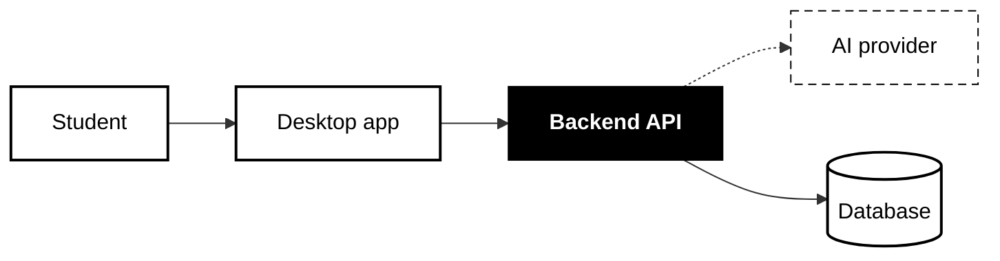
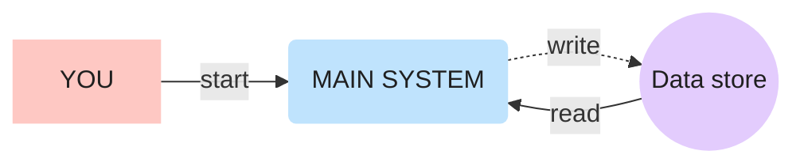

## BasaManager override (read first — wins over everything below)
- In this project the `docs` agent uses this skill for every L0/L1/L2 and architecture diagram (no explicit invocation needed). Save to `docs/diagrams/<feature>/<name>.svg`.


# Visual Diagram

**Only run when the user explicitly asks for this skill** (`/visual-diagram …` or "use the visual-diagram skill"). Never use it on your own for ordinary explanations.

Make a diagram of the part the user names (Claude Code passes it as `$ARGUMENTS`; other agents: the rest of the user's message): a flow, pipeline, architecture, request lifecycle, data model… Default output is a hand-laid-out **SVG** linked from Markdown. If the user says `mermaid`, produce a **Mermaid** block instead (see section 6).

## 0. Pick the style and level

| Style | When | Reference |
| --- | --- | --- |
| **clean** (default) | Overviews, slides, reports, L0 and L1, explaining a codebase | [example-clean.svg](example-clean.svg) |
| **detailed** | The user says `detailed`, or a single L2 picture must explain itself without text | [example-pipeline.svg](example-pipeline.svg) |

Open the reference for the chosen style and match its look. Never mix the two styles in one diagram.

**Levels** (when explaining a codebase or a feature):
- **L0:** the whole system in 4–7 boxes: who uses it, the main parts, external services.
- **L1:** one box from L0, broken into its main steps or components.
- **L2:** only when asked, or when the user picks a box from L1: one flow inside a component, for example one request from start to finish.

Default order: L0 diagram → short text → offer L1 for the box the user cares about. Never draw all levels at once unless asked.

## 1. Understand before drawing

1. Read the code/docs for the named part. Diagram what **actually** happens, not a generic picture. If the target is ambiguous, ask one question.
2. List the pieces (≤ 12 shapes; if more, split into two diagrams or group them) and every arrow. In detailed style, give each arrow a 1–4 word label.
3. Decide the story the eye should follow: usually left → right for the main path, loops drawn around the outside, outputs at the bottom.

## 2a. Clean style (default)

The diagram shows **the shape of the system**. Everything else goes in the text under it.

- **Boxes:** white fill, black border (`stroke="#000"`, 2 px), `rx="10"`. All boxes in a row are the same size and evenly spaced.
- **One emphasis:** fill exactly ONE box black with bold white text: the result, or the part the diagram is about.
- **Groups:** light grey fill `#F2F2F2` with a dashed grey border `#7F7F7F`, small grey label at its top-left.
- **Optional / external / not built yet:** dashed black border (`stroke-dasharray="8 6"`); a dashed arrow for an optional or external call.
- **Labels:** 1–4 words, maximum 6, 20–22 px. No sentences, file paths, function names, numbers or sub-labels inside boxes.
- **Arrows:** black, 2 px, direction only. **No text on arrows**, unless two arrows would be confused without it; then 1–3 words.
- **Size:** at most 7 boxes in a row, about 12 in a diagram.
- **Text on the canvas:** a title (24–26 px bold) and an optional one-line subtitle (16 px, `#555`). No legend unless dashed lines need explaining.
- Black, white and greys only. No colours, icons, emoji, shadows or gradients.
- **Rule:** if something important does not fit, it goes in the text explanation, never squeezed into the diagram.

**Text under a clean diagram:** one short paragraph or list that explains each box in 1–2 sentences and names the real files (`app/services/rag.py`), edge cases, numbers and warnings. Mark anything planned or broken as such, matching its dashed border.

## 2b. Detailed style (`detailed`)

| Meaning | Shape | Fill |
| --- | --- | --- |
| People, external apps/services | rectangle, `rx="6"` | pink `#FEC8C3` |
| The main system / agent / process | big rounded box, `rx="48–56"` | blue `#BFE3FD` |
| Data stores, records, queues | circles | purple `#E3CCFD` |
| Decisions / warnings (optional) | rectangle | yellow `#FFF1B8` |
| Success / outputs (optional) | rectangle | green `#C9F2D6` |
| A group (e.g. "Notion", "Cloud") | dashed outline `stroke="#9a8fb0" stroke-dasharray="6 6"`, no fill, label on top | — |

- **Solid arrow** = trigger / call / read. **Dashed arrow** (`stroke-dasharray="8 6"`) = write / return / async / later.
- Text: titles 22–28 px bold `#1f1f1f`; sub-labels 14–16 px `#3a3a3a`; arrow labels 16 px, important ones bold.
- Always include: a title + one-line subtitle at the top-left, and a small legend at the top-right (solid vs dashed, colour meanings).
- Numbered steps (①②③) inside the main box when it does several things in order; reuse the numbers on the arrows.

## 3. Build the SVG (both styles)

- White background rect covering the whole `viewBox` (so dark-mode viewers still show it).
- Canvas: `viewBox="0 0 W H"` with matching `width`/`height`. Clean: about 1400 × 600–900. Detailed: 1600–1700 × 900–1100. Font: `font-family="'Segoe UI', Inter, Helvetica, Arial, sans-serif"`.
- Plan a grid first: write down x/y/width/height for every shape, then compute arrow endpoints on shape **edges** (for circles: `x = cx ± sqrt(r² − (y − cy)²)`).
- Draw **arrows first, shapes after**, so shapes sit on top of line ends.
- Arrowheads via `<marker>` with `orient="auto-start-reverse"`, `refX` at the tip; end the path 2–4 px before the target edge.
- One source fanning out to several targets: draw a short trunk, one horizontal bar, then a drop to each target (see example-clean.svg), not diagonal lines.
- Elbow routes with rounded corners: `H… Q cornerX,cornerY nextX,nextY V…` (12 px radius). Route loops outside the main shapes; never let a line cross through a shape or a label.
- Labels (where used) sit above horizontal arrows (y − 10) or beside vertical ones, centred with `text-anchor="middle"`; keep ≥ 8 px from any line or shape.
- GitHub-safe SVG only: no `<script>`, no `<foreignObject>`, no external fonts/images/CSS imports, no `<style>` with `@import`. Plain shapes, paths, text, markers.
- Save next to the docs it explains (e.g. `docs/diagrams/<name>.svg` or beside the `.md`), kebab-case name. **Don't overwrite an existing diagram without asking.**
- Link it from the relevant Markdown: ``, followed by the text explanation (clean) or one line saying what solid/dashed mean if there's no legend (detailed).

## 4. Verify by looking (mandatory)

Render it and look at the picture before showing the user:

```bash
# Windows (Edge) — adjust size to the viewBox
"/c/Program Files (x86)/Microsoft/Edge/Application/msedge.exe" --headless=new --disable-gpu --hide-scrollbars \
  --window-size=1640,1060 --screenshot="<scratch>/check.png" "file:///<absolute path>/<name>.svg"
# macOS/Linux: same flags with google-chrome / chromium / "Google Chrome.app"
```

Open the PNG (Read tool) and check: no overlapping text, every arrow starts and ends on an edge with its head visible, no line crosses a shape or label, labels readable, legend correct. Fix and re-render until clean. Put the PNG in the scratchpad/temp folder, never in the repo.

**Extra checks for clean style:** no label over 6 words; no text on arrows (unless justified); exactly one black box; no colour anywhere; every detail left out of the diagram appears in the text instead.

## 5. Accuracy

Draw only what exists in the code. Anything planned, optional or broken gets a dashed border, and the text says which.

## 6. Mermaid variant (when the user asks for `mermaid`)

Clean style (default):



Detailed style uses the same palette as section 2b:



Shapes: `[rect]` boxes, `(rounded)` main system, `((circle))` / `[(cylinder)]` data, `{decision}`; `-->` solid, `-.->` dashed; `subgraph` for groups. Tell the user the trade-off once: Mermaid auto-places shapes, so it's quicker to edit but can't match the hand-placed SVG layout.

## 7. Hand-off

Tell the user where the file is, where it's linked, which style and level it uses, and (for detailed) what each colour/arrow style means, in 2–3 lines. For L0 or L1, offer the next level for one specific box. Offer one other improvement only if there is one.
