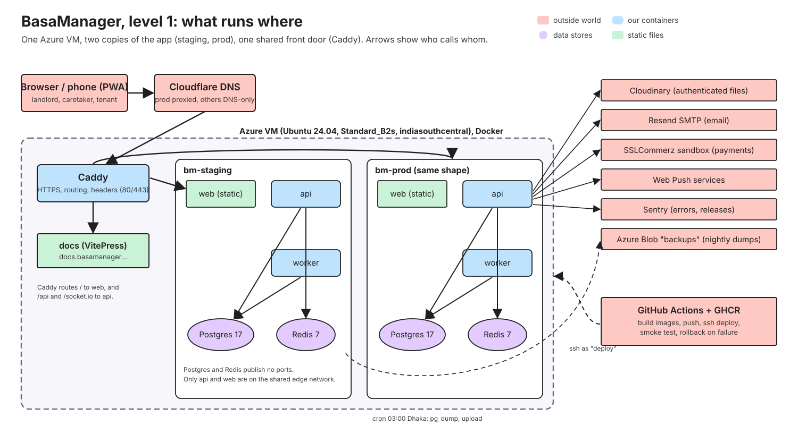

<div align="center">
  <h1>🏢 BasaManager (বাসা ম্যানেজার)</h1>
  <p><strong>Multi-tenant apartment management web app (PWA) for Bangladeshi landlords, caretakers, and tenants.</strong></p>
  <p>
    Automated monthly bills, submeter electricity tracking, SSLCommerz sandbox payments, gapless PDF receipts, and real-time lease ledgers.
  </p>
  <p>
    <a href="https://staging.basamanager.rhrony05.me"><strong>🌐 Live Staging (staging.basamanager.rhrony05.me)</strong></a>
    &nbsp;•&nbsp;
    <a href="https://basamanager.rhrony05.me">Production (basamanager.rhrony05.me)</a>
    &nbsp;•&nbsp;
    <a href="https://docs.basamanager.rhrony05.me">Documentation (docs.basamanager.rhrony05.me)</a>
  </p>

  <p>
    <a href="https://react.dev/"></a>
    <a href="https://vite.dev/"></a>
    <a href="https://nodejs.org/"></a>
    <a href="https://expressjs.com/"></a>
    <a href="https://www.typescriptlang.org/"></a>
    <a href="https://www.postgresql.org/"></a>
    <a href="https://www.prisma.io/"></a>
    <a href="https://tailwindcss.com/"></a>
    <a href="https://sslcommerz.com/"></a>
    <a href="https://github.com/RHRONY05/BasaManager/actions/workflows/ci.yml"></a>
    <a href="LICENSE"></a>
  </p>
</div>

---

## 🗺️ System Architecture & Deployment Topology

<div align="center">
  
</div>

---

## 💡 Why I Built This

Managing residential rental properties in Bangladesh traditionally relies on physical _khata_ notebooks, scattered bKash transaction screenshots over WhatsApp, and manual mental math. This introduces persistent accounting discrepancies, friction between landlords and tenants, and hours of administrative overhead every month.

| Traditional Rental Workflow             | What Goes Wrong                                                                                         | How BasaManager Solves It                                                                                                                                        |
| --------------------------------------- | ------------------------------------------------------------------------------------------------------- | ---------------------------------------------------------------------------------------------------------------------------------------------------------------- |
| **Rent & dues in paper _khatas_**       | Calculation errors, forgotten past arrears, lost receipts, and awkward payment disputes.                | **Automated monthly billing engine**: idempotent cron generation on the building's `billDay`, tracking total, paid, and balance in exact integer poisha.         |
| **Submeter electricity in pen & paper** | Meter rollback errors, misread dials, and new tenants getting billed for previous tenants' electricity. | **Caretaker readings grid**: calculates consumption deltas with meter-reset support (`newMeterStart`), strictly isolating readings to the active lease duration. |
| **bKash & cash on WhatsApp**            | Landlords sift through chat logs to verify transaction IDs; proofs get lost or double-counted.          | **Tenant payment claims & SSLCommerz**: online sandbox checkout or atomic staff-verified cash/bKash claims allocating to oldest dues in order.                   |
| **Handwritten paper receipts**          | Receipt books go missing, numbering duplicates or skips, and tenants lack payment records.              | **Atomic gapless numbering**: PostgreSQL `BM-<year>-<6 digits>` sequence counter and Puppeteer-rendered signed A4 PDF receipts.                                  |
| **Late fees & grace periods**           | Inconsistent verbal agreements lead to resentment and delayed collections.                              | **Transparent late fee engine**: automated percentage or flat fees applied after grace days with auditable landlord courtesy waivers.                            |

> [!NOTE]
> **Bangladeshi Rental Accounting Invariant:**
> All monetary transactions operate strictly in **integer poisha (100 poisha = ৳1.00)** to eradicate floating-point IEEE-754 rounding drift. Prorated mid-month rents round half-up to the nearest whole Taka per standard local accounting practices.

---

## 🚪 How It Works: Three Roles, One Unified Ledger

BasaManager is designed desktop-first for operational staff and mobile-first for tenants:

| Role          | Who Uses It                         | Primary Workflows                                                                                                                                  | Scoping & Permissions                                                                                                                 |
| ------------- | ----------------------------------- | -------------------------------------------------------------------------------------------------------------------------------------------------- | ------------------------------------------------------------------------------------------------------------------------------------- |
| **Landlord**  | Building Owners & Property Managers | Creates buildings & units, sets rents & utility rates, issues bills, manages adjustments, records/voids payments, and invites staff.               | Full access scoped to their organisation (`org_id`).                                                                                  |
| **Caretaker** | On-site Property Staff              | Enters monthly submeter electricity readings on mobile/tablet, views building dues, and reviews tenant cash claims.                                | Strictly scoped to assigned buildings (`caretaker_buildings`). Cannot view financial documents or leases outside assigned properties. |
| **Tenant**    | Residents & Flat Occupants          | Mobile-first portal (`/t/bills`): itemized bill breakdown, online payment via SSLCommerz, payment claims with photo proofs, and receipt downloads. | Strictly isolated to their active lease. Zero visibility into other units or organization details.                                    |

---

## 🛡️ Core Engineering Invariants & Guardrails

1. **Two-Tier Multi-Tenancy Defense in Depth**:
   - Every database query runs inside an organisation-scoped transaction (`db.$tx(ctx)`).
   - **PostgreSQL Row-Level Security (RLS)** enforces tenant isolation at the database kernel level. The API user `bm_app` is non-owner and cannot read or write rows outside `current_setting('app.org_id')`.
2. **Financial Immutability**:
   - The database role `bm_app` is granted **NO `DELETE` privilege** on `bill_lines`, `payments`, or `receipts`.
   - Voiding a payment (`POST /api/payments/:id/void`) uses an auditable PostgreSQL `app_void_payment` `SECURITY DEFINER` function that atomically restores dues and records the void event.
3. **Deadlock-Free Two-Level Lock Hierarchy**:
   - Universal invariant across all transactions: `leases` row `FOR UPDATE` **first**, `bills` rows `FOR UPDATE` **second**. Eliminates PostgreSQL `40P01` deadlocks between concurrent payment confirmations and bill modifications.
4. **Strict Asia/Dhaka Calendar Alignment**:
   - Billing days, grace windows, and proration days are evaluated using `@date-fns/tz` in `Asia/Dhaka` time, preventing UTC midnight cut-off bugs.

---

## 🧰 Completed Modules & Live Features

|     | Module                                                              | In One Line                                                                                    | Status      |
| --- | ------------------------------------------------------------------- | ---------------------------------------------------------------------------------------------- | ----------- |
| 🔐  | **[Auth & Accounts](#-1-auth--accounts)**                           | Argon2id, rotating refresh tokens in httpOnly cookies, Google OAuth, sessions, lockout         | ✅ **Live** |
| 🏢  | **[Organisations & Buildings](#-2-organisations-buildings--units)** | Multi-building management, units, flat configurations, and staff assignments                   | ✅ **Live** |
| 📜  | **[Tenants & Leases](#-3-tenants--leases)**                         | Lease lifecycle stepper, digital invite accept, deposit tracking, and active lease guards      | ✅ **Live** |
| ⚡  | **[Billing Engine](#-4-billing-engine--meter-readings)**            | Idempotent monthly generation, submeter electricity tracking, proration, and late fees         | ✅ **Live** |
| 💵  | **[Manual Payments & Receipts](#-5-manual-payments--receipts)**     | Waterfall allocation (Rule 5), overpayment credit ledger, atomic voiding, gapless PDF receipts | ✅ **Live** |
| 💳  | **[SSLCommerz Online Gateway](#-6-sslcommerz-online-payments)**     | Zero-trust IPN webhook validation, payment intent polling, and auto-recheck worker cron        | ✅ **Live** |

---

### 🔐 1. Auth & Accounts

- **JWT access tokens (15 min)** + **opaque rotating refresh tokens (30 days)** stored in `httpOnly`, `Secure`, `SameSite=Lax` cookies.
- Reuse detection kills the entire token family immediately upon compromised token replay.
- Password hashing with **argon2id** and rate-limited login lockouts.
- **Google OAuth** integration via `arctic` (PKCE + state).
- Multi-organization switcher and device session revocation.

### 🏢 2. Organisations, Buildings & Units

- Landlord organization profile with building management.
- Unit drawer: flat numbers, floor levels, bedrooms, base rent, and utility billing modes (`submeter` vs `fixed`).
- Interactive building location mapping via **Leaflet + OpenStreetMap** tiles (zero external API keys required).
- Caretaker team invites and granular per-building assignments.

### 📜 3. Tenants & Leases

- Multi-step lease creation stepper: tenant details, dates, monthly rent, fixed charges, and security deposit.
- Secure email token invite workflow: tenants accept invites and instantly access their tenant portal.
- Lease isolation guard: unit can only have one active lease at any time (enforced via partial unique DB indexes).
- Mid-month lease activation draft bill creation: automatically provisions prorated first bills if activated past billing day.

### ⚡ 4. Billing Engine & Meter Readings

- Idempotent generation runs serialized by PostgreSQL transaction advisory locks (`hashtext`).
- Interactive meter readings grid for caretakers with live consumption preview and quick-save.
- Transparent line items: rent, water, gas, service charge, and electricity (`1,240 → 1,395 = 155 units × ৳9.00`).
- Proration math: calendar-accurate days in Dhaka month, move-in/move-out boundary calculations, and whole Taka rounding.
- Automated daily late-fee worker job (`applyLateFees`) applying percentage or flat fines past due day + grace period.

### 💵 5. Manual Payments & Receipts

- **Waterfall Allocation (Rule 5)**: Payments allocate automatically to oldest unpaid or partially paid bills in ascending period order; excess balances deposit into the tenant's credit ledger.
- **Tenant Payment Claims**: Tenants submit cash/bKash payment claims with proof photo uploads (`kind: payment_proof`).
- **Atomic Voiding Rollback (Rule 6)**: Reverses bill allocations, deducts overpayments, reverses credit usages, and marks receipts void with a prominent red diagonal watermark.
- **Sequential Concurrency-Safe Receipts**: Gapless sequential counter (`BM-<year>-<6 digits>`) and automated background PDF rendering via Puppeteer.

### 💳 6. SSLCommerz Online Payments

- Seamless checkout initiation with SSLCommerz sandbox gateway (minimum ৳100 / 10,000 poisha).
- Zero-trust IPN (Instant Payment Notification) server-to-server validation: verifies amount, currency (BDT), and transaction ID directly with SSLCommerz verification APIs before confirming funds.
- Browser return handling decouples redirect navigation from financial state changes.
- Automated `recheckPaymentIntents` cron reconciles stale initiated payments (>30 min) in the background.

---

## 🏗️ Repository Architecture

BasaManager is organized as a strict **pnpm monorepo**:

```text
BasaManager/
├── apps/
│   ├── api/          # Express 5 REST API + Prisma ORM + Pino structured logger
│   ├── web/          # React 19 + Vite 8 + TanStack Query + Tailwind CSS v4 + shadcn/ui (PWA)
│   ├── worker/       # Background node-cron jobs, outbox processor, and Puppeteer PDF worker
│   └── docs/         # VitePress comprehensive architecture, feature, and learning documentation
├── packages/
│   ├── shared/       # Shared TypeScript types, Zod schemas, IDs, and error contracts
│   └── domain/       # Pure, dependency-free financial, billing, and proration domain logic
├── infra/
│   ├── compose.dev.yml    # Local development PostgreSQL 17 + Redis 7 + Mailpit
│   ├── compose.server.yml # Production & Staging container definitions
│   ├── docker/            # Production multi-stage Dockerfiles (api, web, worker, docs)
│   └── caddy/             # Caddy reverse proxy configuration with automatic TLS
├── docs/             # 97+ architectural, concept, feature, and operational guide pages
└── tests/
    └── e2e/          # Playwright test suites (Desktop Chrome + Mobile Chrome)
```

---

## 🛠️ Local Setup & Quickstart

### 1. Prerequisites

- **Node.js** ≥ 22.x LTS
- **pnpm** ≥ 10.x (`corepack enable pnpm`)
- **Docker Desktop** (for PostgreSQL 17, Redis, and Mailpit)
- **Git**

### 2. Clone and install dependencies

```bash
git clone https://github.com/RHRONY05/BasaManager.git
cd BasaManager
pnpm install
```

### 3. Start local infrastructure

```bash
# Starts Postgres on 5432, Redis on 6379, Mailpit on 8025
docker compose -f infra/compose.dev.yml up -d
```

### 4. Configure environment variables

```bash
cp .env.example .env
```

_(The default `.env.example` values connect directly to your local Docker containers with zero extra configuration required)._

### 5. Run database migrations and seed demo data

```bash
# Apply Prisma migrations from zero and seed full landlord/caretaker/tenant demo data
pnpm db:migrate
pnpm db:seed
```

### 6. Start development servers

```bash
pnpm dev
```

- **Web App (PWA)**: `http://localhost:5173`
- **Backend API**: `http://localhost:4000`
- **Docs Site**: `http://localhost:5174`
- **Mailpit Web UI**: `http://localhost:8025`

---

## 🧪 Verification & Test Suites

BasaManager enforces a strict four-layer testing strategy:

```bash
# 1. Typechecking & Linting (ESLint 10, Prettier, Token Lint, OpenAPI drift, Bundle size)
pnpm typecheck
pnpm lint

# 2. Domain & Backend Unit Tests (Vitest with >80% coverage enforcement)
pnpm test:cov

# 3. Integration Tests against real PostgreSQL with RLS and Redis
pnpm test:int

# 4. End-to-End Tests across Desktop (1440x900) & Mobile (390x844) viewports
pnpm test:e2e

# 5. Docs Build & Link Integrity Check
pnpm docs:check
```

---

## 📚 Documentation & Learning Path

Every single feature, database design decision, and operational runbook is documented with Level 0, Level 1, and Level 2 SVG architecture diagrams in the docs site:

- **[Multi-Tenancy & Row-Level Security](docs/concepts/multi-tenancy-and-rls.md)**
- **[Transactions, Row Locks & Deadlock Prevention](docs/concepts/transactions-and-locking.md)**
- **[Money Arithmetic & Bangladesh Proration Rules](docs/concepts/money-and-rounding.md)**
- **[Billing Engine Feature Walkthrough](docs/features/billing.md)**
- **[Payment Allocation & Voiding Engine](docs/features/payments.md)**
- **[Sequential Receipts & PDF Generation](docs/features/receipts-and-statements.md)**
- **[Interactive Learning Path](docs/learning-path.md)**

---

## 📄 License

This project is licensed under the [MIT License](LICENSE).
