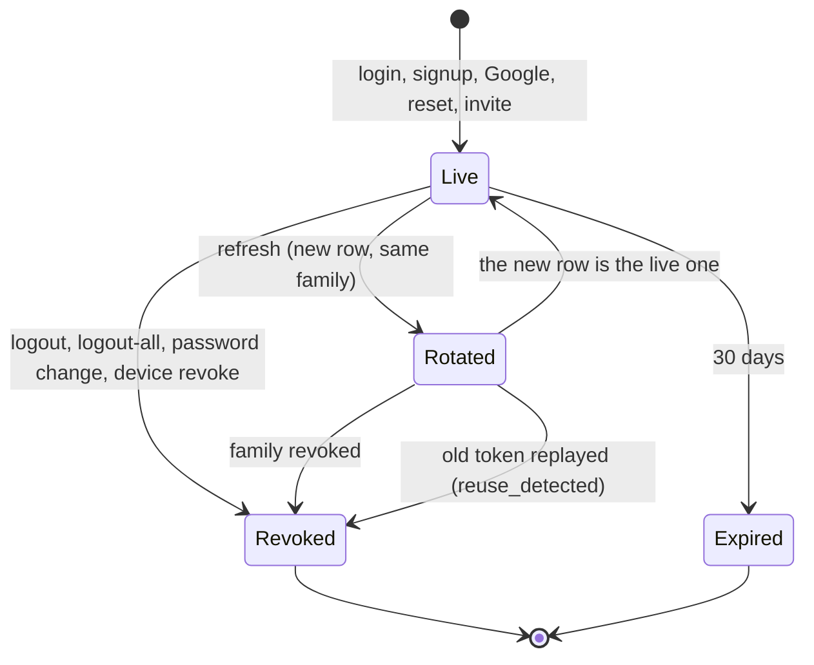

# Authentication & sessions

> **New to you: read this one slowly.** JWTs, rotating refresh tokens, CSRF and OAuth with PKCE are the core
> of "who is this person". Written in task V5 from the real code. The step-by-step flows are on
> [Auth & accounts](/features/auth); this page explains the ideas.

## What problem it solves

HTTP has no memory: every request arrives alone. After you type a password once, the server must recognise
you on the next hundred requests **without** asking again, and it must be able to say "stop, this device is
no longer allowed" quickly. A cookie that simply says "user 42" can be forged; a cookie with a random id that
lives forever is dangerous if stolen. BasaManager uses two cookies with different jobs plus a third that
defends against forged requests.

**Analogy.** A conference badge. The _access token_ is the day pass on your lanyard: quick to check at every
door, expires in 15 minutes. The _refresh token_ is the registration slip at the front desk: you show it
rarely, they stamp it and give you a new one each time, and if the desk ever sees an already-stamped slip, it
cancels all slips of that booking because two people carry copies.

## How it works here

**Passwords.** Hashed with argon2id (`m=19456, t=2, p=1`), a deliberately slow, memory-hungry hash. Minimum 10
characters and not on the common-password list (`apps/api/src/lib/passwords.ts`).

**Access token.** A signed JWT (HS256, `JWT_SECRET`) holding `sub` (user id), `sid` (session row id), `adm`
(platform admin). Lives 15 minutes in the HttpOnly cookie `bm_at`. A JWT is normally "stateless", but here
`requireUser` also loads the `sessions` row every request, so revoking a session takes effect at once.

**Refresh token.** 32 random bytes in HttpOnly cookie `bm_rt`, `SameSite=Strict`, `Path=/api/auth`, 30 days.
The database stores only its SHA-256 hash. Every use **rotates** it: the old row gets `rotated_at`, a new row
with the same `family_id` is created. A token presented after it was rotated means a copy exists: the whole
family is revoked and a security mail is sent ("reuse detection").

**Sessions page.** One live family equals one device. `GET /api/me/sessions` lists rows with `rotated_at` and
`revoked_at` empty (the newest row of each family). Revoking a device revokes its whole family.

**CSRF.** A malicious site can make your browser send a request with your cookies. Three layers stop it:
`SameSite` cookies; the `Origin` header must equal `APP_URL` on every unsafe method; and a **double-submit
token**: cookie `bm_csrf` (readable by our JavaScript) must be repeated in header `X-CSRF-Token`. A foreign
site can send the cookie but cannot read it, so it cannot fill the header.

**Google OAuth (arctic).** `/api/auth/google/start` makes a random `state` and a PKCE `code_verifier`, seals
them with AES-256-GCM into cookie `bm_g_oauth` (10 min) and redirects to Google. On return the callback
checks the cookie decrypts and `state` matches (stops forged callbacks), sends `code` + verifier to Google
(PKCE: a stolen `code` is useless without the verifier), requires `email_verified`, then links or creates the
account. Failures redirect to `/login?error=google_failed`.

**One-time email tokens.** Verify (24 h), reset (30 min) and invite (7 days) tokens are random, stored as
hashes and consumed with a single conditional `UPDATE`, so they work exactly once.

**In the browser.** `apiFetch` copies `bm_csrf` into the header, and on `401 UNAUTHENTICATED` runs one shared
refresh and retries once. `AuthProvider` asks `/api/me` to learn who is signed in.

## Diagram

The full level 0, 1 and 2 pictures are on the [feature page](/features/auth).

## Gotchas

- **Revocation must hit the database.** Checking only the JWT would leave a stolen access token valid for 15
  minutes. `requireUser` reads the session row each request (one cheap indexed lookup).
- **Reuse detection signs out the real user too.** That is intended: the server cannot tell thief from owner.
- **The refresh read-then-update is not atomic.** Two tabs refreshing at the very same moment can trigger a
  false "reuse". The browser shares one refresh per tab only.
- **Sockets are cut only on logout-all and reset-password.** A revoked user can open a new socket with an
  unexpired JWT for up to 15 minutes; HTTP calls still fail at once.
- `COOKIE_SECURE` must be `true` on staging and prod (config refuses to start otherwise); dev uses plain HTTP.
- Never log cookies or tokens; the logger redacts them and `logging.int.test.ts` proves it.

## Where in code

- [auth.service.ts](https://github.com/RHRONY05/BasaManager/blob/main/apps/api/src/modules/auth/auth.service.ts): signup, login, refresh, logout, reset, Google.
- [tokens.ts](https://github.com/RHRONY05/BasaManager/blob/main/apps/api/src/lib/tokens.ts), [cookies.ts](https://github.com/RHRONY05/BasaManager/blob/main/apps/api/src/lib/cookies.ts), [passwords.ts](https://github.com/RHRONY05/BasaManager/blob/main/apps/api/src/lib/passwords.ts).
- [auth.ts](https://github.com/RHRONY05/BasaManager/blob/main/apps/api/src/middleware/auth.ts) (`createRequireUser`), [csrf.ts](https://github.com/RHRONY05/BasaManager/blob/main/apps/api/src/middleware/csrf.ts).
- [google.ts](https://github.com/RHRONY05/BasaManager/blob/main/apps/api/src/modules/auth/google.ts): state sealing and the Google client.
- [client.ts](https://github.com/RHRONY05/BasaManager/blob/main/apps/web/src/lib/api/client.ts), [AuthContext.tsx](https://github.com/RHRONY05/BasaManager/blob/main/apps/web/src/app/auth/AuthContext.tsx).

## Self-check

1. Why is the refresh token rotated on every use instead of staying the same for 30 days?
   

Answer
A fixed token that leaks works for 30 days and nobody notices. A rotating one turns theft into a visible event: whoever uses the old copy second triggers reuse detection.

2. **What happens if** a user logs out on their laptop while their phone is signed in?
   

Answer
Only the laptop's session row is revoked (<code>logout</code>). The phone's family is separate and keeps working. "Log out of all devices" revokes every family.

3. Why can an attacker's website not forge a `POST /api/me/change-password`?
   

Answer
Its Origin would not equal <code>APP_URL</code>, and it cannot read <code>bm_csrf</code> to build the <code>X-CSRF-Token</code> header. SameSite cookies are a third barrier.

4. What does PKCE add on top of `state` in the Google flow?
   

Answer
<code>state</code> proves the callback belongs to the browser that started it. PKCE proves whoever exchanges the <code>code</code> is the one who started the flow, so an intercepted code is useless.

