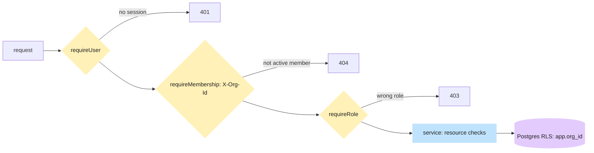

# Authorization

> Written in task V5 from the real code. Authentication asks "who are you?". Authorization asks "what may you
> do here?". Row-level security (the database lock) is explained on
> [Multi-tenancy & RLS](/concepts/multi-tenancy-and-rls).

## What problem it solves

One person can be a landlord in one organisation and a tenant in another, using the same login. A caretaker
may see only the buildings they are assigned to. A rule like "landlords can edit the organisation" must be
enforced on the server for every request, because the browser can be edited by anyone.

## How it works here

Three questions, asked in order, each by a small middleware or check:

1. **Who is calling?** `requireUser` (`bm_at` JWT plus a live session row) sets `req.user`.
2. **Which organisation, and are they really in it?** The browser sends header `X-Org-Id` (its remembered
   active org). `requireMembership` looks for an **active** membership of this user in that org. No match
   gives `404 NOT_FOUND`, never "forbidden", so nobody can probe which orgs exist. On success it sets
   `req.org` (`id`, `role`, `membershipId`) and `req.tenantCtx`.
3. **Is the role allowed?** `requireRole('landlord')` compares `req.org.role` to the allowed list, else
   `403 FORBIDDEN`. Resource rules (a caretaker's assigned buildings, "only your own lease") are checked in
   each feature's service, and again by Postgres row-level security through `req.tenantCtx`.

The role is **per organisation**: `GET /api/me` returns every membership, and the web `AuthProvider` picks the
active one (`switchOrg` clears the query cache). Platform admin is a flag on the user (`adm` in the JWT,
`isPlatformAdmin`), not a membership.

On the web, route guards (`RequireAuth`, `RequireRole`, `RedirectIfSignedIn` in
[guards.tsx](https://github.com/RHRONY05/BasaManager/blob/main/apps/web/src/app/auth/guards.tsx)) only decide what to **show**. They are convenience, not
security: the API refuses regardless.

## Diagram

## Gotchas

- Hiding a button in React is not authorization. Always add the server check.
- Never accept a role or org from the request body. Only `X-Org-Id` is accepted, and only after it is verified.
- `404` for "exists but not yours" is deliberate; do not "improve" it to 403.
- A removed membership stops working immediately (the lookup requires `status = 'active'`).
- `requireRole` needs `requireMembership` before it, otherwise `req.org` is empty and everyone is refused.

## Where in code

- [org.ts](https://github.com/RHRONY05/BasaManager/blob/main/apps/api/src/middleware/org.ts): `createRequireMembership`, `requireRole`.
- [auth.ts](https://github.com/RHRONY05/BasaManager/blob/main/apps/api/src/middleware/auth.ts): `createRequireUser`, `createOptionalUser`.
- [orgs.routes.ts](https://github.com/RHRONY05/BasaManager/blob/main/apps/api/src/modules/orgs/orgs.routes.ts): the guards stacked on a real route.
- Tests: `apps/api/src/middleware/org.test.ts`, `apps/api/test/auth/csrf-me.int.test.ts`.

## Self-check

1. A tenant calls `PATCH /api/org` with their own org id. What happens?
   

Answer
They pass <code>requireUser</code> and <code>requireMembership</code> (they are a member), but <code>requireRole('landlord')</code> returns 403.

2. **What happens if** someone sends an `X-Org-Id` that is a valid UUID of another landlord's organisation?
   

Answer
No active membership matches, so the answer is 404 NOT_FOUND, identical to a random UUID. Even if the service forgot a filter, row-level security would hide the rows.

3. Why is the role not stored in the JWT?
   

Answer
A person has different roles in different organisations, and roles change (a caretaker is removed). Looking up the membership per request keeps the answer current.

