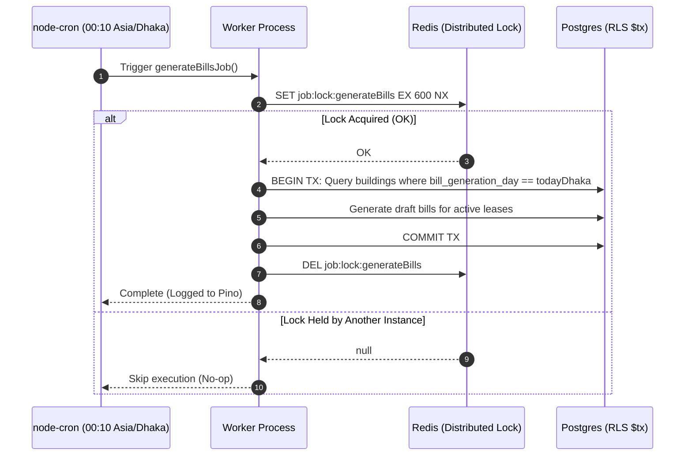

# Background jobs & cron

> How the worker process executes scheduled tasks, handles distributed Redis locks, and ensures reliable background processing.

## What problem it solves

Certain critical property management tasks must occur automatically on schedule without human intervention:

1. Activating future-dated leases when their start date arrives.
2. Generating draft bills on each building's configured billing day.
3. Calculating and applying late fees when bills exceed due dates and grace periods.
4. Delivering outbox notifications (email, push, webhooks).

Running scheduled cron jobs inside the main Express API server has severe drawbacks: long-running tasks block the Node event loop, scaling the web app across multiple instances causes jobs to run multiple times concurrently, and an uncaught exception in a background job could crash the web server handling user requests.

BasaManager solves this by running a dedicated worker application (`apps/worker`) isolated from web traffic, guarded by distributed Redis locks.

## How it works here

1. **Independent Worker Process**:
   `apps/worker` is a distinct service within the monorepo. It connects to the same PostgreSQL database and Redis cluster as `apps/api`, but exposes no public HTTP routes.
2. **Distributed Redis Locking**:
   To prevent duplicate execution when scaling the worker container, jobs wrap their logic in `withJobLock` (`apps/worker/src/lib/jobLock.ts`):
   ```typescript
   export async function withJobLock<T>(
     redis: Redis,
     lockKey: string,
     ttlSeconds: number,
     fn: () => Promise<T>,
   ): Promise<T | null> {
     const acquired = await redis.set(lockKey, 'locked', 'EX', ttlSeconds, 'NX');
     if (!acquired) {
       logger.info({ lockKey }, 'Job lock not acquired; another worker is running');
       return null;
     }
     try {
       return await fn();
     } finally {
       await redis.del(lockKey);
     }
   }
   ```
   The atomic Redis command `SET lockKey locked EX 600 NX` acquires the lock only if no other process holds it.
3. **Timezone-Aware Cron Schedules**:
   `apps/worker/src/jobs/index.ts` registers schedules with explicit Asia/Dhaka timezones:
   - `05 0 * * *`: `activateDueLeasesJob` (Daily at 00:05 Dhaka time)
   - `10 0 * * *`: `generateBillsJob` (Daily at 00:10 Dhaka time)
   - `20 0 * * *`: `applyLateFeesJob` (Daily at 00:20 Dhaka time)
4. **Idempotent Job Logic**:
   Even if the lock were to release prematurely due to a network partition, the underlying database transactions enforce idempotent unique constraints so data corruption cannot occur.

## Diagram



## Gotchas

1. **Lock TTL must exceed job execution time**:
   If a lock TTL is set to 30 seconds but generating bills takes 45 seconds, the lock will expire while the first worker is still writing, allowing a second worker to acquire the lock. BasaManager sets generous 10-minute (600s) TTLs and cleans up in the `finally` block.
2. **Crash before unlock**:
   If a worker container is hard-killed (e.g. OOM or SIGKILL) before reaching the `finally` block, the lock key remains in Redis until the TTL expires, automatically freeing the lock for the next scheduled run.
3. **Database context in workers**:
   Worker jobs execute under system authority (`userId: '00000000-0000-4000-8000-000000000000'`, `role: null`), but still pass the target `orgId` to `db.$tx(ctx)` to ensure Row-Level Security policies properly scope updates per organization.

## Where in code

- `apps/worker/src/jobs/index.ts`: Worker startup, registration of jobs and cron schedules.
- `apps/worker/src/lib/jobLock.ts`: Redis distributed lock implementation using `SET ... EX ... NX`.
- `apps/worker/src/jobs/generateBills.ts`: Daily draft generation job.
- `apps/worker/src/jobs/applyLateFees.ts`: Daily late fee calculation job.
- `apps/worker/src/jobs/activateDueLeases.ts`: Daily lease activation job.
- `apps/worker/src/jobs/billingJobs.test.ts`: Integration tests verifying Redis locking and job execution.

## Self-check

<details>
<summary>1. Why is the worker process separated from the web API process?</summary>
Separating the worker keeps the API server fast and responsive to HTTP requests, prevents heavy batch jobs from starving web traffic of CPU, and allows independent scaling and error boundaries.
</details>

<details>
<summary>2. How does <code>withJobLock</code> ensure only one worker runs a job in a multi-container deployment?</summary>
It uses the Redis atomic command <code>SET key value EX ttl NX</code>. The <code>NX</code> flag ensures the key is set only if it does not already exist. Only the first container to execute this command succeeds; all other containers receive <code>null</code> and immediately exit.
</details>

<details>
<summary>3. What happens if a worker crashes midway through executing <code>generateBillsJob</code>?</summary>
The database transaction rolls back, leaving no orphaned or incomplete draft bills. The Redis lock automatically expires after its 600-second TTL, allowing the next scheduled invocation or landlord trigger to run normally.
</details>

<details>
<summary>4. At what time in Bangladesh does the late fee job run?</summary>
At <code>00:20</code> (12:20 AM) Asia/Dhaka time, 10 minutes after the bill generation job.
</details>
