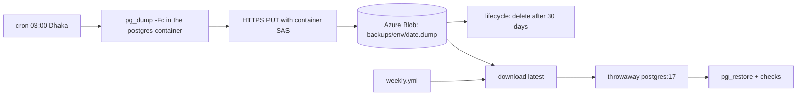

# Backups

## What problem it solves

Databases are lost to bugs (a bad migration), mistakes (a wrong `DELETE`), and hardware. A backup you have
never restored is a hope, not a backup. The goals here: a copy every night, stored **somewhere else**, kept for
30 days, and a **weekly proof** that a copy can really be brought back.

**Analogy.** A fire-proof copy of your documents at a relative's house, and once a week you phone to check you
can read it.

## How it works here

1. **Nightly dump.** The VM's cron runs `backup.sh staging` at 03:00 and `backup.sh prod` at 03:10 (Dhaka time).
   It runs `pg_dump -Fc` (custom, compressed format) inside the Postgres container.
2. **Upload.** The dump goes to **Azure Blob Storage**: storage account `bmbackupsf1f2c5bb` in `rg-basamanager`,
   private container `backups`, blob `<env>/YYYY-MM-DD.dump`. One HTTPS `PUT` with a **SAS token** (a URL
   signature that allows only create/write/read/list on that one container, for 60 days). The script then reads
   the size back and compares it.
3. **Retention.** A lifecycle rule on the storage account deletes blobs older than 30 days. Cost is cents.
4. **Before every deploy**, `deploy.sh` also writes a local dump to `/opt/basamanager/state/pre-deploy/` (last 5
   kept): the quick undo for a bad migration.
5. **Weekly restore drill.** `weekly.yml` (Monday 04:00 Dhaka) downloads the newest staging dump, starts a
   throwaway `postgres:17` container, creates the roles, restores with `--exit-on-error` and checks the archive.
   A red drill is the alarm: the backups are not usable.

What a dump contains: every table and row of one database (from V4 on: all tenants' data), not the Redis cache
and not Cloudinary files (Cloudinary keeps those).

## Diagram

## Gotchas

- **The SAS expires after 60 days** (about 2027-01-06 for the first one). Regenerate it with
  `infra/azure/create-backup-storage.sh`, update the secret, deploy ([Rotate a secret](/operations/rotate-a-secret)).
  If it lapses, nightly uploads fail.
- **A dump is plain data.** Anyone with it has every tenant's data: treat the container and SAS as secrets.
- **Restoring into live replaces the database** and needs you to type the environment name.
- **Roles are not in a `pg_dump` of one database.** `restore.sh` creates them first in the drill; on a new VM
  `deploy.sh` re-applies them from `infra/postgres/server-roles.sql`.
- **V3 has no application tables yet**, so the first dumps are small; the drill still proves the pipeline.

## Where in code

- `infra/scripts/backup.sh`, `infra/scripts/restore.sh`, `infra/azure/create-backup-storage.sh`
- `infra/postgres/server-roles.sql`, `.github/workflows/weekly.yml`
- Runbook: [Backup & restore drill](/operations/backup-and-restore)

## Self-check

1. Why store backups outside the VM?
2. What can the SAS token do, and what can it not do?
3. How is a backup "verified" in this project, twice over?
4. What is lost if you restore last night's dump after a day of changes?
5. Why is it fine that `backup.sh` needs no Azure CLI on the server?
