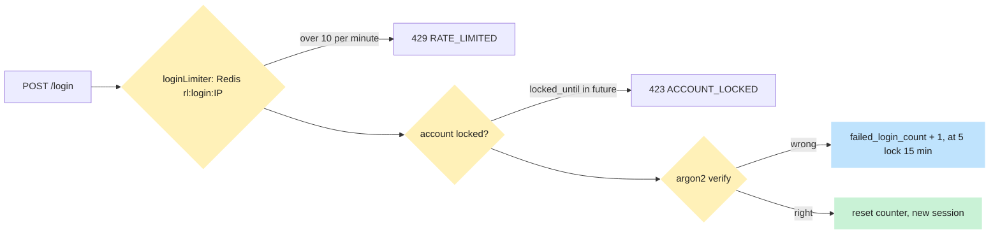

# Caching & rate limiting with Redis

> **New to you: rate limiting and lockout.** Written in task V5 from the real code. The cache rules for the
> web app (TanStack Query) come with later pages; this version covers limits and lockout, which exist now.

## What problem it solves

Login forms get hammered by bots trying millions of passwords, and "send me a reset email" buttons get
abused to spam inboxes. Two defences work together: a **rate limit** (too many requests from one place) and
an **account lockout** (too many wrong passwords for one account).

## How it works here

**Rate limiters** (`express-rate-limit` with a Redis store from `rate-limit-redis`) in
[rateLimit.ts](https://github.com/RHRONY05/BasaManager/blob/main/apps/api/src/middleware/rateLimit.ts):

| Limiter                     | Route                                | Limit         | Key               | Redis prefix        |
| --------------------------- | ------------------------------------ | ------------- | ----------------- | ------------------- |
| `loginLimiter`              | `POST /api/auth/login`               | 10 per minute | client IP         | `rl:login:`         |
| `forgotPasswordLimiter`     | `POST /api/auth/forgot-password`     | 10 per minute | client IP         | `rl:forgot:`        |
| `resendVerificationLimiter` | `POST /api/auth/resend-verification` | 3 per hour    | user id (else IP) | `rl:resend_verify:` |

Over the limit the handler raises `ApiError(RATE_LIMITED)`, which is HTTP 429 in the standard error body.
Redis holds the counters so **every API instance shares them** and a restart does not reset them. The client
IP is correct behind Caddy because `app.set('trust proxy', 1)` is set in `app.ts`.

**Account lockout** lives in Postgres, not Redis, in `AuthService.login`: each wrong password adds 1 to
`users.failed_login_count`; at 5, `locked_until` is set 15 minutes ahead and further attempts (even with the
right password) answer `ACCOUNT_LOCKED` (HTTP 423). A success resets the counter. After the lock expires the
count restarts from zero.

Why both? The IP limiter stops one machine trying many accounts; the lockout stops many machines trying one
account.

**Other Redis uses in V5:** the Socket.io Redis adapter (so `emitSessionRevoked` reaches sockets on any
instance). No application data is cached in Redis yet.

## Diagram

## Gotchas

- Limits are per IP: users behind one office or mobile-carrier NAT share a bucket.
- The lockout can be used to annoy a victim (lock their account on purpose). 15 minutes keeps that mild.
- The failure counter is a read-then-write, so truly parallel guesses can under-count by a few; the IP
  limiter is the real brake on parallel bursts.
- Signup, verify-email, reset-password and refresh have **no** limiter in V5.
- The tests use a real Redis; expiry is tested by moving the test clock for the lockout, and by the limiter window for rate limits.

## Where in code

[rateLimit.ts](https://github.com/RHRONY05/BasaManager/blob/main/apps/api/src/middleware/rateLimit.ts), [auth.routes.ts](https://github.com/RHRONY05/BasaManager/blob/main/apps/api/src/modules/auth/auth.routes.ts)
(where each limiter is placed), `AuthService.login` in [auth.service.ts](https://github.com/RHRONY05/BasaManager/blob/main/apps/api/src/modules/auth/auth.service.ts).
Tests: `rateLimit.test.ts`; `login.int.test.ts` ("the 11th login attempt ... is RATE_LIMITED", the lock cases);
`password.int.test.ts` (forgot-password limiter); `signup.int.test.ts` (resend limit).

## Self-check

1. Why are the counters in Redis and not in a JavaScript variable in the API process?
   

Answer
A variable resets on restart and is not shared between instances, so an attacker could just spread requests across instances or wait for a deploy.

2. **What happens if** an attacker tries 5 wrong passwords against a landlord's account?
   

Answer
The account locks for 15 minutes: even the correct password gets <code>ACCOUNT_LOCKED</code> until <code>locked_until</code> passes.

3. Why does the resend-verification limiter key on the user id rather than the IP?
   

Answer
The route requires a signed-in user, so the user id is a more precise key than an IP that many people may share.

