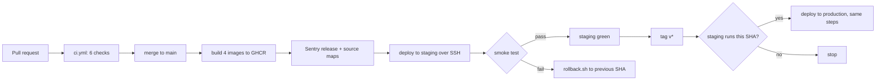

# CI/CD pipeline

## What problem it solves

Without automation, "deploying" means a person typing commands on a server from memory. That is slow, and the
one time someone skips a step (the tests, the migration, the backup) is the time it hurts.

- **CI (continuous integration)** runs the checks on every proposed change, so broken code never reaches `main`.
- **CD (continuous delivery)** takes what is on `main` and puts it on a server by a script that is the same
  every time, checks that it works, and **undoes itself** if it does not.

**Analogy.** An airport. CI is security screening (nobody boards with a problem). CD is the ground crew
following a checklist; if a warning light comes on, the plane goes back to the gate.

## How it works here

### Two workflows

**`ci.yml` (every pull request and every push to `main`)** runs six jobs: `lint-typecheck`, `unit`,
`integration` (real Postgres, Redis, Mailpit), `e2e` (Playwright, desktop and mobile), `docs` and `security`
(`pnpm audit`, gitleaks, CodeQL). Branch protection on `main` requires all six.

**`deploy.yml`** has these jobs, in order:

1. `meta` decides the target. A push to `main` means **staging**. A tag `v*` means **production**.
2. `build` (four copies, one per image) builds `api`, `worker`, `web`, `docs`, pushes them to GHCR tagged with
   the git SHA, and **skips** an image that already exists for that SHA (a tag on a commit that is already on
   staging builds nothing).
3. `sentry-release` creates the Sentry release (named with the SHA) and uploads the web source maps.
4. `deploy` (uses the GitHub _Environment_ `staging` or `production`, which holds that environment's secrets):
   - production only: **gate**: the tag's commit must already be what `staging` reports at `/api/health`;
   - uploads `infra/` and the rendered env file to the VM over SSH (secrets travel over the encrypted
     connection and are written with mode 600; they are never printed);
   - runs `deploy.sh` on the VM (pull images, roles, pre-deploy dump, migrations, start, wait healthy);
   - runs the **smoke test** from the runner against the public URL;
   - on any failure runs `rollback.sh` and smoke-tests the old version again.

### Smoke test

`tests/smoke.ts` checks `/api/health` returns **the SHA that was just deployed**, `/api/ready` is 200,
`/api/public-config` has the right `appEnv`, `/` serves the web build and (staging) the docs site answers.
It retries for a minute because DNS, certificates and containers may still be settling. When login exists
(V5) it also logs in as a smoke user.

### Rollback

`rollback.sh` restarts the previous version's images (they are still on the VM). The database is **not**
rolled back. That is safe because migrations are _expand then contract_: a release may add columns and
tables but never remove them; removals ship in a later release, once nothing old needs them. An older image
therefore still works against a newer schema. The failure path was **proved once** by running the workflow
with "force smoke fail" (logged in PROGRESS.md).

### Secrets

Every environment secret lives in a GitHub Environment (`staging`, `production`), created with
`infra/scripts/provision-secrets.sh`. `render-env.sh` turns them into the VM's env file. See
[Rotate a secret](/operations/rotate-a-secret).

## Diagram

## Gotchas

- **Tag only after staging is green.** The production gate refuses a commit staging does not run.
- **The first deploy of an environment cannot roll back** (nothing earlier exists); the job just fails.
- **Concurrency.** Two deploys to the same environment queue instead of racing.
- **GHCR login expires.** The pipeline logs the VM in with a short-lived token; a manual pull days later needs
  a fresh `docker login` (the images already on the VM are enough for a rollback).
- **A migration that is not backwards compatible** breaks the "roll back the image" promise. Review them.

## Where in code

- `.github/workflows/ci.yml`, `.github/workflows/deploy.yml`, `.github/workflows/weekly.yml`
- `infra/scripts/deploy.sh`, `rollback.sh`, `render-env.sh`, `provision-secrets.sh`; `tests/smoke.ts`
- Runbooks: [Deploy](/operations/deploy), [Roll back](/operations/rollback)

## Self-check

1. Which event deploys staging and which deploys production?
2. Why does the smoke test compare the SHA from `/api/health` rather than only checking for a 200?
3. Why can rolling back the images be safe even after a migration ran?
4. How do secrets get from GitHub to the VM, and where could one leak? (Name two places they must not appear.)
5. What does the production gate protect against?
