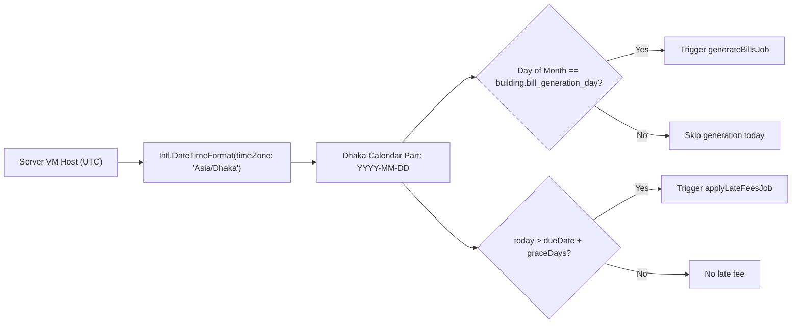

# Dates & time zones

> How BasaManager handles calendar boundaries, lease start dates, billing days, and grace periods strictly in Asia/Dhaka time.

## What problem it solves

Date and time bugs are notoriously subtle in server and web applications. When a server running in UTC or on a cloud platform (e.g. Azure East US or UK) generates bills at midnight UTC, it is already 06:00 AM in Bangladesh. Worse, if a developer uses local browser time or system time for calendar comparisons, a lease starting on the 1st of November might be evaluated as October 31st depending on client time zone offsets.

In BasaManager, rental billing, grace periods, lease activations, and meter reading cycles follow the statutory and commercial calendar of Bangladesh (`Asia/Dhaka`, UTC+6, no Daylight Saving Time). A bill due on "10 November 2026" means midnight at the end of 10 November in Dhaka time, not in London or San Francisco.

## How it works here

1. **Explicit Dhaka Calendar Computation**:
   Every worker job and date-sensitive query converts timestamps to Asia/Dhaka date parts:
   ```typescript
   export function getDhakaDate(date: Date = new Date()): {
     year: number;
     month: number;
     day: number;
     todayStr: string;
     currentMonthStr: string;
   } {
     const fmt = new Intl.DateTimeFormat('en-CA', {
       timeZone: 'Asia/Dhaka',
       year: 'numeric',
       month: '2-digit',
       day: '2-digit',
     });
     const todayStr = fmt.format(date); // YYYY-MM-DD in Asia/Dhaka
     return { ... };
   }
   ```
2. **Calendar Days vs UTC Milliseconds**:
   Proration and grace periods are measured in integer calendar days, not arbitrary 86,400,000 millisecond offsets.
   - Days in month: 28, 29, 30, or 31 according to the Gregorian calendar in Dhaka.
   - Leap years (such as 2024, 2028, 2032): February has 29 days.
3. **Storage in UTC**:
   All timestamps in PostgreSQL (`created_at`, `issued_at`, `late_fee_applied_at`) are stored as `timestamptz` (Timestamp with Time Zone) in UTC.
   Calendar dates (`period_month`, `start_date`, `due_date`) are stored as explicit ISO date strings (`YYYY-MM-DD` or `YYYY-MM`) or SQL `date` types without ambiguous time-of-day components.
4. **Scheduled Worker Timing**:
   Scheduled cron jobs in `apps/worker` run on an explicit timezone:
   ```typescript
   cron.schedule('10 0 * * *', () => runJob(), { timezone: 'Asia/Dhaka' });
   ```
   This ensures daily bill generation fires at exactly 00:10 AM Dhaka time regardless of VM host time.

## Diagram



## Gotchas

1. **Never use `new Date().getDate()`**:
   Node.js `new Date().getDate()` evaluates the day in the server's local OS time zone (often UTC in Docker). If run at 11:30 PM UTC on the 31st of the month, `getDate()` returns 31, while in Dhaka it is already 05:30 AM on the 1st of the new month!
2. **Leap year calculation**:
   Always compute days in February using calendar logic:
   `new Date(Date.UTC(year, month, 0)).getUTCDate()`.
   Hardcoding 28 days causes proration errors in leap years.
3. **Date parsing without timezones**:
   Constructing dates with `new Date('2026-11-01')` parses as UTC midnight in ECMAScript, but `new Date('2026/11/01')` parses as local time. Always pass explicit ISO strings or use date-part extraction to avoid one-day shifts.

## Where in code

- `apps/worker/src/jobs/generateBills.ts`: `getDhakaDate` and daily cron scheduled at `00:10 Asia/Dhaka`.
- `apps/worker/src/jobs/applyLateFees.ts`: Overdue evaluation against `todayStr` in Asia/Dhaka.
- `packages/domain/src/billing/index.ts`: `prorationFactor` calendar day computation.
- `apps/web/src/lib/format.ts`: `formatDate` and `formatMonth` formatting strings in `Asia/Dhaka`.

## Self-check

<details>
<summary>1. Why must background cron jobs specify <code>{ timezone: 'Asia/Dhaka' }</code>?</summary>
Without an explicit time zone, <code>node-cron</code> uses the system clock of the host machine (which defaults to UTC in cloud containers). A job configured for <code>00:10</code> would run at 06:10 AM in Dhaka instead of right after midnight.
</details>

<details>
<summary>2. How many days does February have in year 2028 in the domain engine?</summary>
29 days (2028 is a leap year divisible by 4). The proration factor for a lease starting Feb 15, 2028 evaluates to <code>15 / 29</code>.
</details>

<details>
<summary>3. Why are billing months stored as <code>YYYY-MM</code> strings rather than timestamps?</summary>
A billing month is a calendar period, not an instant in time. Storing <code>2026-11</code> eliminates any time zone ambiguity or drift that occurs when serializing date-time objects across different database and client locales.
</details>

<details>
<summary>4. What happens if a building's billing day is configured as 31, but the current month is April (which has 30 days)?</summary>
The billing generation job checks if today is the last day of the month when the configured day exceeds the month's total days, ensuring bills are generated on April 30th without skipping.
</details>
