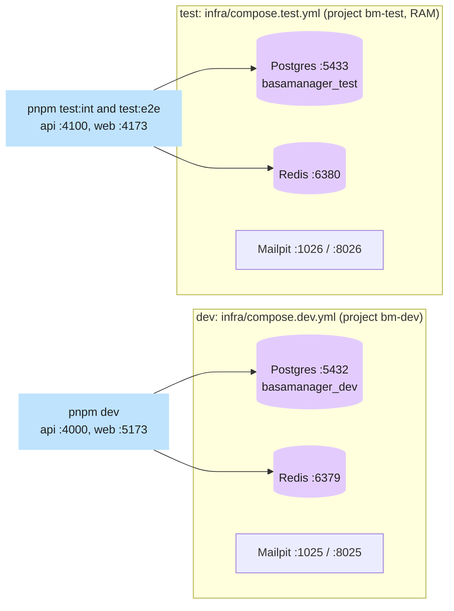

# Environments & config

> **Updated in task V3.** Dev and test come from the real compose and env files (V1); staging and production
> from the VM, `infra/compose.server.yml` and the GitHub Environment secrets (V3).

## What problem it solves

The same code has to run on your laptop, in the test suite, on a staging server where you can break things, and
in production where you cannot. Each place needs different databases, ports, passwords and safety switches.
If those differences are scattered through the code, the day you forget one is the day a test sends a real
email or a dev command touches real data.

The rule here: **the code is identical everywhere; only the environment variables differ**, and the app checks
those variables at start-up and refuses to run if they are inconsistent.

## How it works here

### The four environments

|                      | dev                                        | test                                                     | staging                           | prod                            |
| -------------------- | ------------------------------------------ | -------------------------------------------------------- | --------------------------------- | ------------------------------- |
| Where                | your laptop                                | your laptop and GitHub Actions                           | the VM, project `bm-staging`      | the VM, project `bm-prod`       |
| Started by           | `pnpm dev`                                 | `pnpm test:int`, `pnpm test:e2e`                         | merge to `main`                   | a `v*` tag                      |
| `APP_ENV`            | `dev`                                      | `test`                                                   | `staging`                         | `prod`                          |
| Postgres             | container, db `basamanager_dev`, port 5432 | container, db `basamanager_test`, port 5433, data in RAM | own container and volume          | own container and volume        |
| Redis                | container, port 6379                       | container, port 6380                                     | own container                     | own container                   |
| Mailpit (fake inbox) | SMTP 1025, UI `localhost:8025`             | SMTP 1026, UI 8026                                       | none: real email through Resend   | none: real email through Resend |
| API / web            | 4000 / 5173                                | 4100 / 4173 (built preview)                              | `staging.basamanager.rhrony05.me` | `basamanager.rhrony05.me`       |
| Files                | local disk (`.data/uploads`)               | local disk (temp)                                        | Cloudinary                        | Cloudinary                      |

The first two columns exist today. The whole design is written in `.agent/02-ARCHITECTURE.md`
("Environments").

### Database users (roles)

One Postgres, four logins. `infra/postgres/init/01-roles.sql` creates three of them the first time a dev or
test container starts; the owner is created by the container itself (`POSTGRES_USER`).

| Role          | Used by                                | Power                                                                     |
| ------------- | -------------------------------------- | ------------------------------------------------------------------------- |
| `bm_owner`    | migrations only (`DATABASE_OWNER_URL`) | Superuser, **owns** the database and the tables                           |
| `bm_app`      | the running API (`DATABASE_URL`)       | `NOBYPASSRLS`: can read and write rows but is bound by row-level security |
| `bm_worker`   | the worker (`DATABASE_WORKER_URL`)     | `BYPASSRLS`: jobs span every organisation                                 |
| `bm_readonly` | reports and debugging                  | `SELECT` only on new tables                                               |

**Why the app is not the owner.** Postgres does not apply row-level security to a table's owner or to a
superuser. If the API connected as the owner, the security rules that keep landlord A away from landlord B's
rows would silently not apply. So the app logs in as `bm_app`, which is subject to them. This is the core of
[multi-tenancy](/concepts/multi-tenancy-and-rls) (written in V4); here you only need to know why there are
four logins.

The passwords (`bm_owner_dev`, `bm_app_dev`, ...) are **dev and test only** and are public in this repo.
Staging and production use the **same role names** but **generated passwords**, one set per environment,
and never reuse these. `infra/postgres/server-roles.sql` creates the roles on the VM (and re-applies the
passwords) on every deploy; the passwords come from the env file, never from the repository.

### Env files

| File                | Purpose                                                                                                 |
| ------------------- | ------------------------------------------------------------------------------------------------------- |
| `.env.example`      | Committed. Every variable name, with safe dev values or empty. Copy to `.env` for dev.                  |
| `.env.test.example` | Committed. Test values (ports 4100, 5433, 6380; `APP_ENV=test`; mock payments on). Copy to `.env.test`. |
| `.env`, `.env.test` | **Git-ignored.** Your real local copies. Never commit them.                                             |

How each is loaded:

- `pnpm --filter @bm/api dev` and `@bm/worker dev` start with `tsx watch --env-file-if-exists=../../.env`.
- `playwright.config.ts` calls `process.loadEnvFile('.env.test')` and the servers it spawns inherit it.
- `apps/api/test/global-setup.ts` loads `.env.test` for integration tests.

Every variable and its rules are in [Environment variables](/reference/env-vars).

### Config is checked, not trusted

`apps/api/src/config/env.ts` validates the whole environment with Zod at start-up. A missing or malformed value
produces one readable list and exit code 1. On top of that it enforces safety rules that depend on
`APP_ENV`: fake payments, a frozen clock and insecure cookies are all refused in staging and production.
`NODE_ENV` only tells tooling whether to optimise; **`APP_ENV` decides behaviour**.

### Staging and production (V3)

|                    | staging                                                     | prod                                              |
| ------------------ | ----------------------------------------------------------- | ------------------------------------------------- |
| URL                | `staging.basamanager.rhrony05.me` (DNS-only)                | `basamanager.rhrony05.me` (proxied by Cloudflare) |
| Compose project    | `bm-staging`                                                | `bm-prod`                                         |
| Database           | container `bm-staging-postgres-1`, db `basamanager_staging` | `bm-prod-postgres-1`, db `basamanager_prod`       |
| Env file on the VM | `/opt/basamanager/env/staging.env` (mode 600)               | `/opt/basamanager/env/prod.env`                   |
| Secrets live in    | GitHub Environment `staging`                                | GitHub Environment `production`                   |
| Files              | Cloudinary `basamanager/staging/`                           | Cloudinary `basamanager/prod/`                    |
| Deployed by        | every merge to `main`                                       | a `v*` tag, only if staging runs that commit      |

The env file is **written by the deploy workflow** from the secrets (`infra/scripts/render-env.sh`); nobody
edits it on the server. Both stacks run the identical images; only the env file differs. See
[Docker & the VPS](/concepts/docker-and-vps) and [CI/CD](/concepts/ci-cd).

### Running several copies at once

Each agent works in its own git worktree, and two of them cannot both bind port 4000. `scripts/ports.mjs`
prints a per-task set of ports (and a test database name `basamanager_test_<task>`) derived from the task id,
so parallel runs do not collide. With no task id it prints the base ports above.

## Diagram

See the flowchart above: two independent stacks, one for dev data and one for throw-away test data.

## Gotchas

- **Port clashes.** Another project's Postgres on 5432 or Redis on 6379 stops `pnpm dev` from starting its
  own. Stop the other containers or change the port mapping.
- **Test data vanishes on purpose.** The test Postgres keeps its data in RAM; `docker compose ... down` wipes
  it. Dev data lives in the `pgdata` volume and survives restarts.
- **The role script runs once.** `01-roles.sql` only runs on a container's first start (Docker's init
  directory). To re-run it on an existing volume, run the file with `psql`, as CI does. The script is safe to
  run twice.
- **`pnpm --filter @bm/api start` reads no `.env` file.** Only `dev` does. Started by hand it fails with a
  config error unless the variables are already in the shell. Playwright works because it loads `.env.test`
  first.
- Staging and production are not described here yet, so do not copy values from these pages into them.

## Where in code

- `infra/compose.dev.yml`, `infra/compose.test.yml`, `infra/postgres/init/01-roles.sql`
- `.env.example`, `.env.test.example`
- `apps/api/src/config/env.ts`, `apps/api/src/config/db.ts`
- `scripts/ports.mjs`

## Self-check

1. Why does the API log in as `bm_app` and not as the database owner? 

Answer
Row-level security is not applied to a table owner or superuser. As <code>bm_app</code> (<code>NOBYPASSRLS</code>) the API is forced through the tenant-isolation rules; as the owner it would bypass them silently.

2. What happens if you start the API with `PAYMENTS_MOCK=true` and `APP_ENV=prod`? 

Answer
It prints a config error and exits with code 1 before opening a port. <code>env.ts</code> refuses that combination, and <code>env.test.ts</code> proves it.

3. Your integration tests wiped something you cared about. How could that have happened, and what prevents it? 

Answer
Only by pointing <code>DATABASE_URL</code> at the dev database. Tests use <code>.env.test</code> with port 5433 and the <code>basamanager_test</code> database, kept in RAM and separate from dev.

4. What is the difference between `NODE_ENV` and `APP_ENV`? 

Answer
<code>NODE_ENV</code> (development/test/production) is for tooling such as bundlers. <code>APP_ENV</code> (dev/test/staging/prod) decides which environment the app thinks it is in, and drives the safety rules.

