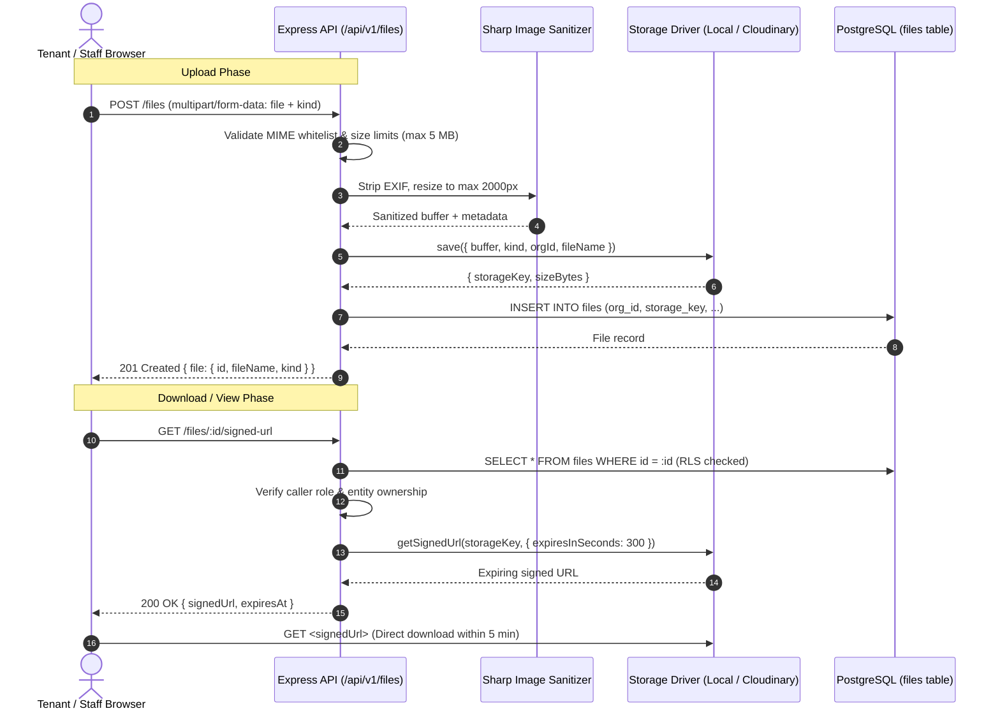

# File uploads, Cloudinary & expiring signed URLs

> **Written in task V9.** Covers file handling architecture, image sanitization with Sharp, local disk vs Cloudinary authenticated storage, and expiring signed download URLs.

## What problem it solves

Tenants upload payment slips, bank transfer screenshots, and NID cards. Caretakers upload photos of broken pipes and damaged electrical fixtures. Landlords generate official rent receipts and financial statements.

These documents contain sensitive personal and financial data:

- National ID numbers and personal addresses
- Bank account details, transaction references, and payment amounts
- Rental dispute evidence and property condition photos

If files were uploaded to a public cloud bucket (e.g. `https://res.cloudinary.com/.../receipt.pdf`), anyone who guesses or intercepts the URL could view private tenant documents without authenticating. Furthermore, public URLs cannot enforce tenancy boundaries or permissions: a tenant could view another tenant's payment slips.

**Solution:** Files in BasaManager are **never public**. Every file is stored in an authenticated, private storage tier. Reading a file requires passing an API authentication and tenancy check, which generates an **expiring signed URL** valid for only 5 minutes.

---

## How it works here

### 1. Storage Driver Abstraction (`StorageDriver`)

The application defines a unified interface in `apps/api/src/config/storage/index.ts` so business logic does not depend on a specific storage provider:

```typescript
export interface StorageDriver {
  save(params: SaveFileParams): Promise<void>;
  getSignedUrl(params: SignedUrlParams): Promise<{ url: string; expiresAt: string }>;
  read(publicId: string): Promise<Buffer>;
  delete(publicId: string, resourceType: 'image' | 'raw'): Promise<void>;
}
```

Two implementations exist:

1. **`LocalStorageDriver`** (dev & test):
   - Stores files on the local filesystem (configured via `STORAGE_LOCAL_DIR` or defaulting to `.data/uploads`).
   - Generates HMAC-SHA256 signed URLs (`/api/v1/files/download/:id?expires=...&signature=...`).
   - Ensures CI and local development run hermetically without requiring external cloud credentials or network access.
2. **`CloudinaryStorageDriver`** (staging & production):
   - Stores files under Cloudinary with delivery type `type: 'authenticated'` (never `upload` or `public`).
   - Uploads to an isolated prefix: `basamanager/<env>/org/<orgId>/<kind>/<filename>`.
   - Generates expiring signed download URLs via `cloudinary.utils.private_download_url(...)` with a 300-second (5-minute) TTL.

### 2. Pre-processing & Sanitization (Sharp)

Raw images uploaded from mobile phones contain dangerous metadata and excessive resolution:

- **EXIF metadata** contains GPS coordinates of the tenant's home, phone serial numbers, and camera timestamps.
- **File bloat**: Raw 12–48 MP phone photos waste storage and bandwidth.

Before saving:

- Images (`image/jpeg`, `image/png`, `image/webp`) are processed through **`sharp`**.
- EXIF metadata is stripped completely (`sharp(buffer).rotate()`).
- Images are resized to a maximum bounding box of 2000×2000 px at 85% quality.
- A 400×400 px thumbnail is generated for fast gallery previews.
- PDFs are validated and stored raw without raster alteration.

### 3. File Metadata Record (`files` Table)

Every upload writes a row to the `files` table within the current organisation:

| Column           | Type      | Description                                                   |
| ---------------- | --------- | ------------------------------------------------------------- |
| `id`             | `uuid`    | Primary key                                                   |
| `org_id`         | `uuid`    | Tenant isolation key (RLS enforced)                           |
| `uploaded_by`    | `uuid`    | User ID who uploaded the file                                 |
| `kind`           | `text`    | e.g. `payment_proof`, `receipt_pdf`, `maintenance_photo`      |
| `file_name`      | `text`    | Sanitized original filename                                   |
| `mime_type`      | `text`    | Whitelisted MIME type (`image/jpeg`, `application/pdf`, etc.) |
| `size_bytes`     | `integer` | File size after sanitization                                  |
| `storage_driver` | `text`    | `'local'` or `'cloudinary'`                                   |
| `storage_key`    | `text`    | Internal storage path / Cloudinary public ID                  |

### 4. Expiring Signed Download URLs

When a user requests to view a file (`GET /files/:id/signed-url` or `GET /receipts/:id/download`):

1. **Auth & RLS check**: The caller's session must be authenticated. The database checks RLS on `files` or the parent entity (`receipts`, `payments`, `maintenance_tickets`).
2. **Permission rule**: A tenant can only access files attached to their own lease or tickets. Caretakers and Landlords can access files within their assigned buildings and organisation.
3. **Short-lived signature**: The storage driver generates a signed URL containing an expiry timestamp (5 minutes in the future) and an HMAC cryptographic signature.
4. **Direct retrieval**: The client browser fetches the file directly using the signed URL. Once expired, the URL cannot be reused.

---

## Diagram



---

## Gotchas

- **Never pass unauthenticated Cloudinary URLs:** If an image is stored as `type: 'upload'`, it is public on the web. Always use `type: 'authenticated'` and generate signatures with `sign_url: true`.
- **EXIF location leakage:** Many smartphone photos embed precise latitude/longitude in EXIF tags. If images are stored raw, tenants' privacy is violated. Sharp's processing pipeline strips all metadata tags by default unless explicitly preserved.
- **Multipart boundaries in Fetch:** When sending `FormData` via `fetch` from the browser, do **not** set `'Content-Type': 'multipart/form-data'` manually. Omitting the header allows the browser to automatically insert the correct `boundary=----WebKitFormBoundary...` parameter. Setting it manually strips the boundary and causes upload parsing errors.
- **Local driver security:** In development, the local driver serves files from disk. The download route validates the HMAC signature using `APP_SECRET` and checks that the expiration timestamp has not elapsed.

---

## Where in code

- Storage interface & drivers: `apps/api/src/config/storage/index.ts`
  - Defines `StorageDriver` contract, `LocalStorageDriver`, and `CloudinaryStorageDriver`
- File endpoints: `apps/api/src/modules/files/`
  - `files.routes.ts` — Multer upload middleware and route definitions
  - `files.controller.ts` — Upload and signed URL controllers
  - `files.service.ts` — Sharp processing, storage persistence, and DB records
- Frontend file client: `apps/web/src/lib/api/payments.ts` (`uploadFile`, `getFileSignedUrl`)
- Database schema: `apps/api/prisma/schema.prisma` (`model File`)

---

## Self-check

1. Why are payment proof photos and receipts never stored with public URLs?
   <details><summary>Answer</summary>They contain private financial and identity details (bank transaction references, NID, amounts, tenant names). Public URLs allow anyone with the link to bypass authentication and access private documents.</details>

2. How does BasaManager prevent uploading smartphone photos that leak tenant home coordinates?
   <details><summary>Answer</summary>Uploaded images are passed through Sharp, which re-encodes the image and strips all EXIF metadata (including GPS coordinates, device serial numbers, and camera timestamps) before saving to storage.</details>

3. How long is an expiring signed download URL valid for?
   <details><summary>Answer</summary>300 seconds (5 minutes). This is sufficient time for the browser to download or display the file, but prevents long-term link sharing or unauthorized access.</details>

4. Which storage driver is used in local development and automated CI tests, and why?
   <details><summary>Answer</summary>The <code>LocalStorageDriver</code>, which writes to disk in <code>apps/api/uploads/</code> and verifies downloads using HMAC-SHA256 signatures. This ensures tests are 100% hermetic, fast, and require no internet access or Cloudinary API keys.</details>

5. What happens if a frontend request manually sets <code>headers: { 'Content-Type': 'multipart/form-data' }</code> on a FormData POST?
   <details><summary>Answer</summary>The browser's boundary string is lost, causing the backend parser (Multer) to fail to parse form fields and files, resulting in an empty request body or 400 Bad Request error.</details>
