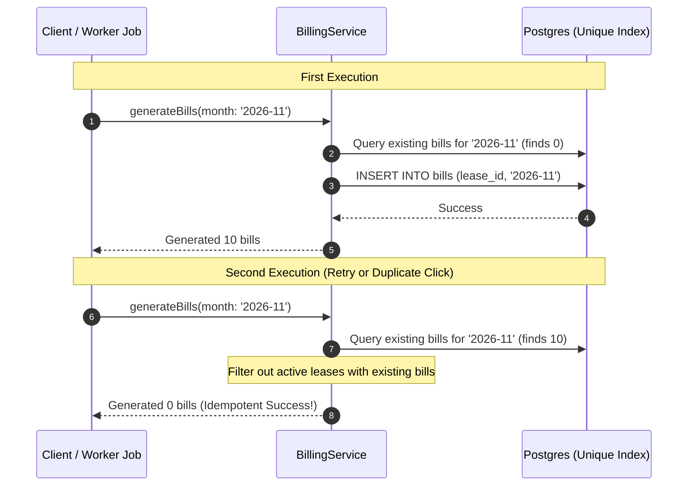

# Idempotency & unique constraints

> How BasaManager guarantees that re-running jobs, re-trying web requests, and concurrent operations never duplicate financial records.

## What problem it solves

In distributed web systems, network requests fail, connections timeout, and users double-click buttons. In background job runners, a worker process might crash mid-execution and be restarted by a supervisor, or multiple worker containers might run simultaneously behind a load balancer.

If bill generation is not idempotent, re-running the job could generate two or three bills for the same tenant in the same month. If a payment webhook is delivered twice by a gateway (a standard retry behaviour), a non-idempotent system would double-credit the tenant.

Idempotency means that performing an operation once has the exact same side effects as performing it multiple times:
`f(f(x)) === f(x)`.

## How it works here

BasaManager enforces idempotency at two independent layers: the application service layer and the PostgreSQL database engine.

1. **Database Unique Constraints**:
   PostgreSQL unique indexes act as the immutable source of truth:
   - `bills(lease_id, period_month)`: A lease can only have one bill per calendar month.
   - `meter_readings(unit_id, period_month)`: A unit has at most one recorded reading per month.
   - `payments(trx_id)`: Gateway transaction IDs cannot be inserted twice.
2. **Safe Pre-Flight Filtering**:
   Before executing insertions, the service layer queries existing records and filters out already-processed entities:
   ```typescript
   const existingBills = await tx.bill.findMany({
     where: { leaseId: { in: activeLeaseIds }, periodMonth: month },
   });
   const unbilledLeases = activeLeases.filter((l) => !existingBillLeaseIds.has(l.id));
   ```
3. **Graceful Handling of Concurrency Races**:
   If two requests pass the pre-flight check at the exact same millisecond, the database engine enforces the unique index. One transaction succeeds; the other transaction rolls back cleanly with a unique constraint violation (error code `23505`).
4. **Idempotent Background Jobs**:
   Worker jobs (`apps/worker/src/jobs/generateBills.ts` and `applyLateFees.ts`) use Redis distributed locks (`withJobLock`) to ensure only one worker node runs at a time, backed by database unique constraints so even if locks expire, no duplicate records are created.

## Diagram



## Gotchas

1. **Never rely on in-memory checks alone**:
   Checking `if (!exists) { insert(); }` in Node.js without a database unique constraint fails under concurrency. Two concurrent Node processes will both observe `!exists` and both execute `insert()`.
2. **Outbox event deduplication**:
   When an operation succeeds, outbox events must be written in the **same transaction**. If the transaction commits, the outbox message is guaranteed to exist exactly once.
3. **Idempotency vs Error Responses**:
   A billing generation run on an already-billed building is not an error; it gracefully reports that 0 new drafts were needed. Conversely, submitting conflicting readings or contradictory updates returns a 409 Conflict.

## Where in code

- `apps/api/src/modules/billing/billing.service.ts`: Idempotent `runGeneration` with composite unique constraint checks.
- `apps/worker/src/lib/jobLock.ts`: Distributed Redis locking (`withJobLock`) preventing simultaneous worker invocations.
- `apps/api/test/billing/billing.int.test.ts`: Integration tests proving generation idempotency when run twice and under concurrency.
- `prisma/schema.prisma`: Schema constraints `@@unique([leaseId, periodMonth])` and `@@unique([unitId, periodMonth])`.

## Self-check

<details>
<summary>1. What PostgreSQL constraint prevents duplicate bills for the same lease in the same month?</summary>
The composite unique index <code>@@unique([leaseId, periodMonth])</code> defined on the <code>bills</code> table.
</details>

<details>
<summary>2. What happens if a landlord clicks the "Generate Drafts" button twice within 100 milliseconds?</summary>
Both requests reach the server. The first request generates the draft bills. The second request either sees that bills already exist (pre-flight check) or is rejected by the database unique constraint if racing simultaneously. Zero duplicate bills are created.
</details>

<details>
<summary>3. Why is a distributed Redis lock used in addition to database unique constraints?</summary>
The Redis lock prevents wasteful CPU and query churn across worker containers. While the database unique constraint guarantees absolute correctness, the Redis lock prevents multiple containers from running identical full-table scans and calculations concurrently.
</details>

<details>
<summary>4. What does the API return if <code>POST /api/billing/generate</code> is called when all units are already billed?</summary>
It returns <code>200 OK</code> with <code>{ generatedCount: 0 }</code>, signifying that the requested end-state is satisfied.
</details>
