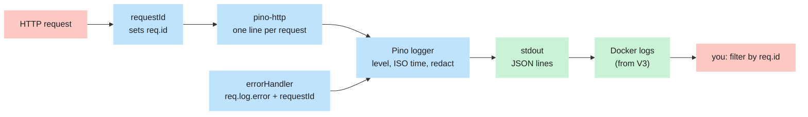

# Logging (Pino)

## What problem it solves

When something goes wrong in production you cannot attach a debugger. The only witness is what the app wrote
down. Good logs answer three questions fast: **what happened, to which request, and how bad was it**. Bad
logs either say nothing, or say too much (a password in a log file is a data breach).

**Analogy.** A ship's logbook. Every entry has a timestamp, a severity, and the voyage number (the request
id), so you can pull out every line that belongs to one incident. And the captain never writes the vault
combination in it.

## How it works here

### Structured, not sentences

Logs are **JSON, one object per line, written to stdout** by Pino. The app never opens a log file; Docker
collects stdout and decides where it goes. JSON means a machine can filter it (`level`, `req.id`, `msg`)
instead of someone grepping prose.

`createLogger()` in `apps/api/src/lib/logger.ts` builds the logger:

- level from `LOG_LEVEL` (default `info`; `silent` in unit tests via `isTest`),
- ISO timestamps (`pino.stdTimeFunctions.isoTime`),
- the redaction list below.

Levels, from loudest problem to chattiest detail: `fatal`, `error`, `warn`, `info`, `debug`, `trace`.
Setting `LOG_LEVEL=warn` shows `warn` and above only.

### One line per request, with an id

`createHttpLogger()` in `apps/api/src/middleware/logger.ts` wraps the `pino-http` library. When a response
finishes it writes a single line containing the request (`req.id`, method, url, headers, remote address) and
response (`statusCode`, headers) plus `responseTime` in milliseconds.

- **The id.** `req.id` is the same value that `requestId` put in the `X-Request-Id` response header and that
  `errorHandler` puts in the error body. One id ties together the user's screenshot, the HTTP exchange and the
  log lines. See [Request lifecycle](/overview/request-lifecycle).
- **Level by outcome.** 5xx or an error is `error`, 4xx is `warn`, everything else `info`.
- **Skipped.** `/api/health` is not logged (it is polled constantly).
- **Bodies are never logged.** pino-http does not log request or response bodies, and this project keeps it
  that way: auth, file and payment bodies hold secrets.

An unexpected error is logged **twice** on purpose: once by `errorHandler` (`req.log.error`, message
"Unhandled internal server error", with the full error and stack trace) and once by pino-http when the
response finishes ("request errored"). Search for the `req.id` to see both.

### What is redacted

Redaction replaces a value with `[REDACTED]` _before_ the line is written. The list is `REDACT_PATHS` in
`apps/api/src/lib/logger.ts`:

| Path                          | Why                                                    |
| ----------------------------- | ------------------------------------------------------ |
| `req.headers.cookie`          | Holds the session and refresh cookies                  |
| `req.headers.authorization`   | Bearer tokens                                          |
| `req.headers["x-csrf-token"]` | The CSRF token                                         |
| `res.headers["set-cookie"]`   | Cookies the server sets (new session tokens)           |
| `*.password`                  | A password one level down, for example `user.password` |
| `*.token`                     | A token one level down, for example `body.token`       |
| `*.refreshToken`              | A refresh token one level down                         |

A real request line, shortened, with the redaction applied:

```json
{
  "level": 30,
  "time": "2026-11-08T10:15:02.331Z",
  "req": {
    "id": "b7ca1fe5-ec19-4a1b-9fcc-9e861337850e",
    "method": "GET",
    "url": "/api/ready",
    "headers": { "cookie": "[REDACTED]", "authorization": "[REDACTED]" }
  },
  "res": { "statusCode": 200 },
  "responseTime": 4,
  "msg": "request completed"
}
```

### The worker

`apps/worker/src/index.ts` creates its own plain `pino` logger (level and ISO time only). It is **not** built
with `createLogger`, so it has no redaction list yet. Nothing sensitive is logged there today; when jobs start
handling emails and tokens, switch it to the shared setup.

## Diagram



## Gotchas

- **Redaction is by exact path, and `*` is exactly one level.** `*.password` hides `user.password` but **not** a
  top-level `password` key, and not `a.b.password` two levels down. (Checked by logging all three.) Never put a
  secret in a log call and rely on redaction to save you; do not log it.
- **The URL and query string are logged as-is.** Only headers are redacted. A request to
  `/api/x?token=abc` is logged with `url` and `query` showing `abc`. Today no route puts a secret in the URL.
  Signed file-download URLs (task V9) will, so when files arrive the logger must redact `req.url` and
  `req.query`, or those routes must use a header or path segment instead. The security rules already say "never
  log file URLs".
- **`/api/ready` is logged on every call**, unlike `/api/health`. A probe that polls it every few seconds
  produces a steady stream of `info` lines.
- **Do not use `console.log`.** ESLint (`no-console`) fails the build. Use the logger; in a route, `req.log`
  already carries the request id.
- **Logs are not an audit trail.** They rotate and are filtered by level. Anything the business must keep
  (who voided a payment) goes in a database table, not in a log line.

## Where in code

- `apps/api/src/lib/logger.ts`: `createLogger`, `REDACT_PATHS`
- `apps/api/src/middleware/logger.ts`: `createHttpLogger`
- `apps/api/src/middleware/errorHandler.ts`: the `req.log.error` call
- `apps/api/src/middleware/requestId.ts`: where the id comes from
- `apps/worker/src/index.ts`: the worker's logger
- `apps/api/src/config/env.ts`: `LOG_LEVEL`

## Self-check

1. A user says "I got _Something went wrong_ at 14:05". What do you ask for, and what do you do with it? <details><summary>Answer</summary>The <code>requestId</code> from the error message or the <code>X-Request-Id</code> header. Search the logs for that id: you will find the request line and, because it was a 500, the "Unhandled internal server error" line with the stack trace.</details>
2. Why is the Cookie header logged as `[REDACTED]`? <details><summary>Answer</summary>It contains the session and refresh tokens. Anyone with log access could replay them to impersonate the user. The path <code>req.headers.cookie</code> is in <code>REDACT_PATHS</code>.</details>
3. What happens if a developer writes `logger.info({ password })`? <details><summary>Answer</summary>The password is written in clear text. <code>*.password</code> only matches a <code>password</code> key nested one level down, not at the top level. The rule is: never log secrets.</details>
4. What is `LOG_LEVEL=silent` for? <details><summary>Answer</summary>Unit tests use it (through <code>createLogger({ isTest: true })</code>) so test output stays readable.</details>
5. Why is `/api/health` excluded from request logging? <details><summary>Answer</summary>It is polled by Docker, the load balancer and the uptime monitor all day. Logging every probe would bury real requests in noise.</details>
