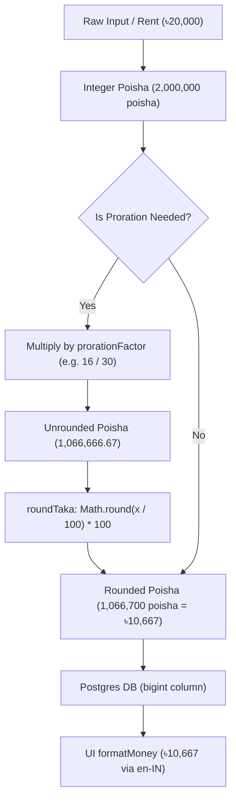

# Money as integers & rounding

> Why BasaManager bans floats, stores all currency in integer poisha, and rounds strictly to whole Taka.

## What problem it solves

Computers represent fractional numbers using binary floating-point (IEEE 754). In binary, decimal fractions like `0.1` or `0.2` cannot be represented exactly, leading to well-known inaccuracies:

```javascript
0.1 + 0.2 === 0.30000000000000004; // true
```

In property management and multi-tenant billing, accumulating floating-point discrepancies across rent, proration, metered electricity, late fees, and payments causes financial drift. A tenant's balance might show `৳0.00000001` remaining, preventing clean reconciliation, triggering false overdue warnings, and violating audit integrity.

Furthermore, in Bangladeshi banking and commerce, while commercial transactions are measured in poisha (1 Taka = 100 poisha), residential rental bills are traditionally settled in whole Taka. Proration and utility calculations must have deterministic, unambiguous rounding rules agreed upon by both parties.

## How it works here

1. **Poisha as the Single Unit of Account**:
   Every monetary column in the database is an integer (Postgres `bigint` mapped to integer poisha).
   - ৳1 = 100 poisha.
   - ৳20,000 rent = `2000000` poisha.
   - Electricity rate ৳9.00/unit = `900` poisha.
2. **Deterministic Whole-Taka Rounding**:
   Proration and intermediate calculations round to the nearest whole Taka using the standard half-up rule:
   ```typescript
   export function roundTaka(poisha: number): number {
     return Math.round(poisha / 100) * 100;
   }
   ```
   If a calculated amount ends in 50 poisha (e.g. ৳10,666.50 = 1,066,650 poisha), `Math.round(10666.5) * 100` rounds up to ৳10,667 (1,066,700 poisha).
3. **Proration Factor**:
   Calculated strictly using integer calendar days in Asia/Dhaka time:
   ```typescript
   export function prorationFactor(startDate: string, periodMonth: string): number {
     // days active in month / total days in month
   }
   ```
4. **Display Formatting**:
   In the UI, `formatMoney` (`apps/web/src/lib/format.ts`) formats integer poisha using the `en-IN` (South Asian) numbering system (lakhs and crores: `৳1,25,000`). If poisha remainder is 0, it renders whole Taka; otherwise it displays 2 decimal places. Negative values use the standard Unicode minus sign `−` (`\u2212`).

## Diagram



## Gotchas

1. **Do not divide before arithmetic**:
   Always multiply integer poisha by factors first, then divide and round at the very boundary:
   `Math.round((rentPoisha * factor) / 100) * 100`.
   Dividing `rentPoisha` to Taka before applying proration re-introduces float truncation.
2. **Prisma BigInt serialization**:
   Prisma returns PostgreSQL `bigint` as native JavaScript `BigInt` (e.g. `2000000n`). Native `BigInt` cannot be passed to `JSON.stringify()` without serialization handling. The API layer casts BigInt columns to `Number` inside DTO mappers (`Number(bill.totalPoisha)`), which is safe up to 90 trillion Taka (`Number.MAX_SAFE_INTEGER` = 9,007,199,254,740,991 poisha).
3. **Signed adjustments**:
   Adjustments can be positive (additional charges) or negative (discounts). Credit entries use positive values for overpayment credit additions and negative values for deductions applied to bills.

## Where in code

- `packages/domain/src/billing/index.ts`: Pure domain rounding and calculations (`roundTaka`, `prorate`, `electricityCharge`, `computeLateFee`, `allocatePayment`).
- `packages/domain/src/billing/billing.test.ts`: 44 unit tests proving precision, leap years, and tie rounding.
- `apps/web/src/lib/format.ts`: `formatMoney`, `parseTakaToPoisha`, and `poishaToTakaInput`.
- `apps/api/src/modules/billing/billing.service.ts`: Backend service recording integer poisha values into PostgreSQL.

## Self-check

<details>
<summary>1. Why does BasaManager disallow storing monetary values as floats in the database?</summary>
Binary floating-point types (like PostgreSQL <code>real</code> or JavaScript <code>number</code> with decimals) cannot accurately represent base-10 fractions. Arithmetic on floats accumulates micro-errors that lead to discrepancies in bills, balances, and ledger reconciliation.
</details>

<details>
<summary>2. How much is ৳15,450.75 represented as in integer poisha?</summary>
<code>1,545,075</code> poisha (multiply by 100).
</details>

<details>
<summary>3. What is the result of <code>roundTaka(1066650)</code>?</summary>
<code>1066700</code> poisha (৳10,667). The half-Taka (50 poisha) rounds up to the next whole Taka.
</details>

<details>
<summary>4. Why is it safe to convert Prisma's BigInt poisha values to Number for JSON responses?</summary>
JavaScript's <code>Number.MAX_SAFE_INTEGER</code> is <code>9,007,199,254,740,991</code>, which corresponds to over ৳90 trillion. No apartment management bill or balance will ever exceed this limit.
</details>
