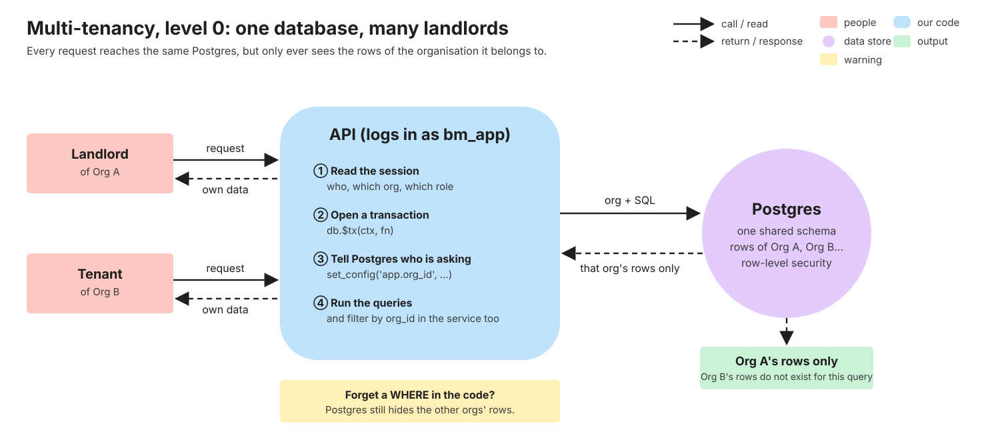
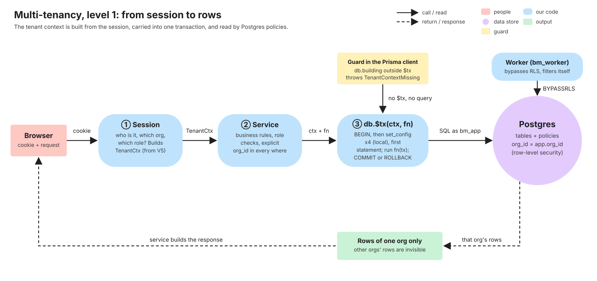
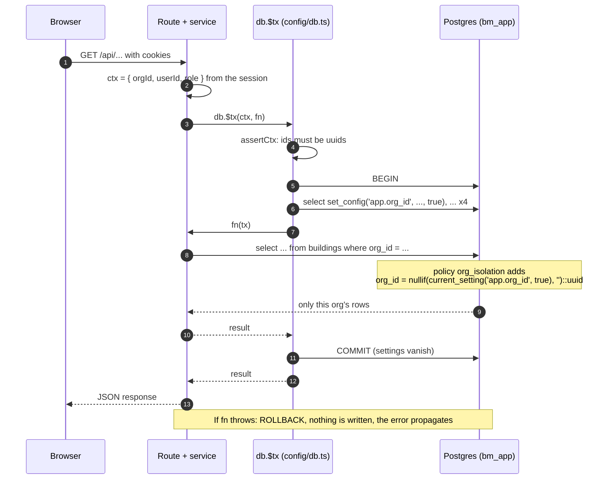

# Multi-tenancy & row-level security

> **New to you: read this one slowly.** Row-level security (RLS) is a Postgres feature you have not used
> before. This page explains it from zero, then shows exactly how BasaManager uses it. Written in task V4
> from the real code and tests.

## What problem it solves

BasaManager serves many landlords. Rahman Properties and a landlord in Dhaka both use the same website, the
same API and the same database. Their buildings, tenants, bills and payments must **never** mix: landlord A
must not be able to read, change or even count landlord B's rows. A single leaked bill is a serious breach of
trust.

Each landlord's business is called an **organisation** (software people say _tenant_; do not confuse it with
a _tenant_ who rents a flat). In these docs "tenant" means the renter and "organisation" or "org" means the
landlord's business.

### Three ways to keep organisations apart

| Approach                                     | How                                            | Why not (here)                                                                     |
| -------------------------------------------- | ---------------------------------------------- | ---------------------------------------------------------------------------------- |
| One database per organisation                | A separate Postgres database for each landlord | Hundreds of databases to migrate and back up; far too heavy for this app           |
| One schema per organisation                  | Same database, a copy of every table per org   | Every migration runs N times; tooling such as Prisma does not like it              |
| **One shared schema, `org_id` on every row** | One set of tables; each row says who owns it   | **Chosen.** Simple to run. The risk: one forgotten `WHERE org_id = ...` leaks data |

That last risk is the whole story. With a shared schema, isolation is only as good as the discipline of every
query ever written. Humans (and AI agents) forget. So BasaManager enforces the rule **twice**.

### Defence in depth

**Analogy.** A hotel guest needs a key card to get into their room. That is the service layer: the code asks
"which organisation is this user in?" and filters by it. But the hotel also fits **every door** with a lock
that only opens for the right card, so even if a receptionist hands out the wrong floor plan, the guest still
cannot walk into the wrong room. That second lock is **row-level security**: the database itself refuses to
show rows that belong to someone else, whatever query the code sends.

1. **Service layer.** Every service puts `org_id` into its queries (`where: { orgId, ... }`). This is the
   normal, readable way, and it is the first line.
2. **Postgres RLS.** Every organisation-owned table has _policies_. A policy is a rule attached to a table
   that Postgres adds to every query on it. If the service forgets its filter, the policy still applies.

The rest of this page is about the second line, because it is the new idea.

## How it works here

### What a policy is (the five-minute version)

Normally `select * from buildings` returns every row. After `alter table buildings enable row level
security`, the same query returns only rows for which a **policy** expression is true. Think of Postgres
silently rewriting your query:

```sql
-- you write
select * from buildings;
-- Postgres runs
select * from buildings where org_id = nullif(current_setting('app.org_id', true), '')::uuid;
```

A policy has two parts that matter to us:

- `using (...)`: which **existing** rows you may see, update or delete.
- `with check (...)`: which **new or changed** rows you may write. An insert that fails this check is
  rejected with an error, not silently dropped.

Postgres has no built-in notion of "the current organisation". We invent one with a **custom setting**: any
name containing a dot is allowed, and ours is `app.org_id`. Our code sets it; the policy reads it with
`current_setting('app.org_id', true)` (the `true` means "return NULL instead of an error if it was never
set").

### The four database logins (roles)

RLS depends on **who is connected**, so the roles matter. They are created by the first migration,
`apps/api/prisma/migrations/20261108000000_roles/migration.sql` (passwords for dev and test come from
`infra/postgres/init/01-roles.sql`).

| Role          | Used by                             | Subject to RLS?                        | What it may do                                                                                        |
| ------------- | ----------------------------------- | -------------------------------------- | ----------------------------------------------------------------------------------------------------- |
| `bm_owner`    | migrations only                     | **No** (superuser; it owns the tables) | Everything. Test fixtures use it to insert rows without any context                                   |
| `bm_app`      | the API (`DATABASE_URL`)            | **Yes** (`NOBYPASSRLS`)                | `select/insert/update/delete` on tables; **no** `delete` on history tables; only `insert` on `outbox` |
| `bm_worker`   | the worker (`DATABASE_WORKER_URL`)  | **No** (`BYPASSRLS`)                   | Same grants as `bm_app`, plus full access to `outbox`. Jobs span every organisation                   |
| `bm_readonly` | `pnpm db:docs`, backup verification | Yes (`NOBYPASSRLS`)                    | `select` only. Because RLS still applies, it sees **no** organisation rows                            |

Two facts to remember:

- **The table owner and superusers skip RLS.** If the API logged in as `bm_owner`, every policy would be
  ignored and nothing would warn you. That is why the API uses `bm_app`. The test
  `bm_app is NOBYPASSRLS, bm_worker is BYPASSRLS, bm_owner owns the tables` in
  `apps/api/test/role-grants.int.test.ts` proves the attributes.
- `alter table ... force row level security` (used on every table) makes even a _non-superuser owner_ obey
  the policies. `bm_owner` is a superuser in our containers, so it still bypasses them; FORCE is belt and
  braces for any environment where the owner is not a superuser.

### Telling Postgres who is asking: `db.$tx`

The policy needs `app.org_id` to be set. One function sets it: `db.$tx(ctx, fn)` in
`apps/api/src/config/db.ts`. It opens a database transaction and, as its **very first statement**, runs:

```sql
select set_config('app.org_id',   <orgId or ''>,      true),
       set_config('app.user_id',  <userId>,           true),
       set_config('app.role',     <role or ''>,       true),
       set_config('app.is_admin', 'true' | 'false',   true)
```

then runs your function with the transaction client, then commits (or rolls back if your function throws).

| Setting        | Value                                      | Read by                                                                                               |
| -------------- | ------------------------------------------ | ----------------------------------------------------------------------------------------------------- |
| `app.org_id`   | the current organisation (or empty)        | `org_isolation` on every org table; the `org_self_*` policies; the outbox policy                      |
| `app.user_id`  | the signed-in user                         | `own_rows` on `notifications`; `own_memberships`; `member_orgs`                                       |
| `app.role`     | `landlord`, `caretaker`, `tenant` or empty | `no_caretaker` on `documents`, `no_caretaker_documents` on `files`; `org_self_update` (landlord only) |
| `app.is_admin` | `'true'` only on `/api/admin` routes       | `org_self_select`, `org_self_update` and the two admin views                                          |

`ctx` (type `TenantCtx`) must be built from the **authenticated session only**, never from request input.
`assertCtx` rejects any id that is not a uuid with a `TypeError` before a connection is used.

#### Why `set_config(..., true)` and why inside the transaction

The third argument, `true`, means **local to the current transaction**: the setting disappears when the
transaction ends. This matters because the API keeps a **pool** of database connections and hands them to
different requests in turn. Without it, two bad things could happen:

1. **Leak.** If we set the org for a whole _connection_ (`is_local = false`), the next request that reuses the
   connection would still carry the previous landlord's org. That is exactly the leak we are preventing.
2. **Wrong connection.** If the setting and the query were separate statements outside a transaction, Prisma
   could send them down _different_ pooled connections, and the query would run without the setting.

Inside one interactive transaction there is exactly one connection from `BEGIN` to `COMMIT`, and the setting
dies at the end. The test `settings do not leak into the next transaction on the same pooled connection` in
`apps/api/test/tenant-extension.int.test.ts` runs ten transactions in a row and checks that a plain query
afterwards sees an empty context. `concurrent $tx calls with different orgs never see each other` runs twelve
at once, pausing 20 ms inside each.

It is the **first** statement because policies are evaluated per statement: a query that ran before the
settings would see no context. (That fails safe, with zero rows, but it is a bug.)

### The `nullif(...)` trap

Every policy contains this:

```sql
org_id = nullif(current_setting('app.org_id', true), '')::uuid
```

Why not simply `current_setting('app.org_id', true)::uuid`? Because of a Postgres quirk:

- A setting that was **never** set reads as `NULL`.
- But once a setting has been set on a connection (even with `is_local = true`), after the transaction ends
  Postgres remembers that it **exists** and gives it an empty-string value. A later transaction with no context
  on the same pooled connection reads `''`, not `NULL`.
- `''::uuid` is not a valid uuid, so Postgres raises error `22P02` ("invalid input syntax for type uuid") on
  every query. The app would break in a way that depends on which pooled connection a request happened to get.

`nullif(x, '')` turns an empty string back into `NULL`. `org_id = NULL` is _unknown_, which counts as not
true, so a query with no context returns **no rows** instead of an error. "No context" means "no rows".

The test `after a tenant transaction on the SAME connection, a context-less query still returns 0 rows (no uuid
cast error)` in `apps/api/test/tenant-isolation.int.test.ts` reproduces it: it sets the context, commits,
queries again on the same connection and expects 0 rows and no error.

### The policies, table by table

In `apps/api/prisma/migrations/20261108000200_rls/migration.sql`, plus the user-scoped additions of
`20261108000400_user_scoped_access/migration.sql` (`own_memberships`, the split `organizations` policies and
the `app_find_invitation` function).

| Where                                           | Policy                                 | Rule                                                                               |
| ----------------------------------------------- | -------------------------------------- | ---------------------------------------------------------------------------------- |
| 24 org-owned tables (`buildings`, `bills`, ...) | `org_isolation`                        | `org_id` equals `app.org_id`, for reading **and** writing (`using` + `with check`) |
| `documents` (extra)                             | `no_caretaker` (restrictive)           | invisible when `app.role = 'caretaker'`                                            |
| `files` (extra)                                 | `no_caretaker_documents` (restrictive) | `kind = 'document'` rows invisible when `app.role = 'caretaker'`                   |
| `notifications`                                 | `own_rows`                             | `user_id` equals `app.user_id`; writes also need `org_id` null or `app.org_id`     |
| `memberships` (extra)                           | `own_memberships` (select)             | **only with no org context**: the user can read their own memberships in every org |
| `organizations`                                 | `org_self_select`                      | read: `id` equals `app.org_id`, **or** `app.is_admin = 'true'`                     |
| `organizations`                                 | `member_orgs` (select)                 | read, **only with no org context**: any org the user has a membership in           |
| `organizations`                                 | `org_self_insert`                      | insert: the new row's `id` equals `app.org_id`                                     |
| `organizations`                                 | `org_self_update`                      | update: own org **and** `app.role = 'landlord'`, or the admin context              |
| `organizations`                                 | no delete policy                       | organisations are never deleted (suspended instead)                                |
| `outbox`                                        | `app_insert` (insert only)             | `bm_app` may insert rows with its own org or no org; nothing else                  |
| `invitations` (lookup)                          | function `app_find_invitation`         | one row by token hash, with no org context (see below)                             |

#### `org_isolation`: the normal case

Created in a loop over every org-owned table: enable RLS, **force** it, add one policy. A guard test,
`every table with an org_id column has RLS enabled, FORCED, and at least one policy` in
`apps/api/test/rls.int.test.ts`, lists the tables from `information_schema` and fails if a future migration
adds an `org_id` table without RLS. It cannot be forgotten.

What the isolation tests prove (`apps/api/test/tenant-isolation.int.test.ts`): reading another org's id
returns `null`; updating or deleting it touches 0 rows; creating a row with another org's `orgId` is rejected
by the `with check`; a raw `$queryRaw` cannot see other orgs either.

#### Foreign keys carry `org_id` too

RLS filters the rows a query reads and writes, but **foreign-key checks ignore RLS**. With a plain
`units.building_id → buildings.id`, a transaction in org A could insert a unit whose `building_id` is org B's
building: the `with check` only looks at the new row's own `org_id` (A, fine), and the FK only asks "does that
building id exist?" (yes, in B). Worse, org A could create a live lease on org B's unit, and org B could then
never lease its own unit (`leases_one_live_per_unit`), with no way to see why. The FK error would also tell a
curious caller whether some other org's id exists.

So every link from one org-owned table to another is **composite**: `(org_id, building_id) → buildings(org_id,
id)`. The parent has a unique key on `(org_id, id)` for it to point at. Now the database itself refuses a row
that mixes two orgs (error `23503`), even for the owner login that skips RLS. In Prisma it reads
`@relation(fields: [orgId, buildingId], references: [orgId, id])`. Optional links (`payments.proof_file_id`,
`maintenance_requests.assigned_to`, ...) use `on delete restrict` instead of `set null`, because `set null` on
a composite key would also try to blank `org_id`, and those parents are never deleted anyway (soft-deleted or
`removed`).

Two smaller rules close the last gaps. First, composite FKs are `on update no action` (Prisma
`onUpdate: NoAction`). Prisma's default is `cascade`, and because `org_id` is part of the key, a worker or
admin login that skips RLS could run `update buildings set org_id = B` and silently drag every unit, lease and
bill under it into org B. With `no action` that update fails with `23503` while any child still points at the
old `(org_id, id)`. Second, every unique key on a link column starts with `org_id`: `unique(org_id,
building_id, label)`, `(org_id, unit_id) where live` and so on. A unique check runs before the FK check, so with
plain `unique(unit_id)` org A naming org B's unit would get `23505` ("already taken") and learn that the unit
exists and is let. With `org_id` first, A's key can never collide with B's, the FK check runs and the answer is
the same `23503` as for an id that doesn't exist at all.

Guarded by `every foreign key from an org_id table to an org_id table is composite and pairs org_id with
org_id` in `apps/api/test/rls.int.test.ts` (it reads every FK from `pg_constraint`), and proved by `a row in org
A cannot point at a row of org B` in `tenant-isolation.int.test.ts`.

#### `documents`: a restrictive policy

Caretakers must never see tenants' ID documents. Policies normally **add up**: Postgres OR-s together all
_permissive_ policies on a table. A second ordinary policy "not a caretaker" would be OR-ed with
`org_isolation` and let everyone through. So `no_caretaker` is declared `as restrictive`, which means it is
**AND-ed** with the others: a row must pass `org_isolation` _and_ `no_caretaker`.

A missing role setting is not treated as "caretaker" (`coalesce(nullif(...), '') <> 'caretaker'`), so
background work with no role still works. Proved by `apps/api/test/documents-caretaker.int.test.ts` (`caretaker
cannot read via a raw query, count, or by id; a missing role setting is not treated as caretaker`).

The stored object behind a document is a row in `files` with `kind = 'document'` (public id, type, size, hash).
Hiding only `documents` would leave a hole: a later download service that checks just the `files` row could hand
an NID scan to a caretaker. So `files` has a second restrictive policy, `no_caretaker_documents`: rows of kind
`document` are invisible to (and cannot be inserted by) a caretaker context; maintenance photos, payment proofs
and PDFs stay visible. Proved by `the files row behind a document is hidden from caretakers; other file kinds
are not`.

> **Consequence.** At the database level a `tenant` context can read **every** document of the org. RLS draws
> the line between organisations (and hides documents from caretakers); "a tenant sees only their own lease's
> documents" must be enforced by the **service** (task V13). RLS is a safety net under the service, not a
> replacement for it.

#### `notifications`: by user, not by org

A notification belongs to a person, and `org_id` may be empty (platform messages). If it also had
`org_isolation`, the two permissive policies would be OR-ed, and every member of an org could read each other's
notifications. So it has **only** `own_rows`, keyed on `app.user_id`. That is why `$tx` needs a `userId` even
for work that has no organisation. Its `with check` adds one org rule for writes: the new row's `org_id` must be
empty or the transaction's `app.org_id`, so a user in org A cannot file a notification under org B.

#### `organizations`: keyed by `id`, one policy per command, and why the id is generated first

`organizations` has no `org_id` column; its own `id` is the key. It has one policy per command, so each kind
of access is spelled out:

- **Read** (`org_self_select`): "this row is mine if its `id` is my `app.org_id`, or I am in the admin context".
- **Read** (`member_orgs`): "or, when no org is chosen (`app.org_id` empty), I (`app.user_id`) have a
  membership in it". This is what lets the login page, `GET /api/me` and the org switcher list a user's
  organisations **before** any org is chosen. Inside org A's context it is off, so `organization.findMany()`
  returns org A only.
- **Update** (`org_self_update`): only the org's **landlord** context (or the admin context, which suspends and
  reactivates orgs). A caretaker or tenant context updates 0 rows, even in its own org.
- **Insert** (`org_self_insert`): the new row's `id` must equal `app.org_id`.
- **Delete**: no policy at all, so a delete matches no rows. Organisations are suspended, never deleted.

The insert rule creates a chicken-and-egg problem: to insert a new organisation, the transaction's
`app.org_id` must already equal the new row's `id`.

The fix is how organisations are created: generate the id **first**, then use it as the context:

```ts
const orgId = newId(); // packages/shared/src/ids.ts
await db.$tx({ orgId, userId, role: 'landlord' }, async (tx) => {
  await tx.organization.create({ data: { id: orgId /* ... */ } });
  // memberships etc. in the same transaction carry the same orgId
});
```

`apps/api/prisma/seed.ts` does exactly this for the demo organisation. (It also shows the admin context: to
ask "does the demo org already exist?" it runs `db.$tx({ orgId: null, ..., isAdmin: true }, ...)`, because only
that context may look across organisations.)

#### Without an org context: my memberships, my orgs, an invitation

Some work happens **before** an organisation is chosen, with `ctx = { orgId: null, userId }`:

- **"Which organisations am I in?"** `memberships` has an extra _permissive_ policy `own_memberships`, for
  `select` only: `app.org_id` is empty **and** `user_id = app.user_id`. Permissive policies are OR-ed with
  `org_isolation`, so with no org chosen a signed-in user can read **their own** membership rows in every org,
  and nothing else: other people's memberships stay hidden, and writing a membership still needs the org
  context. The "no org" condition matters: without it, inside org A a team page's
  `membership.findMany({ where: { status: 'active' } })` would also return the caller's own memberships in
  orgs B and C. `member_orgs` on `organizations` then lets them
  read those orgs. Its `exists (select 1 from memberships ...)` subquery runs under the memberships policies
  (so it sees exactly the user's own rows) and cannot loop, because no memberships policy refers back to
  organizations. A membership does **not** open the org's other tables: buildings, bills and so on still need
  `app.org_id`.
- **"Show / accept this invite link."** The invite token's hash is all we have, and the invitation belongs to
  an org we are not in yet. `invitations` stays strictly org-isolated; instead a small `security definer`
  function, `app_find_invitation(token_hash)`, runs as its owner (`bm_owner`, so RLS does not apply inside it)
  with a fixed `search_path`, and returns **at most the one row** whose hash matches, and only the columns the
  invite flow needs (never the hash). Only `bm_app` may execute it. `findInvitationByTokenHash(db, hash)` in
  `apps/api/src/config/db.ts` wraps it. The service checks expiry, acceptance and revocation, then accepts inside
  `db.$tx({ orgId: invitation.orgId, ... })`. Guessing a hash is hopeless (sha-256 of a random token), so the
  function reveals nothing to someone without the link.

Proved in `apps/api/test/cross-org-user.int.test.ts`: a user who is a tenant in org A and landlord in org B sees
exactly those 2 memberships and those 2 orgs (not org C); inside org A's context the same user sees only A's
memberships and org A; another user sees none; the function finds the right
hash, nothing for a wrong one, works without org context, while `select * from invitations` still returns 0
rows; a caretaker or tenant context cannot update the organization row; the landlord and admin contexts can;
nobody can delete it.

#### `outbox`: insert-only, and why `createMany`

The outbox is a delivery queue for emails and push notifications (the pipeline is explained in
[Notification pipeline (outbox)](/concepts/notification-pipeline-outbox), V11). The API writes a row **inside
the same transaction as the business change**, so the message exists if and only if the change committed. But
the API must not read or edit the queue, so `bm_app` has only the `insert` privilege on it (migration
`20261108000300_constraints_grants_views`) plus the `app_insert` policy, which lets it insert rows for its own
org or for no org.

A subtle point: Prisma's `create` runs `INSERT ... RETURNING *`, and `RETURNING` needs `select` permission,
which `bm_app` does not have, so `create` fails with `42501`. **`createMany`** sends a plain `INSERT` with no
`RETURNING`, so it works. Rule for every later task: write the outbox with
`tx.outboxMessage.createMany({ data: [...] })`. The worker (`BYPASSRLS`) reads and updates it. Proved in
`apps/api/test/schema-extras.int.test.ts` (`createMany inside $tx inserts for the own org or no org; bm_worker
reads it` and `bm_app cannot insert for another org, nor select, update or delete outbox rows`).

### The guard: `TenantContextMissing`

RLS makes a forgotten context safe (no rows). But "my page is mysteriously empty" is a terrible way to find a
bug. So the Prisma client has a second guard in `apps/api/src/config/db.ts`: every query on a model in
`TENANT_MODELS` that is **not** run through `db.$tx` throws `TenantContextMissing` immediately, naming the
model and the operation:

```
Building.findMany needs a tenant context: run it inside db.$tx(ctx, fn)
```

`TENANT_MODELS` is not typed by hand. It is computed from the generated Prisma client: every model that has an
`orgId` field, plus `Organization`. Add a table with `org_id` and it is protected automatically (27 models
today, asserted in `apps/api/test/schema-extras.int.test.ts`). Models that are not organisation data (`User`,
`Session`, `AuthToken`, `OauthAccount`, `NotificationPreference`, `PushSubscription`, `JobRun`) work on `db`
directly. Raw SQL outside `$tx` is **not** blocked by the guard, but RLS makes it return no org rows.

The guard also looks **inside** the arguments of those non-tenant models. `db.user.findMany({ include: {
memberships: true } })` would otherwise run, and RLS would silently answer `memberships: []`. So the extension
walks `include`, `select` (also `_count`), `where` (relation filters like `memberships: { some: ... }`),
`orderBy` and `data` (nested writes like `memberships: { create: ... }`), and throws `TenantContextMissing` with
`relation` set to the path (`memberships`, or `user.memberships` from `db.session`) as soon as it reaches a
tenant model. The map "relation field → target model" comes from the generated client's runtime data model
(Prisma 7's `prisma-client` generator has no `Prisma.dmmf`), so it cannot drift from the schema. Inside `$tx`
the same query is fine: RLS decides what it returns.

The guard has unit tests that need no database: `apps/api/src/config/db.test.ts`; the nested cases are in
`apps/api/test/tenant-extension.int.test.ts`.

### Admin views

The platform admin must see all organisations (counts, health) without gaining access to their data. Two SQL
views in migration `20261108000300_constraints_grants_views` do this:

- `admin_org_overview`: name, status and the number of buildings, units, active leases and members per
  organisation.
- `admin_health`: job runs, failed outbox messages, flagged or stuck payment intents. No amounts, payloads or
  emails.

Admin endpoints use `db.$tx({ orgId: null, userId, role: null, isAdmin: true }, ...)`. The views return rows
**only** when `app.is_admin = 'true'`; otherwise they are empty. They are `security_barrier` (the caller's own
filter functions cannot run ahead of the view's check) and read-only (`bm_app` has `select` only). A normal
view runs with its _owner's_ rights; the owner is `bm_owner`, a superuser, so RLS does not hide other orgs'
rows inside the view. That is deliberate, and the reason `bm_owner` must stay the superuser. Tests: the
`admin views` block in `apps/api/test/schema-extras.int.test.ts`; `role-grants.int.test.ts` asserts that
`bm_owner` **is** a superuser, so a future non-superuser owner fails a test instead of the admin screens quietly
showing 0 counts.

Prisma's own ledger, `_prisma_migrations`, is created by `bm_owner` during the first `migrate deploy`. Only the
owner touches it: `bm_app` and `bm_worker` have no rights on it, `bm_readonly` may read it.

### The worker

`bm_worker` has `BYPASSRLS` because jobs (billing, reminders, retention) run across every organisation. That
removes the safety net, so the worker **must filter by `org_id` itself**, and uses `db.$tx` with the org it is
processing for tenant models. It still cannot delete history rows (`bm_worker keeps the no-delete rule on
history tables too`).

## Diagram

Level 0: the whole idea in one picture.



Level 1: the path from the signed-in session to rows, with the guard and the worker.



One request through `db.$tx`. The routes arrive in V5 and V6; this is the path every one of them will take.



## Gotchas

- **Forgetting `db.$tx` is a loud error, not a silent leak.** `TenantContextMissing` on org models. Do not
  "fix" it by using a raw client or loosening the guard.
- **RLS is the org boundary, not the permission system.** A `tenant` or `caretaker` context sees every row of
  the org at SQL level (except documents, which caretakers cannot see). Role and per-building rules live in the
  services (authorization, from V5).
- **Reads of other orgs look like "not found", not "forbidden".** `findUnique` on another org's id returns
  `null`; `update` throws; `updateMany` returns `count: 0`. Services should answer 404.
- **Inserts with a foreign `orgId` fail loudly** (`with check`), and so do links to another org's row
  (composite foreign keys, `23503`; Prisma `P2003`).
- **Never run the app as `bm_owner` or any superuser.** Every policy would be silently ignored. Test fixtures
  use the owner on purpose; the app must not.
- **Creating an organisation needs the id first** (see `org_self_insert`). Forgetting this gives a "violates row-level
  security policy" error on insert.
- **`createMany` for the outbox**, never `create`.
- **A `create` also has to be able to read the row it made** (Prisma returns it with `RETURNING`). A policy that
  allowed an insert but hid the row afterwards would make `create` fail.
- **Do not do slow work inside `$tx`.** A transaction holds one pooled connection; see
  [Transactions & locking](/concepts/transactions-and-locking).
- **No org context is not "no access" for everything.** With `{ orgId: null, userId }` a user still reads their
  own memberships and the orgs behind them (`own_memberships`, `member_orgs`), and the invite flow reads one
  invitation through `app_find_invitation`. Nothing else: never work around a missing context with the owner or
  worker login.
- **Membership is read-only without the org.** `own_memberships` is `select` only; accepting an invite, leaving
  an org or changing a role runs in that org's `db.$tx`.
- **Identity tables have no RLS.** `users`, `sessions`, `auth_tokens`, `oauth_accounts`,
  `notification_preferences`, `push_subscriptions` and `job_runs` have no policy: only the services that own
  them may touch them.

## Where in code

- `apps/api/src/config/db.ts`: `createPrisma`, `db.$tx`, `TenantCtx`, `Tx`, `TENANT_MODELS`,
  `TenantContextMissing`.
- `apps/api/prisma/migrations/20261108000000_roles/migration.sql`: the roles and default grants.
- `apps/api/prisma/migrations/20261108000200_rls/migration.sql`: every policy.
- `apps/api/prisma/migrations/20261108000300_constraints_grants_views/migration.sql`: history `delete`
  revokes, outbox revokes, the admin views.
- `packages/shared/src/ids.ts`: `newId()` for organisation creation.
- `apps/api/prisma/seed.ts` and `apps/api/prisma/seed-repo.ts`: a worked example that runs as `bm_app` through
  `db.$tx`, including creating an organisation.
- Tests: `apps/api/test/rls.int.test.ts` (coverage guard), `tenant-isolation.int.test.ts`,
  `tenant-extension.int.test.ts`, `documents-caretaker.int.test.ts`, `role-grants.int.test.ts`,
  `schema-extras.int.test.ts`; helper `apps/api/test/helpers/pg.ts` (`asApp` sets the same context in raw SQL).
- The rules in prose: `.agent/03-DATABASE.md` ("RLS", "Database roles"). The generated schema:
  [Database schema](../database/README.md).

Run the tests with `pnpm test:int` (see [Testing strategy](/concepts/testing-strategy)).

## Self-check

1. In one sentence, what does an RLS policy do? <details><summary>Answer</summary>It is a rule attached to a table that Postgres adds to every query on it, so a connection only sees (and may only write) the rows for which the rule is true, whatever the SQL says.</details>
2. Why does the API connect as `bm_app` instead of `bm_owner`? <details><summary>Answer</summary>Table owners and superusers bypass RLS. As <code>bm_app</code> (<code>NOBYPASSRLS</code>) every policy applies. As the owner, isolation would be silently off.</details>
3. What happens if a service queries `db.building.findMany()` without `db.$tx`? <details><summary>Answer</summary>The Prisma extension throws <code>TenantContextMissing</code> ("Building.findMany needs a tenant context") before any SQL is sent. Raw SQL in the same situation would not throw but would return no rows, because <code>app.org_id</code> is empty.</details>
4. What happens if `set_config` were called with `is_local = false` on a pooled connection? <details><summary>Answer</summary>The setting would stay on the connection after the request. The next request to reuse it would run with the previous landlord's org: a cross-organisation leak. <code>true</code> ties it to the transaction, and the "settings do not leak" test guards it.</details>
5. Why is the check `nullif(current_setting('app.org_id', true), '')::uuid` and not just `current_setting(...)::uuid`? <details><summary>Answer</summary>After a transaction that used <code>set_config(..., true)</code>, a pooled connection reads the setting as an empty string, not NULL. <code>''::uuid</code> raises error 22P02. <code>nullif</code> turns it into NULL, so the comparison is "unknown" and returns no rows instead of crashing.</details>
6. Why is `no_caretaker` on `documents` declared `restrictive`? <details><summary>Answer</summary>Permissive policies are OR-ed, so a second ordinary policy would widen access instead of narrowing it. A restrictive policy is AND-ed with <code>org_isolation</code>: the row must be in the org <em>and</em> the role must not be caretaker.</details>
7. What happens if you create an organisation inside `db.$tx` with `orgId: null`? <details><summary>Answer</summary>Postgres rejects the insert with a row-level security violation: <code>org_self_insert</code> requires the new row's <code>id</code> to equal <code>app.org_id</code>. Generate the id with <code>newId()</code> first and use it as <code>orgId</code> in the context.</details>
8. What happens if a service forgets `where: { orgId }` on a bill lookup? <details><summary>Answer</summary>Inside <code>db.$tx</code> the policy still limits the query to the current org, so another org's bill is never returned (it looks like "not found"). The service filter is the first line of defence; RLS is the net. That is why the same rule is enforced twice.</details>
9. Why does the outbox insert use `createMany` rather than `create`? <details><summary>Answer</summary><code>bm_app</code> may only <code>insert</code> into the outbox. <code>create</code> adds <code>RETURNING</code>, which needs <code>select</code> and fails with 42501. <code>createMany</code> sends a plain insert.</details>
10. Can RLS stop one tenant (renter) of Org A from reading another renter's bills in the same org? <details><summary>Answer</summary>No. RLS separates organisations (and hides documents from caretakers). Rules like "a tenant sees only their own lease" are enforced in the service layer. Know which layer owns which rule.</details>
