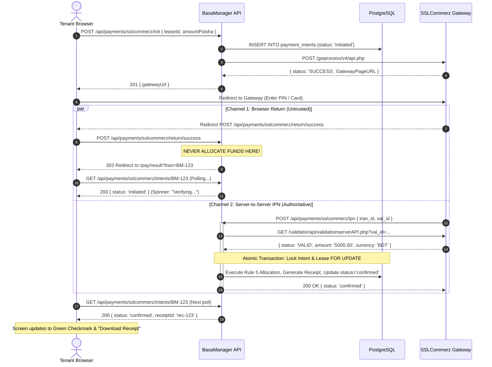

# Payment gateways & webhooks

> The two-channel payment architecture, server-to-server validation APIs, IPN idempotency, and the iron rule of financial webhooks: **never trust the browser redirect**.

## What problem it solves

When a web application accepts payments through a third-party gateway (such as SSLCommerz, Stripe, or bKash), two critical security challenges arise:

1. **Client-Side Untrustworthiness**: After a customer pays, the gateway redirects the customer's browser back to the merchant site with query parameters like `status=VALID&amount=5000&tran_id=BM-12345`. An attacker can trivially forge or modify these query parameters in their browser dev tools, curl, or browser extensions, pretending they paid ৳50,000 when they only paid ৳10 (or paid nothing at all).
2. **Channel Asynchrony & Network Dropped Packets**: A user might close their browser tab or lose mobile data connectivity the millisecond after their bank approves the charge, never completing the return redirect. If the system relied on the browser return, the tenant would be charged by their bank, but their apartment bill would remain marked unpaid.

BasaManager solves both problems by strictly decoupling **user visual redirection** from **financial settlement**, combining **instant server-to-server Instant Payment Notifications (IPN)** with **secondary gateway validation calls** and **background automated reconciliation crons**.

## How it works here

The BasaManager payment gateway implementation adheres to **Rule 8 (Online Payments)** from `.agent/07-BILLING.md`:

```
┌────────────────────────────────────────────────────────────────────────────────────────┐
│                              THE THREE INDEPENDENT CHANNELS                            │
├────────────────────────────────┬───────────────────────────┬───────────────────────────┤
│ 1. Browser Return (Frontend)   │ 2. Server Webhook (IPN)   │ 3. Worker Cron (Recheck)  │
├────────────────────────────────┼───────────────────────────┼───────────────────────────┤
│ • Redirects browser to result  │ • Gateway POSTs val_id    │ • Scans initiated > 30m   │
│ • NEVER changes money          │ • Server calls Validate   │ • Queries Merchant API    │
│ • Polls GET /intents/:tranId   │ • Confirms via Rule 5     │ • Confirms or flags       │
└────────────────────────────────┴───────────────────────────┴───────────────────────────┘
```

### 1. Payment Initialization (`POST /api/payments/sslcommerz/init`)

- Accessible only to authenticated tenants for their active lease.
- Upper bound check: `amountPoisha` must be between ৳100 and total open dues plus one month's rent (`openDues + lease.monthlyRentPoisha`).
- Generates a cryptographically random, globally unique transaction ID (`tranId`), e.g., `BM-1731307200000-A1B2C3D4`.
- Inserts a row into `payment_intents` with status `'initiated'`.
- Calls SSLCommerz `/gwprocess/v4/api.php` with merchant credentials and callback endpoints.
- Returns `gatewayUrl` to the client, which redirects the user.

### 2. The Browser Return (`POST /api/payments/sslcommerz/return/:result`)

- The gateway POSTs form data back to `/api/payments/sslcommerz/return/:result` (`success`, `fail`, `cancel`).
- **Critical Security Invariant**: The return handler **NEVER marks a bill paid or moves money**.
- If `fail` or `cancel`, it updates the intent status to `failed` or `cancelled` (only if still `initiated`).
- Emits a HTTP 303 See Other redirecting the user to `/pay/result?tran=:tranId`.
- The frontend page polls `GET /api/payments/sslcommerz/intents/:tranId` until the backend confirms the status.

### 3. Server-to-Server IPN (`POST /api/payments/sslcommerz/ipn`)

- SSLCommerz makes an out-of-band POST request containing `tran_id` and `val_id`.
- BasaManager **does not trust the payload fields**. It takes `val_id` and immediately calls the SSLCommerz **Validation Server API** (`/validator/api/validationserverAPI.php`).
- It verifies that:
  - `status === 'VALID'`
  - `tran_id === intent.tranId`
  - `currency === 'BDT'`
  - `valRes.amount` converts exactly to `intent.amountPoisha`.
- If any check fails, the intent is stamped `'flagged'` for manual admin review, and **no money is allocated**.
- If valid, it enters an atomic database transaction:
  - Takes a row lock (`FOR UPDATE`) on the intent to guarantee idempotency.
  - Takes a row lock on the lease.
  - Executes **Rule 5 waterfall allocation** across unpaid bills ordered by `period_month ASC`.
  - Increments the gapless receipt counter (`BM-<year>-<seq>`).
  - Marks the intent `'confirmed'`, links `paymentId`, and queues an outbox event.

### 4. Background Reconciliation Cron (`recheckPaymentIntents`)

- What if an IPN packet is lost due to an internet routing blip?
- Every 10 minutes, the background worker executes `recheckPaymentIntentsJob`.
- Scans all intents that have remained in `'initiated'` status for longer than 30 minutes via the `app_find_stale_payment_intents` function.
- Queries SSLCommerz Merchant Transaction Validation API (`/validator/api/merchantTransIDvalidationAPI.php`).
- If the gateway confirms payment was successful, the worker executes the exact same Rule 5 confirmation flow. If failed or missing, it updates status accordingly.

## Diagram



## Gotchas

1. **The "Never Trust the Redirect" Trap**:
   - In naive implementations, developers write `if (req.params.result === 'success') markBillPaid()`.
   - This allows any user to mark their rent paid by typing `/api/payments/sslcommerz/return/success?tran_id=...` into the address bar!
   - In BasaManager, the return endpoint does nothing except issue a 303 redirect. Payment state changes strictly require the server-to-server IPN with validation or the worker reconciliation job.

2. **The Tampered IPN Form Field Attack**:
   - Even in an IPN POST, an attacker attempting a man-in-the-middle or spoofed POST might send `amount=5000.00` while only paying `10.00` at the gateway.
   - BasaManager **never reads the amount from the IPN body**. It reads the amount returned by the SSLCommerz **Validation Server API** and compares that integer poisha value against `intent.amountPoisha`. If they differ by even 1 poisha, the intent is immediately stamped `'flagged'` and zero money changes hands.

3. **Multi-Tenancy & Row-Level Security (RLS)**:
   - When an IPN webhook arrives from SSLCommerz, the HTTP request has no user cookie and no `X-Org-Id` header.
   - Because `payment_intents` is an organisation-owned table protected by Postgres RLS `org_isolation`, a regular query with `app.org_id = null` returns 0 rows.
   - BasaManager uses a dedicated `SECURITY DEFINER` function `app_find_payment_intent_by_tran_id` to safely resolve the owning `org_id` by the global unique `tran_id`. Once resolved, the entire confirmation runs inside a strictly scoped `db.$tx({ orgId: intent.org_id, ... })` transaction.

4. **Floating Point Rounding Errors**:
   - Gateways communicate in decimal strings (e.g., `'5000.00'`).
   - If converted using naive floating point arithmetic (`5000.00 * 100`), IEEE 754 precision issues can cause 1-poisha discrepancies.
   - BasaManager always uses `Math.round(parseFloat(valRes.amount) * 100)` to ensure exact integer poisha conversion.

5. **Simultaneous IPN Deliveries (Race Conditions)**:
   - Gateways often retry IPN delivery aggressively or send duplicate webhooks if the connection is slightly slow.
   - If two worker processes or API instances handle duplicate IPNs simultaneously, both could create payment rows and double-allocate money.
   - BasaManager uses `SELECT id, status FROM payment_intents WHERE id = ... FOR UPDATE`. The first transaction processes the confirmation and commits `status = 'confirmed'`. The second transaction wakes up, sees `status === 'confirmed'`, and immediately returns without touching anything.

## Where in code

- Client: `apps/api/src/modules/payments/sslcommerz.client.ts` (API calls to init, validate, and query transaction).
- Service: `apps/api/src/modules/payments/sslcommerz.service.ts` (core business logic, Rule 8 enforcement, Rule 5 allocation, and worker recheck).
- Controller: `apps/api/src/modules/payments/sslcommerz.controller.ts` (HTTP handlers for init, IPN, return, and intent polling).
- Worker Job: `apps/worker/src/jobs/recheckPaymentIntents.ts` (scheduled cron checking stale initiated intents).
- Migration: `apps/api/prisma/migrations/20261108000600_payment_intents_lookup/migration.sql` (SECURITY DEFINER lookup functions).
- Webhook Exemption: `apps/api/src/middleware/csrf.ts` (CSRF exemption for public IPN and gateway return POSTs).
- Web UI:
  - `apps/web/src/pages/tenant/PayOnlineDialog.tsx` (payment modal with amount validation and gateway redirection).
  - `apps/web/src/pages/tenant/PaymentResultPage.tsx` (state machine polling and receipt download interface).
  - `apps/web/src/lib/api/payments.ts` (`useInitOnlinePayment`, `usePaymentIntent`).

## Self-check

1. **Why does `/api/payments/sslcommerz/return/success` never allocate money or mark a bill as paid?**  
   _Answer_: Because the return endpoint is hit by the user's browser, which can be spoofed, replayed, or manipulated by the client. Financial state changes only occur when the gateway directly contacts our server via IPN and our server independently verifies the transaction with the SSLCommerz validation API.

2. **What happens if a tenant pays through SSLCommerz, but their internet drops before their browser returns to BasaManager?**  
   _Answer_: The payment is still completely safe. SSLCommerz delivers the server-to-server IPN directly to our API in the background. Even if the IPN were delayed, the 10-minute worker job (`recheckPaymentIntents`) polls SSLCommerz, confirms the transaction, allocates the payment, and generates the receipt.

3. **How does BasaManager prevent an attacker from paying ৳10 at the gateway but claiming they paid ৳10,000 in the IPN?**  
   _Answer_: The system never trusts the amount reported in the IPN POST body. It uses the `val_id` to query the SSLCommerz validation server directly, extracts the server-verified amount, converts it to integer poisha, and checks that it matches the `amountPoisha` recorded in `payment_intents`. If it differs by even 1 poisha, the intent is stamped `flagged` and no payment is recorded.

4. **Why is `app_find_payment_intent_by_tran_id` implemented as a `SECURITY DEFINER` function?**  
   _Answer_: In BasaManager's multi-tenant architecture, `payment_intents` is isolated by Postgres Row-Level Security (`org_isolation`). When an unauthenticated webhook hits our public IPN endpoint, the server does not yet know which organisation owns the `tran_id`. The `SECURITY DEFINER` function allows looking up the single matching intent by its globally unique `tran_id` to safely resolve `org_id` before entering an org-isolated transaction.
