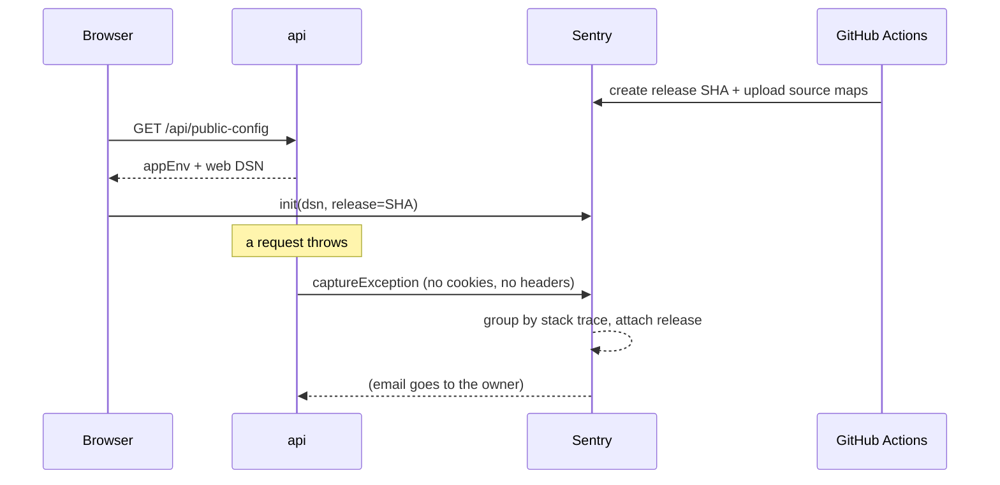

# Error monitoring with Sentry from zero

## What problem it solves

When the app breaks for a tenant at 11 pm you hear about it as "it didn't work". Logs help only if someone
goes looking. **Sentry** is a service that the app reports errors to: when something throws, Sentry stores the
error with its **stack trace**, the release it happened in, the environment, and how often it repeats, and
emails you. You learn about the bug before the user writes to you.

**Analogy.** A smoke detector that also photographs the fire. You do not stare at the room all day; it calls you
and shows you where it started.

## How it works here

Three Sentry **projects** (`basamanager-api`, `basamanager-worker`, `basamanager-web`), one **DSN** each (a
URL that says "send events here"; it identifies the project and is not a password).

- **api and worker** (`apps/api/src/config/sentry.ts`, used by both): `initSentry()` runs first thing at
  boot. The API's error handler calls `captureError()` for every unexpected 500; expected errors (validation,
  not found, auth) are not reported.
- **web** (`apps/web/src/lib/sentry.ts`): the browser fetches `/api/public-config`, which includes the web DSN,
  then starts Sentry. So **no secret or DSN is baked into the build** and one image serves staging and prod.
  Route errors are reported from the route error screen.
- **Release = git SHA.** The images get `SENTRY_RELEASE` (api, worker) and `VITE_RELEASE` (web) set to the
  commit. Sentry then shows "first seen in release abc1234". CI creates that release.
- **Source maps.** The browser runs minified JavaScript, so a raw stack trace is unreadable. CI uploads the
  source maps with `sentry-cli` using the `org:ci` token (it can only create releases and upload maps) and the
  image does **not** ship them. api and worker run TypeScript through `tsx`, so their traces are already readable.
- **Environment tag** = `APP_ENV` (`staging`, `prod`), so one project separates both.
- **Privacy.** `dataCollection` is switched off for user info, cookies, headers, bodies and query strings, and
  `beforeSend` removes them again. User context will only ever be the user id.
- **Off by default.** No DSN (dev, tests) means Sentry does nothing.

The V3 proof was one deliberate test error from each of api, worker and web on staging; the test hooks were then
removed.

## Diagram

## Gotchas

- **The `org:ci` token cannot read events.** It is for CI. You look at issues in the Sentry website.
- **Expected 4xx are not errors.** Do not report them or the inbox becomes noise.
- **Never put secrets in error messages**: they would be sent to a third party.
- **The DSN is public by design** (it is in the page's network traffic). Rate limits and the project's allowed
  domains protect it, not secrecy.
- **A new SHA means a new release**; "regression" alerts depend on releases being created before deploy.

## Where in code

- `apps/api/src/config/sentry.ts`, `apps/api/src/middleware/errorHandler.ts`, `apps/worker/src/index.ts`
- `apps/web/src/lib/sentry.ts`, `apps/web/src/main.tsx`, `apps/web/src/pages/shared/RouteError.tsx`
- `.github/workflows/deploy.yml` (job `sentry-release`), `infra/docker/web.Dockerfile` (`GIT_SHA`)
- Runbook: [Reading logs & Sentry](/operations/reading-logs-and-sentry)

## Self-check

1. What is a DSN, and why is it safe in the browser?
2. Why does CI upload source maps but the image does not contain them?
3. What does "release" give you when a bug appears right after a deploy?
4. Which errors does the API report to Sentry, and which does it not?
5. What can the `org:ci` token do, and what can it not do?
