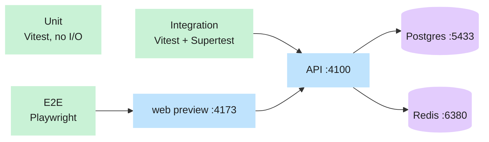

# Testing strategy

## What problem it solves

You cannot read every line of an app you did not write, so you need something that tells you, in seconds,
whether a change broke anything. Tests are that alarm. They only help if each kind of test answers a
different question, and if a failure points at the cause instead of just saying "something is red".

**Analogy.** Think of building a house. A **unit test** checks one brick is strong. An **integration test**
checks the plumbing really holds water with the real pipes. An **end-to-end (e2e) test** has someone walk in,
turn the tap and flush the toilet. A **load test** invites a hundred guests at once.

## How it works here

Four layers (the fifth, Lighthouse, is a measurement rather than a test and arrives in V16).

| Layer           | Tool                                              | Command          | Runs against                                               | Proves                                                                |
| --------------- | ------------------------------------------------- | ---------------- | ---------------------------------------------------------- | --------------------------------------------------------------------- |
| **Unit**        | Vitest (jsdom for the web)                        | `pnpm test`      | Nothing external; mocks and pure functions                 | One function or component behaves, including every edge case          |
| **Integration** | Vitest + Supertest                                | `pnpm test:int`  | Real Postgres, Redis (and Mailpit later), real Express app | A route, the database and the middleware work **together**            |
| **End-to-end**  | Playwright (`desktop` 1440×900, `mobile` 390×844) | `pnpm test:e2e`  | A real browser, the built web app, the real API            | A user can actually do the thing; layout and loading states are right |
| **Load**        | k6                                                | `pnpm test:load` | Staging                                                    | It stays fast with many users (task V16)                              |



Integration tests build the Express app in memory and call it with Supertest. E2E tests start the real API
and the built web app, then drive a browser at them. Both use the **test** stack from
`infra/compose.test.yml`, not your dev data (see [Environments & config](/concepts/environments)).

### A fresh database for every integration run (from V4)

Row-level security, grants and constraints only exist in the real database, so the integration tests need a
database with the exact production schema, and they must not depend on what a previous run left behind.
`apps/api/test/global-setup.ts` does this once per `pnpm test:int` run:

1. Reads the owner URL (`DATABASE_OWNER_URL`, the `bm_owner` superuser) from `.env.test`.
2. Creates a **new database** named `<base>_<timestamp>_<random>` (for example
   `basamanager_test_20261108120000_a1b2c3`; `<base>` is `TEST_DB_NAME`, the per-worktree name from
   `scripts/ports.mjs`, or the database in the owner URL).
3. Runs the real migrations into it with `prisma migrate deploy` (the same command staging and production
   use), then points `DATABASE_URL` (`bm_app`), `DATABASE_OWNER_URL` and `DATABASE_WORKER_URL` (`bm_worker`)
   at the new database, so every test file talks to it.
4. When the run ends (even when it fails) it drops **only** the database it created.

**Why not `prisma migrate reset`?** `reset` is the usual "wipe and re-apply" command, and Prisma 7 refuses to run
it when it detects an AI agent unless a human grants explicit consent through a special environment variable.
This project never sets that variable and no agent is allowed to bypass the guard: a command that can erase a
database is exactly the one that needs a human. A throw-away database per run is also better on its own merits:
two worktrees or two CI jobs never collide, there is no stale state, and "wipe everything" is replaced by
"drop the one database I made". New migrations are likewise created with `prisma migrate diff`, never
`migrate dev` (see `.agent/03-DATABASE.md`).

Inside a run, tests keep their data apart by truncating the fixture tables in `beforeEach` (`resetData` in
`apps/api/test/helpers/pg.ts`) and by building fixtures with `apps/api/test/helpers/factories.ts` as the owner
role. The test files run one at a time (`fileParallelism: false` in `vitest.int.config.ts`).

### The query counter (from V4)

A list page that runs one SQL query per row (an "N+1") is fast with 5 rows and slow with 500, and a human
reviewer rarely sees it. `tests/helpers/queryCounter.ts` counts the SQL statements Prisma sends so a test can
assert they do **not** grow with the number of rows:

```ts
const counter = createQueryCounter();
const db = createPrisma(url, { onQuery: counter.onQuery }); // turns on Prisma's query events (tests only)
const five = await counter.measure(() => db.$tx(ctx, (tx) => tx.building.findMany()));
// ... insert 45 more rows ...
const fifty = await counter.measure(() => db.$tx(ctx, (tx) => tx.building.findMany()));
expect(fifty.count).toBe(five.count);
```

By default it ignores transaction plumbing (`BEGIN`, `COMMIT`, `ROLLBACK`, `SAVEPOINT` and the
`set_config('app.org_id', ...)` that `db.$tx` runs first) so the number means "queries my code asked for".
`createQueryCounter({ countAll: true })` counts everything. It is proven on a real database in
`apps/api/test/schema-extras.int.test.ts` (`counts real Prisma statements; a findMany is one statement whatever
the row count`). Every list endpoint added from V6 on is expected to use it.

### What exists after V1

| Where                                                | Tests                                                                                                                                                                      |
| ---------------------------------------------------- | -------------------------------------------------------------------------------------------------------------------------------------------------------------------------- |
| `packages/shared/src/**/*.test.ts`                   | Every error code has a status; schemas accept and reject the right shapes; pagination bounds                                                                               |
| `apps/api/src/config/env.test.ts`                    | The environment guards (mock payments, clock override, cookie secure, sandbox) refuse bad combinations                                                                     |
| `apps/api/src/middleware/*.test.ts`                  | `requestId` rules; `errorHandler` output shapes and no stack-trace leak                                                                                                    |
| `apps/api/src/lib/*.test.ts`                         | `ApiError` status mapping; the injectable `clock`                                                                                                                          |
| `apps/api/src/modules/health/health.test.ts`         | `/health`, `/ready` (including DB or Redis failing) and `/public-config`, with fakes                                                                                       |
| `apps/worker/src/lib/jobLock.test.ts`                | Two concurrent calls: only one runs the locked function                                                                                                                    |
| `apps/web/src/lib/**/*.test.ts(x)`                   | `apiFetch` success, error body and non-JSON error; money formatting; pseudo-locale; `PrefetchLink`                                                                         |
| `apps/web/src/components/ui/TopProgressBar.test.tsx` | The progress bar only appears after 150 ms of navigation                                                                                                                   |
| `apps/api/test/ready.int.test.ts`                    | `/health`, `/ready` against real Postgres and Redis; `/ready` with a closed Redis port; the 404 shape                                                                      |
| `apps/api/test/*.int.test.ts` (V4)                   | RLS coverage, tenant isolation, `db.$tx`, role grants, constraints, outbox, admin views, the per-run database (see [Multi-tenancy & RLS](/concepts/multi-tenancy-and-rls)) |
| `apps/api/src/config/db.test.ts`                     | The tenant guard and context validation, with no database                                                                                                                  |
| `tests/e2e/home.spec.ts`                             | `/` loads with an `h1`, `/api/public-config` answers 200, no console errors; unknown URL shows the 404 page                                                                |
| `tests/e2e/layout.spec.ts`                           | The mobile layout audit (below)                                                                                                                                            |
| `tests/e2e/states.spec.ts`                           | The loading-state checks (below)                                                                                                                                           |

### The two UI-quality specs

These exist because past agent-built apps had text spilling out of boxes, labels wrapping onto two lines, and
pages that froze for seconds after a click. They are built once in V1 and every later UI task adds its
routes to them.

- **`tests/e2e/layout.spec.ts`** opens every route (the list is `ROUTE_PATHS` in `apps/web/src/lib/router/preload.ts`, and `apps/web/src/app/router.test.tsx` fails if the router and that list differ, so a new page cannot skip the audit) at widths 320, 360, 390, 414, 768 and 1440, in light and
  dark, in English and in the pseudo-locale `en-XA` (every string is accented and made 40% longer, so a layout
  that survives it survives Bangla and long names). `?lng=en-XA` is honoured only in dev/test builds, so the e2e web server is built with `vite build --mode test`; a production build ignores it. Each page is run through `auditLayout()` in
  `tests/helpers/layout-audit.ts`, which measures the real rendered boxes and reports a violation for:
  horizontal page scroll, an element sticking out of the viewport, text overflowing or clipped, truncated
  text without a `title`, text under 11 px, a wrapped button/nav label, a label not centred in its button,
  tap targets under 44 px, overlapping tap targets, inputs under 16 px (iOS zooms them), and content hidden
  behind the fixed bottom nav. The expected number of violations is zero.
- **`tests/e2e/states.spec.ts`** delays the API by 2 seconds and checks that a click on a nav link changes the
  URL and shows a skeleton within 300 ms with almost no layout shift; delays JS chunks and checks the shell
  stays, the progress bar shows and a skeleton fills the page; checks that going Back shows cached content
  instantly even with the API delayed; and makes the API return 500 and checks the error card, three attempts,
  and that **Retry** recovers. Checks 5 (mutation pending) and 6 (filters) are `test.skip` until V5 and V6
  bring the first mutation and the first filter.

`tests/fixtures/stress.ts` holds the nasty content (the longest names, `৳1,25,00,000`, a 40-character
unbroken id) for later specs to feed in.

### How CI runs them

`.github/workflows/ci.yml` runs on every pull request and on pushes to `main`. Six jobs, and **all six** are
required checks on `main`:

| Job              | Runs                                                                                                                   |
| ---------------- | ---------------------------------------------------------------------------------------------------------------------- |
| `lint-typecheck` | `pnpm typecheck`, `pnpm lint`                                                                                          |
| `unit`           | `pnpm test -- --coverage`                                                                                              |
| `integration`    | Postgres 17 service container + Redis started with the test password + Mailpit, the roles script, then `pnpm test:int` |
| `e2e`            | `docker compose -f infra/compose.test.yml up`, Playwright with Chromium, uploads the HTML report on failure            |
| `docs`           | `pnpm docs:check`                                                                                                      |
| `security`       | `pnpm audit --prod --audit-level high`, gitleaks (secret scan), CodeQL                                                 |

### Coverage thresholds

Set in `vitest.config.ts`: `packages/domain` must have 95% line and branch coverage (the billing maths must
be exhaustively tested) and `apps/api` 80% of lines.

## Diagram

See the flowchart above. Each test layer points at progressively more of the real system.

## Gotchas

- **Integration tests never use dev data.** They use the `test` stack on ports 5433/6380 with data in RAM, and
  since V4 each run creates and drops its **own** database inside it (see above). Running them against your dev
  database would be the one way to damage your own data; the owner URL in `.env.test` must point at the test
  stack.
- **Tests run against migrations, never `prisma db push`.** The tests must exercise the exact SQL that will
  run in production, including row-level security (from V4).
- **There is no `migrate reset` anywhere.** If a run is killed before teardown, a leftover database named
  `<base>_<timestamp>_<random>` stays in the test Postgres. It is harmless (RAM-backed, gone on `down`); drop it
  by hand or restart the test container.
- **Fixtures are built as the owner, assertions as `bm_app`.** The owner bypasses RLS, so a fixture can create
  any org's rows; the code under test must go through `bm_app` and `db.$tx`. Using the owner for an assertion
  would make an isolation test pass for the wrong reason.
- **Coverage is probably not enforced yet.** CI runs `pnpm test -- --coverage`, and with the current
  `"test": "vitest run"` script that expands to `vitest run -- --coverage`: the `--coverage` after `--` is read
  as a file filter, not a flag, so no coverage report is produced and the thresholds never fire. Fix: have CI
  run `pnpm exec vitest run --coverage` (or add a `test:cov` script), then confirm a coverage table appears
  in the log. Until then treat the 95%/80% numbers as intent.
- **No real service is called from tests.** Email goes to Mailpit, files to the local disk driver, payments
  and push to mocks. A test that reaches the internet is a bug.
- **Time is injected.** Code reads `clock.now()` (`apps/api/src/lib/clock.ts`), never `new Date()`, so a test
  can pretend it is the first of the month. `CLOCK_OVERRIDE` is refused in staging and production.
- The two UI specs run on **placeholder pages** today. Passing says the harness works, not that the real
  screens are good; the real routes are added as each UI task lands.

## Where in code

- `vitest.config.ts` (unit projects, coverage) and `vitest.int.config.ts` (integration, one file at a time).
- `playwright.config.ts` (the two projects and the two web servers it starts).
- `apps/api/test/global-setup.ts` loads `.env.test`, creates the per-run database, migrates it, and drops it.
- `apps/api/test/helpers/` (`env.ts`, `pg.ts`, `factories.ts`) and `tests/helpers/queryCounter.ts`.
- `.github/workflows/ci.yml` for CI.

## Self-check

1. Why do integration tests use the real Postgres rather than a mock? <details><summary>Answer</summary>A mock only proves your code calls the mock correctly. The risky parts (SQL, constraints, row-level security, transactions) only exist in the real database, so that is what must be tested.</details>
2. A test passes on your machine and fails in CI at 00:30 on the 1st. What is the likely cause? <details><summary>Answer</summary>Time. Something read the real clock instead of <code>clock.now()</code>, or a month or time-zone boundary was crossed. This is why code never calls <code>new Date()</code> directly.</details>
3. What happens if someone removes `--coverage` from the CI step? <details><summary>Answer</summary>Nothing changes today, because coverage is not actually being collected (see the gotcha). That is the point: a safety net you never see fail may not be there.</details>
4. What does a violation of `wrapped-label` mean, and which test finds it? <details><summary>Answer</summary>A button or nav label that renders on two lines. <code>layout.spec.ts</code> finds it by counting the lines of text in each control through <code>auditLayout()</code>.</details>
5. Why is the pseudo-locale `en-XA` used in the layout test? <details><summary>Answer</summary>It makes every string about 40% longer and accented, so overflow shows up now rather than when Bangla or a long building name appears.</details>
6. Why does every integration run create its own database instead of running `prisma migrate reset`? <details><summary>Answer</summary>Prisma 7 refuses <code>migrate reset</code> for AI agents without a human's explicit consent, and this project never bypasses that guard. A fresh database per run, migrated with <code>migrate deploy</code> and dropped at the end, is also isolated from other runs and needs no wiping.</details>
7. What happens if a test run is killed halfway? <details><summary>Answer</summary>Teardown may not run, so the run's database stays in the test Postgres. It is harmless and RAM-backed: the next run makes a new one with a different name, and restarting the test container removes it.</details>
8. What does the query counter ignore by default, and why? <details><summary>Answer</summary><code>BEGIN</code>, <code>COMMIT</code>, <code>ROLLBACK</code>, <code>SAVEPOINT</code> and the <code>set_config('app.org_id', ...)</code> statement that <code>db.$tx</code> runs. They are plumbing, so the count means the queries the code under test asked for.</details>
