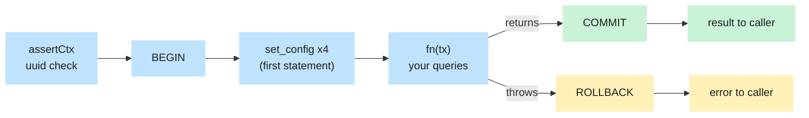

# Transactions, locking & isolation

> **First version (task V4).** Covers transactions as they exist in the code today: `db.$tx`, rollback, the
> tenant settings and the "history is never deleted" grants. The row-locking section for money is a stub
> that task V9 completes.

## What problem it solves

Some changes are several steps that only make sense together. Confirming a payment will (later) insert the
payment, allocate it to bills, update the bills' `paid_poisha`, write a receipt number and queue a
notification. If the server crashes after step 2, you would have a payment with no allocation: money that
exists but belongs to no bill.

A **transaction** groups steps into one unit: either **all** of them take effect (`COMMIT`) or **none** do
(`ROLLBACK`). Other connections never see the half-done state.

**Analogy.** Moving money between two bank accounts: take 500 from A, add 500 to B. The bank puts both
changes in one sealed envelope. If anything goes wrong before the envelope is sealed, it is shredded and
nobody sees a thing.

## How it works here

### One door: `db.$tx`

All organisation data is touched through `db.$tx(ctx, fn, options?)` in `apps/api/src/config/db.ts`. In
plain steps:

1. `assertCtx(ctx)`: the org and user ids must be uuids, else `TypeError` (nothing has touched the database).
2. `BEGIN`: Prisma's interactive transaction opens one database connection and keeps it.
3. The **first statement** sets the tenant settings (`app.org_id`, `app.user_id`, `app.role`,
   `app.is_admin`) with `set_config(..., true)`. See [Multi-tenancy & RLS](/concepts/multi-tenancy-and-rls).
4. Your function runs with `tx`, the transaction client (type `Tx`). Every query through `tx` is on that one
   connection.
5. If the function returns, `COMMIT` and the settings vanish. If it throws, `ROLLBACK` and the error is
   re-thrown. Whatever the function wrote is gone.



The test `$tx returns the callback result and rolls back everything when the callback throws` in
`apps/api/test/tenant-extension.int.test.ts` creates a building inside `$tx`, throws, and then checks the
building does not exist.

### Why the tenant settings must be the first statement

Row-level security reads the settings on **every statement**. A statement that runs before `set_config` has no
org, so it sees zero rows (safe, but wrong). Putting the settings first, inside the same transaction and on
the same connection, means every statement of the function runs with the right context, and when the
transaction ends the settings end with it. A separate "set the org" call outside the transaction could land on
a different pooled connection. Details and the `nullif` trap are in the RLS page.

### Isolation level

`$tx` accepts Prisma's `{ maxWait, timeout, isolationLevel }`. **Nothing sets `isolationLevel` today**, so
Postgres's default applies: **READ COMMITTED**. That means each _statement_ sees the data committed by others
up to the moment that statement starts. Two consequences you must know:

- Two transactions can both read "paid so far = 0" and both decide to write; reading inside a transaction does
  **not** reserve anything. Protecting such read-then-write steps is the job of row locks, unique constraints
  and atomic updates (the next section and [Idempotency](/concepts/idempotency)).
- The stricter levels (`RepeatableRead`, `Serializable`) can be requested per call but then need retry logic
  for serialization failures. The design uses explicit locks instead, so they are not planned.

Prisma's own defaults for an interactive transaction are 2 s to get a connection (`maxWait`) and 5 s to finish
(`timeout`); after that the transaction is rolled back. The seed raises `timeout` to 30 s
(`apps/api/prisma/seed.ts`) because it creates many rows in one go.

### History tables cannot be deleted

Rows that are financial or audit history must never disappear. This is enforced by **database grants**, not
by programmer discipline. Migration `20261108000300_constraints_grants_views` runs:

```sql
REVOKE DELETE ON payments, bill_lines, payment_allocations, receipts, maintenance_events, credit_entries
  FROM bm_app, bm_worker;
```

If any code (a bug, a prompt-injected agent, a pasted SQL snippet) tries to `delete from payments` as the API
or the worker, Postgres answers error `42501` (permission denied) and nothing is deleted, whatever the
`WHERE`. Corrections are made by adding rows: a payment is **voided** (status change), a wrong bill line gets
an **adjustment** line, a wrong credit gets a **reversing** entry.

The tests: `bm_app cannot DELETE from %s (42501) even with a valid org context`, `bm_app cannot DELETE a
specific existing history row either` and `bm_worker keeps the no-delete rule on history tables too` in
`apps/api/test/role-grants.int.test.ts`. The same file proves `bm_app` _can_ `select` and `insert` into those
tables.

Two more guards of the same kind: the `outbox` is insert-only for `bm_app`, and the CHECK constraints
(`payments.amount_poisha > 0`, `bills.paid_poisha <= total_poisha`, ...) make impossible numbers
unwritable (`apps/api/test/constraints.int.test.ts`).

### Row locks around money (written in V9)

> **Stub.** Task V9 (manual payments and receipts) writes this section. It will cover:
>
> - `select ... from leases where id = $1 for update`: why confirming, voiding and issuing for the same lease
>   run one after another (see "Concurrency" in `.agent/03-DATABASE.md`);
> - the gapless receipt number (`receipt_counters` upsert inside the payment transaction);
> - `for update skip locked` for the outbox claim in the worker;
> - the concurrency tests (two confirmations at once) and what the loser sees.

## Diagram

See the flowchart above. For the full request path through `db.$tx` (browser, service, Postgres) see the
sequence diagram in [Multi-tenancy & RLS](/concepts/multi-tenancy-and-rls).

## Gotchas

- **Do not do slow or external work inside `$tx`.** A transaction holds one pooled connection and, after 5 s,
  is rolled back. Call Cloudinary, SSLCommerz, SMTP or render a PDF **outside** it (queue it through the
  outbox instead).
- **An error inside a transaction poisons it.** In Postgres, after a failed statement (for example a unique
  violation) every further statement in the same transaction is refused until rollback. You cannot "catch the
  duplicate and carry on" inside one `$tx` the way you would in application code; let the error roll the whole
  thing back and handle it outside, or use an `upsert`/`on conflict` that does not error.
- **Side effects before commit.** If you send an email inside `fn` and then the commit fails, the email is
  already gone. Write the intent to the `outbox` inside the transaction instead (it commits or rolls back with
  the data).
- **`tx` has no `$transaction`.** Transactions do not nest; pass the same `tx` down to helper functions
  (services take `tx: Tx`).
- **Use `db.$tx` for everything with an org.** Queries on `db` directly throw `TenantContextMissing` for
  organisation models, and for user/session queries whose `include`, `select`, `where` or `data` reaches one
  (`db.user.findMany({ include: { memberships: true } })`).
- **Wrong test expectation:** the `asApp` helper in `apps/api/test/helpers/pg.ts` always rolls back at the end;
  a test that expects data to persist must use the owner connection or commit explicitly.

## Where in code

- `apps/api/src/config/db.ts`: `$tx`, `TxOptions`, `Tx`.
- `apps/api/prisma/migrations/20261108000300_constraints_grants_views/migration.sql`: the `REVOKE DELETE`.
- `apps/api/prisma/seed.ts`: a long `$tx` with a raised timeout.
- Tests: `apps/api/test/tenant-extension.int.test.ts`, `apps/api/test/role-grants.int.test.ts`,
  `apps/api/test/constraints.int.test.ts`.

## Self-check

1. What does "all or nothing" mean for a transaction? <details><summary>Answer</summary>Either every change made inside it is committed together, or (on an error or an explicit rollback) none of them are. Other connections never see a half-done state.</details>
2. What happens if the function passed to `db.$tx` throws after inserting a row? <details><summary>Answer</summary>The transaction is rolled back, the inserted row disappears, and the error is re-thrown to the caller. The test <code>$tx returns the callback result and rolls back everything when the callback throws</code> proves it.</details>
3. Why must `set_config` be the first statement of the transaction? <details><summary>Answer</summary>Row-level security is evaluated per statement. A statement before the settings would run with no organisation and see no rows. It must also be on the same connection and local to the transaction so it cannot leak to another request.</details>
4. What isolation level do we use, and what does it NOT protect you from? <details><summary>Answer</summary>Postgres's default, READ COMMITTED. It does not stop two transactions from both reading the same value and both writing based on it; that needs row locks (<code>for update</code>), unique constraints or atomic updates.</details>
5. What happens if code running as `bm_app` executes `delete from payments`? <details><summary>Answer</summary>Postgres refuses with error 42501 (permission denied) because <code>delete</code> was revoked on that table. Nothing is deleted. Payments are voided instead.</details>
6. What happens if you call a slow external API inside `$tx`? <details><summary>Answer</summary>The connection stays tied up, other requests may wait for the pool, and after Prisma's 5 s default timeout the transaction is rolled back, losing the work. Do external calls outside the transaction, or queue them through the outbox.</details>
7. A unique violation happens in the middle of a `$tx`. Can the function catch it and keep inserting? <details><summary>Answer</summary>No. Postgres marks the transaction as aborted; later statements fail until rollback. Avoid the error with <code>on conflict</code>/<code>upsert</code>, or let the transaction roll back and retry outside.</details>
