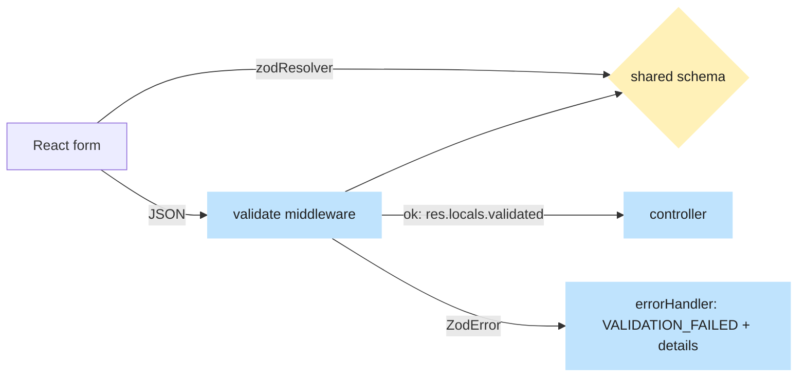

# Validation with Zod

> Written in task V5 from the real code.

## What problem it solves

Anything that arrives from outside, a request body, a query string, even the response the browser receives,
is untrusted text until proven otherwise. TypeScript types vanish at run time, so `body.email` could be a
number, an object or missing. We need one place that says "this is the shape" and that both checks the data
and gives us the type.

## How it works here

A **Zod schema** describes a shape once. It lives in `packages/shared` so the **browser and the API use the
same definition**: the form validates before sending (react-hook-form with `zodResolver`), and the API
validates again because the browser cannot be trusted.

- Schemas: `packages/shared/src/api/auth.ts` (`signupRequestSchema`, `loginRequestSchema`,
  `resetPasswordRequestSchema`, `acceptInviteRequestSchema`, ...). The TypeScript types are inferred from them
  (`z.infer`).
- API: the [validate.ts](https://github.com/RHRONY05/BasaManager/blob/main/apps/api/src/middleware/validate.ts) middleware parses `body`, `query` or
  `params` against a schema and stores the result in `res.locals.validated`; controllers read it with
  `getValidated`. A failure throws a `ZodError`.
- [errorHandler.ts](https://github.com/RHRONY05/BasaManager/blob/main/apps/api/src/middleware/errorHandler.ts) turns a `ZodError` into the standard
  body `{ error: { code: 'VALIDATION_FAILED', message, details: [{path, message}], requestId } }`.
- Web: `apiFetch` can take a `schema` and parses the response, so a wrong server shape fails loudly in one
  place.
- The same schemas feed the generated OpenAPI file (`pnpm openapi`, checked in CI by `pnpm openapi:check`).

Rules that are not shape rules (password strength: 10+ characters, not common) live in
`validatePassword` in [passwords.ts](https://github.com/RHRONY05/BasaManager/blob/main/apps/api/src/lib/passwords.ts) and raise the same
`VALIDATION_FAILED` shape.

## Diagram

## Gotchas

- Client validation is for the user's comfort only. Never remove the server check.
- Validate **before** doing expensive or one-time work. `resetPassword` checks the new password before it
  consumes the token, so a typo does not burn the link.
- Schemas allow what is legal; business rules ("this invite is expired") belong in services.
- `acceptInviteRequestSchema` has optional `fullName` and `password` because a signed-in invitee needs
  neither; `InvitesService.accept` enforces them for brand-new users.
- The schema checks only password length; the common-password check is in the service.

## Where in code

[validate.ts](https://github.com/RHRONY05/BasaManager/blob/main/apps/api/src/middleware/validate.ts), [errorHandler.ts](https://github.com/RHRONY05/BasaManager/blob/main/apps/api/src/middleware/errorHandler.ts),
`packages/shared/src/api/auth.ts`, [auth.routes.ts](https://github.com/RHRONY05/BasaManager/blob/main/apps/api/src/modules/auth/auth.routes.ts) (where `validate` is
stacked), [client.ts](https://github.com/RHRONY05/BasaManager/blob/main/apps/web/src/lib/api/client.ts). Tests: `validate.test.ts`,
`apps/api/test/body-errors.int.test.ts`, "login validates its input" in `login.int.test.ts`.

## Self-check

1. Why validate on both the form and the API?
   

Answer
The form gives fast feedback; the API is the only place that cannot be bypassed (anyone can call it with curl).

2. **What happens if** a request body is not valid JSON or exceeds 100 kb?
   

Answer
The JSON parser rejects it before any route runs and the error handler returns a standard error body (see <code>body-errors.int.test.ts</code>).

3. Where does the TypeScript type `LoginRequest` come from?
   

Answer
It is inferred from <code>loginRequestSchema</code> with <code>z.infer</code>, so the type and the check can never drift apart.

