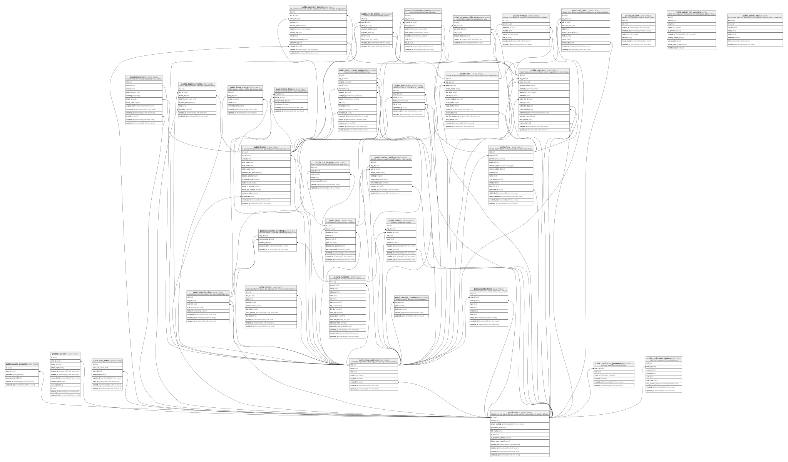

# BasaManager

## Tables

| Name                                                                  | Columns | Comment                                                                         | Type       |
| --------------------------------------------------------------------- | ------- | ------------------------------------------------------------------------------- | ---------- |
| [public.users](public.users.md)                                       | 12      | People who can sign in. Not org-owned (no RLS); anonymised on account deletion. | BASE TABLE |
| [public.oauth_accounts](public.oauth_accounts.md)                     | 6       |                                                                                 | BASE TABLE |
| [public.sessions](public.sessions.md)                                 | 12      |                                                                                 | BASE TABLE |
| [public.auth_tokens](public.auth_tokens.md)                           | 8       |                                                                                 | BASE TABLE |
| [public.organizations](public.organizations.md)                       | 8       | A landlord's organisation. RLS org_self (own org, or admin context).            | BASE TABLE |
| [public.memberships](public.memberships.md)                           | 8       | A user's role in one org. Exactly one active landlord per org.                  | BASE TABLE |
| [public.caretaker_buildings](public.caretaker_buildings.md)           | 5       | Which buildings a caretaker membership may act on.                              | BASE TABLE |
| [public.invitations](public.invitations.md)                           | 13      | Caretaker/tenant invites (hashed single-use token).                             | BASE TABLE |
| [public.buildings](public.buildings.md)                               | 17      | A building with its billing calendar and late-fee rule.                         | BASE TABLE |
| [public.units](public.units.md)                                       | 11      | A rentable flat, room or shop in a building.                                    | BASE TABLE |
| [public.unit_charges](public.unit_charges.md)                         | 7       | Fixed monthly charges of a unit (service, water, gas...).                       | BASE TABLE |
| [public.leases](public.leases.md)                                     | 16      | A tenancy of one unit. One live (pending/active/notice) lease per unit.         | BASE TABLE |
| [public.lease_tenants](public.lease_tenants.md)                       | 6       | Tenant memberships on a lease; one primary.                                     | BASE TABLE |
| [public.lease_charges](public.lease_charges.md)                       | 7       | Fixed charges copied from the unit at lease start.                              | BASE TABLE |
| [public.deposit_entries](public.deposit_entries.md)                   | 9       | Deposit ledger (received, refunded, applied to dues).                           | BASE TABLE |
| [public.meter_readings](public.meter_readings.md)                     | 10      | Monthly submeter readings (period_month = 1st of month).                        | BASE TABLE |
| [public.bills](public.bills.md)                                       | 15      | One bill per lease and month. total = sum of lines, paid = sum of allocations.  | BASE TABLE |
| [public.bill_lines](public.bill_lines.md)                             | 11      | History. Rent, charges, electricity, adjustments, at most one late fee.         | BASE TABLE |
| [public.payments](public.payments.md)                                 | 17      | History (void, never delete). Cash, bKash, Nagad, bank, SSLCommerz.             | BASE TABLE |
| [public.payment_allocations](public.payment_allocations.md)           | 7       | History. How a payment is spread over bills.                                    | BASE TABLE |
| [public.credit_entries](public.credit_entries.md)                     | 9       | History. Lease credit ledger (signed).                                          | BASE TABLE |
| [public.payment_intents](public.payment_intents.md)                   | 13      | SSLCommerz sessions; only the validated IPN or the re-check job changes them.   | BASE TABLE |
| [public.receipt_counters](public.receipt_counters.md)                 | 5       | Gapless receipt sequence per org and year.                                      | BASE TABLE |
| [public.receipts](public.receipts.md)                                 | 8       | History. One receipt per payment, numbered BM-YYYY-NNNNNN.                      | BASE TABLE |
| [public.maintenance_requests](public.maintenance_requests.md)         | 17      | Tenant repair requests and their state.                                         | BASE TABLE |
| [public.maintenance_events](public.maintenance_events.md)             | 11      | History. Append-only request timeline.                                          | BASE TABLE |
| [public.notices](public.notices.md)                                   | 11      | Building notices (soft delete).                                                 | BASE TABLE |
| [public.files](public.files.md)                                       | 16      | Private stored objects (Cloudinary authenticated / local driver).               | BASE TABLE |
| [public.documents](public.documents.md)                               | 8       | Tenant documents. Extra RLS no_caretaker.                                       | BASE TABLE |
| [public.notifications](public.notifications.md)                       | 10      | In-app notifications. RLS own_rows (by app.user_id).                            | BASE TABLE |
| [public.notification_preferences](public.notification_preferences.md) | 6       | Per user, type and channel opt-outs.                                            | BASE TABLE |
| [public.push_subscriptions](public.push_subscriptions.md)             | 9       | Web Push endpoints of a user's devices.                                         | BASE TABLE |
| [public.outbox](public.outbox.md)                                     | 11      | Notification delivery queue. bm_app may only insert; the worker delivers.       | BASE TABLE |
| [public.job_runs](public.job_runs.md)                                 | 8       | Worker job history for the admin health screen.                                 | BASE TABLE |
| [public.admin_org_overview](public.admin_org_overview.md)             | 10      | Admin view. Orgs with counts; rows only when app.is_admin = 'true'.             | VIEW       |
| [public.admin_health](public.admin_health.md)                         | 8       | Admin view. Job runs, failed outbox, flagged/stuck intents; admin context only. | VIEW       |

## Stored procedures and functions

| Name                         | ReturnType | Arguments                          | Type     |
| ---------------------------- | ---------- | ---------------------------------- | -------- |
| public.citextin              | citext     | cstring                            | FUNCTION |
| public.citextout             | cstring    | citext                             | FUNCTION |
| public.citextrecv            | citext     | internal                           | FUNCTION |
| public.citextsend            | bytea      | citext                             | FUNCTION |
| public.citext                | citext     | character                          | FUNCTION |
| public.citext                | citext     | boolean                            | FUNCTION |
| public.citext                | citext     | inet                               | FUNCTION |
| public.citext_eq             | bool       | citext, citext                     | FUNCTION |
| public.citext_ne             | bool       | citext, citext                     | FUNCTION |
| public.citext_lt             | bool       | citext, citext                     | FUNCTION |
| public.citext_le             | bool       | citext, citext                     | FUNCTION |
| public.citext_gt             | bool       | citext, citext                     | FUNCTION |
| public.citext_ge             | bool       | citext, citext                     | FUNCTION |
| public.citext_cmp            | int4       | citext, citext                     | FUNCTION |
| public.citext_hash           | int4       | citext                             | FUNCTION |
| public.citext_smaller        | citext     | citext, citext                     | FUNCTION |
| public.citext_larger         | citext     | citext, citext                     | FUNCTION |
| public.min                   | citext     | citext                             | a        |
| public.max                   | citext     | citext                             | a        |
| public.texticlike            | bool       | citext, citext                     | FUNCTION |
| public.texticnlike           | bool       | citext, citext                     | FUNCTION |
| public.texticregexeq         | bool       | citext, citext                     | FUNCTION |
| public.texticregexne         | bool       | citext, citext                     | FUNCTION |
| public.texticlike            | bool       | citext, text                       | FUNCTION |
| public.texticnlike           | bool       | citext, text                       | FUNCTION |
| public.texticregexeq         | bool       | citext, text                       | FUNCTION |
| public.texticregexne         | bool       | citext, text                       | FUNCTION |
| public.regexp_match          | _text      | citext, citext                     | FUNCTION |
| public.regexp_match          | _text      | citext, citext, text               | FUNCTION |
| public.regexp_matches        | _text      | citext, citext                     | FUNCTION |
| public.regexp_matches        | _text      | citext, citext, text               | FUNCTION |
| public.regexp_replace        | text       | citext, citext, text               | FUNCTION |
| public.regexp_replace        | text       | citext, citext, text, text         | FUNCTION |
| public.regexp_split_to_array | _text      | citext, citext                     | FUNCTION |
| public.regexp_split_to_array | _text      | citext, citext, text               | FUNCTION |
| public.regexp_split_to_table | text       | citext, citext                     | FUNCTION |
| public.regexp_split_to_table | text       | citext, citext, text               | FUNCTION |
| public.strpos                | int4       | citext, citext                     | FUNCTION |
| public.replace               | text       | citext, citext, citext             | FUNCTION |
| public.split_part            | text       | citext, citext, integer            | FUNCTION |
| public.translate             | text       | citext, citext, text               | FUNCTION |
| public.citext_pattern_lt     | bool       | citext, citext                     | FUNCTION |
| public.citext_pattern_le     | bool       | citext, citext                     | FUNCTION |
| public.citext_pattern_gt     | bool       | citext, citext                     | FUNCTION |
| public.citext_pattern_ge     | bool       | citext, citext                     | FUNCTION |
| public.citext_pattern_cmp    | int4       | citext, citext                     | FUNCTION |
| public.citext_hash_extended  | int8       | citext, bigint                     | FUNCTION |
| public.digest                | bytea      | text, text                         | FUNCTION |
| public.digest                | bytea      | bytea, text                        | FUNCTION |
| public.hmac                  | bytea      | text, text, text                   | FUNCTION |
| public.hmac                  | bytea      | bytea, bytea, text                 | FUNCTION |
| public.crypt                 | text       | text, text                         | FUNCTION |
| public.gen_salt              | text       | text                               | FUNCTION |
| public.gen_salt              | text       | text, integer                      | FUNCTION |
| public.encrypt               | bytea      | bytea, bytea, text                 | FUNCTION |
| public.decrypt               | bytea      | bytea, bytea, text                 | FUNCTION |
| public.encrypt_iv            | bytea      | bytea, bytea, bytea, text          | FUNCTION |
| public.decrypt_iv            | bytea      | bytea, bytea, bytea, text          | FUNCTION |
| public.gen_random_bytes      | bytea      | integer                            | FUNCTION |
| public.gen_random_uuid       | uuid       |                                    | FUNCTION |
| public.pgp_sym_encrypt       | bytea      | text, text                         | FUNCTION |
| public.pgp_sym_encrypt_bytea | bytea      | bytea, text                        | FUNCTION |
| public.pgp_sym_encrypt       | bytea      | text, text, text                   | FUNCTION |
| public.pgp_sym_encrypt_bytea | bytea      | bytea, text, text                  | FUNCTION |
| public.pgp_sym_decrypt       | text       | bytea, text                        | FUNCTION |
| public.pgp_sym_decrypt_bytea | bytea      | bytea, text                        | FUNCTION |
| public.pgp_sym_decrypt       | text       | bytea, text, text                  | FUNCTION |
| public.pgp_sym_decrypt_bytea | bytea      | bytea, text, text                  | FUNCTION |
| public.pgp_pub_encrypt       | bytea      | text, bytea                        | FUNCTION |
| public.pgp_pub_encrypt_bytea | bytea      | bytea, bytea                       | FUNCTION |
| public.pgp_pub_encrypt       | bytea      | text, bytea, text                  | FUNCTION |
| public.pgp_pub_encrypt_bytea | bytea      | bytea, bytea, text                 | FUNCTION |
| public.pgp_pub_decrypt       | text       | bytea, bytea                       | FUNCTION |
| public.pgp_pub_decrypt_bytea | bytea      | bytea, bytea                       | FUNCTION |
| public.pgp_pub_decrypt       | text       | bytea, bytea, text                 | FUNCTION |
| public.pgp_pub_decrypt_bytea | bytea      | bytea, bytea, text                 | FUNCTION |
| public.pgp_pub_decrypt       | text       | bytea, bytea, text, text           | FUNCTION |
| public.pgp_pub_decrypt_bytea | bytea      | bytea, bytea, text, text           | FUNCTION |
| public.pgp_key_id            | text       | bytea                              | FUNCTION |
| public.armor                 | text       | bytea                              | FUNCTION |
| public.armor                 | text       | bytea, text[], text[]              | FUNCTION |
| public.dearmor               | bytea      | text                               | FUNCTION |
| public.pgp_armor_headers     | record     | text, OUT key text, OUT value text | FUNCTION |

## Enums

| Name                          | Values                                                                                 |
| ----------------------------- | -------------------------------------------------------------------------------------- |
| public.auth_token_kind        | email_verify, password_reset                                                           |
| public.bill_line_kind         | adjustment, electricity, fixed_charge, late_fee, rent                                  |
| public.bill_status            | draft, issued, paid, partially_paid, void                                              |
| public.credit_entry_kind      | applied, overpayment, reversed                                                         |
| public.deposit_entry_kind     | applied_to_dues, received, refunded                                                    |
| public.document_kind          | agreement, nid_back, nid_front, other                                                  |
| public.electricity_mode       | none, prepaid, submeter                                                                |
| public.file_kind              | document, maintenance_photo, payment_proof, receipt_pdf, settlement_pdf, statement_pdf |
| public.file_provider          | cloudinary, local                                                                      |
| public.file_resource_type     | image, raw                                                                             |
| public.invitation_role        | caretaker, tenant                                                                      |
| public.job_run_status         | failed, ok, skipped                                                                    |
| public.late_fee_type          | flat, none, percent                                                                    |
| public.lease_status           | active, ended, ended_with_dues, notice, pending                                        |
| public.maintenance_category   | cleaning, electrical, gas, lift, other, plumbing, security                             |
| public.maintenance_event_kind | assigned, comment, created, photo, status                                              |
| public.maintenance_priority   | low, normal, urgent                                                                    |
| public.maintenance_status     | assigned, closed, in_progress, open, resolved                                          |
| public.membership_role        | caretaker, landlord, tenant                                                            |
| public.membership_status      | active, removed                                                                        |
| public.notification_channel   | email, in_app, push                                                                    |
| public.oauth_provider         | google                                                                                 |
| public.org_status             | active, suspended                                                                      |
| public.outbox_status          | done, failed, pending, processing                                                      |
| public.payment_intent_status  | cancelled, confirmed, expired, failed, flagged, initiated                              |
| public.payment_method         | bank, bkash, cash, nagad, sslcommerz                                                   |
| public.payment_status         | confirmed, pending_claim, rejected, void                                               |
| public.receipt_status         | valid, void                                                                            |
| public.unit_type              | bachelor_flat, family_flat, room, shop                                                 |

## Relations

---

> Generated by [tbls](https://github.com/k1LoW/tbls)
