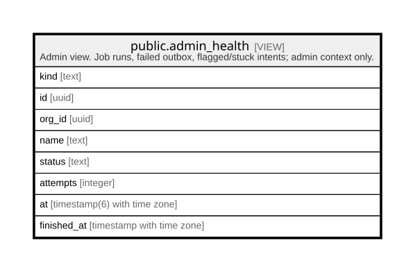

# public.admin_health

## Description

Admin view. Job runs, failed outbox, flagged/stuck intents; admin context only.

<details>
<summary><strong>Table Definition</strong></summary>

```sql
CREATE VIEW admin_health AS (
 SELECT kind,
    id,
    org_id,
    name,
    status,
    attempts,
    at,
    finished_at
   FROM ( SELECT 'job_run'::text AS kind,
            j.id,
            NULL::uuid AS org_id,
            j.job AS name,
            (j.status)::text AS status,
            NULL::integer AS attempts,
            j.started_at AS at,
            j.finished_at
           FROM job_runs j
        UNION ALL
         SELECT 'outbox_failed'::text,
            x.id,
            x.org_id,
            x.type,
            (x.status)::text AS status,
            x.attempts,
            x.updated_at,
            NULL::timestamp with time zone
           FROM outbox x
          WHERE (x.status = 'failed'::outbox_status)
        UNION ALL
         SELECT 'intent_flagged'::text,
            p.id,
            p.org_id,
            'payment_intent'::text,
            (p.status)::text AS status,
            NULL::integer,
            p.updated_at,
            NULL::timestamp with time zone
           FROM payment_intents p
          WHERE (p.status = 'flagged'::payment_intent_status)
        UNION ALL
         SELECT 'intent_stuck'::text,
            p.id,
            p.org_id,
            'payment_intent'::text,
            (p.status)::text AS status,
            NULL::integer,
            p.created_at,
            NULL::timestamp with time zone
           FROM payment_intents p
          WHERE ((p.status = 'initiated'::payment_intent_status) AND (p.created_at < (now() - '00:30:00'::interval)))) h
  WHERE (current_setting('app.is_admin'::text, true) = 'true'::text)
)
```

</details>

## Columns

| Name        | Type                        | Default | Nullable | Children | Parents | Comment |
| ----------- | --------------------------- | ------- | -------- | -------- | ------- | ------- |
| kind        | text                        |         | true     |          |         |         |
| id          | uuid                        |         | true     |          |         |         |
| org_id      | uuid                        |         | true     |          |         |         |
| name        | text                        |         | true     |          |         |         |
| status      | text                        |         | true     |          |         |         |
| attempts    | integer                     |         | true     |          |         |         |
| at          | timestamp(6) with time zone |         | true     |          |         |         |
| finished_at | timestamp with time zone    |         | true     |          |         |         |

## Referenced Tables

| Name                                                | Columns | Comment                                                                       | Type       |
| --------------------------------------------------- | ------- | ----------------------------------------------------------------------------- | ---------- |
| [public.job_runs](public.job_runs.md)               | 8       | Worker job history for the admin health screen.                               | BASE TABLE |
| [public.outbox](public.outbox.md)                   | 11      | Notification delivery queue. bm_app may only insert; the worker delivers.     | BASE TABLE |
| [public.payment_intents](public.payment_intents.md) | 13      | SSLCommerz sessions; only the validated IPN or the re-check job changes them. | BASE TABLE |

## Relations



---

> Generated by [tbls](https://github.com/k1LoW/tbls)
