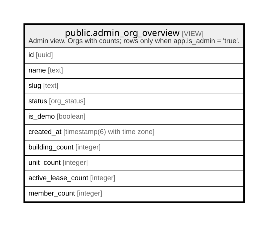

# public.admin_org_overview

## Description

Admin view. Orgs with counts; rows only when app.is_admin = 'true'.

<details>
<summary><strong>Table Definition</strong></summary>

```sql
CREATE VIEW admin_org_overview AS (
 SELECT id,
    name,
    slug,
    status,
    is_demo,
    created_at,
    (( SELECT count(*) AS count
           FROM buildings b
          WHERE ((b.org_id = o.id) AND (b.archived_at IS NULL))))::integer AS building_count,
    (( SELECT count(*) AS count
           FROM units u
          WHERE ((u.org_id = o.id) AND (u.archived_at IS NULL))))::integer AS unit_count,
    (( SELECT count(*) AS count
           FROM leases l
          WHERE ((l.org_id = o.id) AND (l.status = ANY (ARRAY['active'::lease_status, 'notice'::lease_status])))))::integer AS active_lease_count,
    (( SELECT count(*) AS count
           FROM memberships m
          WHERE ((m.org_id = o.id) AND (m.status = 'active'::membership_status))))::integer AS member_count
   FROM organizations o
  WHERE (current_setting('app.is_admin'::text, true) = 'true'::text)
)
```

</details>

## Columns

| Name               | Type                        | Default | Nullable | Children | Parents | Comment |
| ------------------ | --------------------------- | ------- | -------- | -------- | ------- | ------- |
| id                 | uuid                        |         | true     |          |         |         |
| name               | text                        |         | true     |          |         |         |
| slug               | text                        |         | true     |          |         |         |
| status             | org_status                  |         | true     |          |         |         |
| is_demo            | boolean                     |         | true     |          |         |         |
| created_at         | timestamp(6) with time zone |         | true     |          |         |         |
| building_count     | integer                     |         | true     |          |         |         |
| unit_count         | integer                     |         | true     |          |         |         |
| active_lease_count | integer                     |         | true     |          |         |         |
| member_count       | integer                     |         | true     |          |         |         |

## Referenced Tables

| Name                                            | Columns | Comment                                                                 | Type       |
| ----------------------------------------------- | ------- | ----------------------------------------------------------------------- | ---------- |
| [public.buildings](public.buildings.md)         | 17      | A building with its billing calendar and late-fee rule.                 | BASE TABLE |
| [public.units](public.units.md)                 | 11      | A rentable flat, room or shop in a building.                            | BASE TABLE |
| [public.leases](public.leases.md)               | 16      | A tenancy of one unit. One live (pending/active/notice) lease per unit. | BASE TABLE |
| [public.memberships](public.memberships.md)     | 8       | A user's role in one org. Exactly one active landlord per org.          | BASE TABLE |
| [public.organizations](public.organizations.md) | 8       | A landlord's organisation. RLS org_self (own org, or admin context).    | BASE TABLE |

## Relations



---

> Generated by [tbls](https://github.com/k1LoW/tbls)
