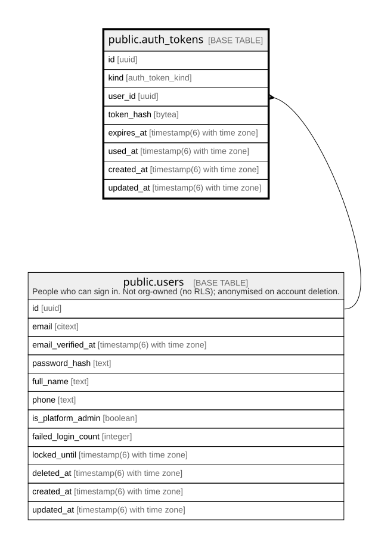

# public.auth_tokens

## Columns

| Name       | Type                        | Default           | Nullable | Children | Parents                         | Comment |
| ---------- | --------------------------- | ----------------- | -------- | -------- | ------------------------------- | ------- |
| id         | uuid                        | gen_random_uuid() | false    |          |                                 |         |
| kind       | auth_token_kind             |                   | false    |          |                                 |         |
| user_id    | uuid                        |                   | false    |          | [public.users](public.users.md) |         |
| token_hash | bytea                       |                   | false    |          |                                 |         |
| expires_at | timestamp(6) with time zone |                   | false    |          |                                 |         |
| used_at    | timestamp(6) with time zone |                   | true     |          |                                 |         |
| created_at | timestamp(6) with time zone | CURRENT_TIMESTAMP | false    |          |                                 |         |
| updated_at | timestamp(6) with time zone | CURRENT_TIMESTAMP | false    |          |                                 |         |

## Constraints

| Name                     | Type        | Definition                                                                     |
| ------------------------ | ----------- | ------------------------------------------------------------------------------ |
| auth_tokens_user_id_fkey | FOREIGN KEY | FOREIGN KEY (user_id) REFERENCES users(id) ON UPDATE CASCADE ON DELETE CASCADE |
| auth_tokens_pkey         | PRIMARY KEY | PRIMARY KEY (id)                                                               |

## Indexes

| Name                       | Definition                                                                                    |
| -------------------------- | --------------------------------------------------------------------------------------------- |
| auth_tokens_pkey           | CREATE UNIQUE INDEX auth_tokens_pkey ON public.auth_tokens USING btree (id)                   |
| auth_tokens_token_hash_key | CREATE UNIQUE INDEX auth_tokens_token_hash_key ON public.auth_tokens USING btree (token_hash) |
| auth_tokens_user_id_idx    | CREATE INDEX auth_tokens_user_id_idx ON public.auth_tokens USING btree (user_id)              |

## Relations

---

> Generated by [tbls](https://github.com/k1LoW/tbls)
