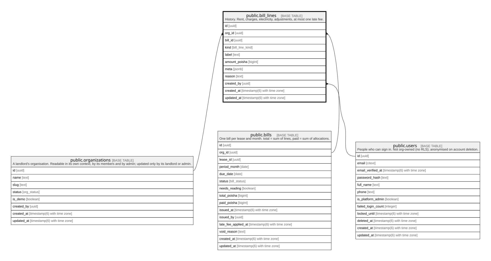

# public.bill_lines

## Description

History. Rent, charges, electricity, adjustments, at most one late fee.

## Columns

| Name          | Type                        | Default           | Nullable | Children | Parents                                                                         | Comment |
| ------------- | --------------------------- | ----------------- | -------- | -------- | ------------------------------------------------------------------------------- | ------- |
| id            | uuid                        | gen_random_uuid() | false    |          |                                                                                 |         |
| org_id        | uuid                        |                   | false    |          | [public.organizations](public.organizations.md) [public.bills](public.bills.md) |         |
| bill_id       | uuid                        |                   | false    |          | [public.bills](public.bills.md)                                                 |         |
| kind          | bill_line_kind              |                   | false    |          |                                                                                 |         |
| label         | text                        |                   | false    |          |                                                                                 |         |
| amount_poisha | bigint                      |                   | false    |          |                                                                                 |         |
| meta          | jsonb                       | '{}'::jsonb       | false    |          |                                                                                 |         |
| reason        | text                        |                   | true     |          |                                                                                 |         |
| created_by    | uuid                        |                   | true     |          | [public.users](public.users.md)                                                 |         |
| created_at    | timestamp(6) with time zone | CURRENT_TIMESTAMP | false    |          |                                                                                 |         |
| updated_at    | timestamp(6) with time zone | CURRENT_TIMESTAMP | false    |          |                                                                                 |         |

## Constraints

| Name                           | Type        | Definition                                                                             |
| ------------------------------ | ----------- | -------------------------------------------------------------------------------------- |
| bill_lines_created_by_fkey     | FOREIGN KEY | FOREIGN KEY (created_by) REFERENCES users(id) ON UPDATE CASCADE ON DELETE SET NULL     |
| bill_lines_org_id_fkey         | FOREIGN KEY | FOREIGN KEY (org_id) REFERENCES organizations(id) ON UPDATE CASCADE ON DELETE RESTRICT |
| bill_lines_pkey                | PRIMARY KEY | PRIMARY KEY (id)                                                                       |
| bill_lines_org_id_bill_id_fkey | FOREIGN KEY | FOREIGN KEY (org_id, bill_id) REFERENCES bills(org_id, id) ON DELETE RESTRICT          |

## Indexes

| Name                      | Definition                                                                                                                               |
| ------------------------- | ---------------------------------------------------------------------------------------------------------------------------------------- |
| bill_lines_pkey           | CREATE UNIQUE INDEX bill_lines_pkey ON public.bill_lines USING btree (id)                                                                |
| bill_lines_bill_id_idx    | CREATE INDEX bill_lines_bill_id_idx ON public.bill_lines USING btree (bill_id)                                                           |
| bill_lines_created_by_idx | CREATE INDEX bill_lines_created_by_idx ON public.bill_lines USING btree (created_by)                                                     |
| bill_lines_one_late_fee   | CREATE UNIQUE INDEX bill_lines_one_late_fee ON public.bill_lines USING btree (org_id, bill_id) WHERE (kind = 'late_fee'::bill_line_kind) |

## Relations

---

> Generated by [tbls](https://github.com/k1LoW/tbls)
