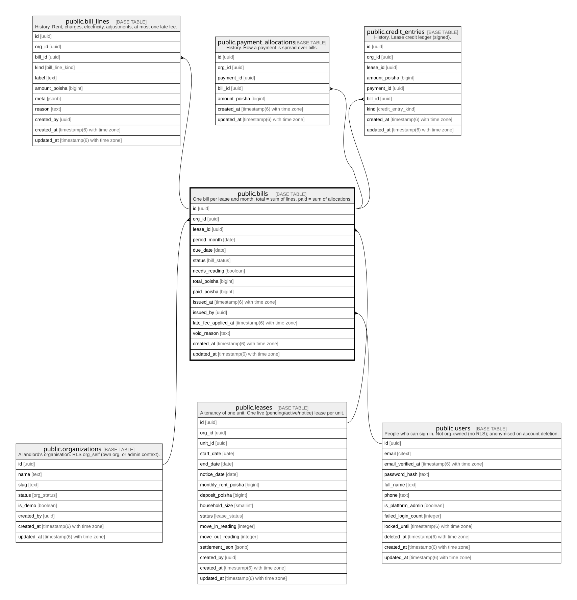

# public.bills

## Description

One bill per lease and month. total = sum of lines, paid = sum of allocations.

## Columns

| Name                | Type                        | Default              | Nullable | Children                                                                                                                                                | Parents                                         | Comment |
| ------------------- | --------------------------- | -------------------- | -------- | ------------------------------------------------------------------------------------------------------------------------------------------------------- | ----------------------------------------------- | ------- |
| id                  | uuid                        | gen_random_uuid()    | false    | [public.bill_lines](public.bill_lines.md) [public.payment_allocations](public.payment_allocations.md) [public.credit_entries](public.credit_entries.md) |                                                 |         |
| org_id              | uuid                        |                      | false    |                                                                                                                                                         | [public.organizations](public.organizations.md) |         |
| lease_id            | uuid                        |                      | false    |                                                                                                                                                         | [public.leases](public.leases.md)               |         |
| period_month        | date                        |                      | false    |                                                                                                                                                         |                                                 |         |
| due_date            | date                        |                      | false    |                                                                                                                                                         |                                                 |         |
| status              | bill_status                 | 'draft'::bill_status | false    |                                                                                                                                                         |                                                 |         |
| needs_reading       | boolean                     | false                | false    |                                                                                                                                                         |                                                 |         |
| total_poisha        | bigint                      | 0                    | false    |                                                                                                                                                         |                                                 |         |
| paid_poisha         | bigint                      | 0                    | false    |                                                                                                                                                         |                                                 |         |
| issued_at           | timestamp(6) with time zone |                      | true     |                                                                                                                                                         |                                                 |         |
| issued_by           | uuid                        |                      | true     |                                                                                                                                                         | [public.users](public.users.md)                 |         |
| late_fee_applied_at | timestamp(6) with time zone |                      | true     |                                                                                                                                                         |                                                 |         |
| void_reason         | text                        |                      | true     |                                                                                                                                                         |                                                 |         |
| created_at          | timestamp(6) with time zone | CURRENT_TIMESTAMP    | false    |                                                                                                                                                         |                                                 |         |
| updated_at          | timestamp(6) with time zone | CURRENT_TIMESTAMP    | false    |                                                                                                                                                         |                                                 |         |

## Constraints

| Name                       | Type        | Definition                                                                                           |
| -------------------------- | ----------- | ---------------------------------------------------------------------------------------------------- |
| bills_paid_check           | CHECK       | CHECK ((paid_poisha >= 0))                                                                           |
| bills_paid_lte_total_check | CHECK       | CHECK ((paid_poisha <= total_poisha))                                                                |
| bills_period_month_check   | CHECK       | CHECK ((period_month = (date_trunc('month'::text, (period_month)::timestamp with time zone))::date)) |
| bills_total_check          | CHECK       | CHECK ((total_poisha >= 0))                                                                          |
| bills_issued_by_fkey       | FOREIGN KEY | FOREIGN KEY (issued_by) REFERENCES users(id) ON UPDATE CASCADE ON DELETE SET NULL                    |
| bills_org_id_fkey          | FOREIGN KEY | FOREIGN KEY (org_id) REFERENCES organizations(id) ON UPDATE CASCADE ON DELETE RESTRICT               |
| bills_lease_id_fkey        | FOREIGN KEY | FOREIGN KEY (lease_id) REFERENCES leases(id) ON UPDATE CASCADE ON DELETE RESTRICT                    |
| bills_pkey                 | PRIMARY KEY | PRIMARY KEY (id)                                                                                     |

## Indexes

| Name                             | Definition                                                                                               |
| -------------------------------- | -------------------------------------------------------------------------------------------------------- |
| bills_pkey                       | CREATE UNIQUE INDEX bills_pkey ON public.bills USING btree (id)                                          |
| bills_org_id_status_due_date_idx | CREATE INDEX bills_org_id_status_due_date_idx ON public.bills USING btree (org_id, status, due_date)     |
| bills_issued_by_idx              | CREATE INDEX bills_issued_by_idx ON public.bills USING btree (issued_by)                                 |
| bills_lease_id_period_month_key  | CREATE UNIQUE INDEX bills_lease_id_period_month_key ON public.bills USING btree (lease_id, period_month) |

## Relations

---

> Generated by [tbls](https://github.com/k1LoW/tbls)
