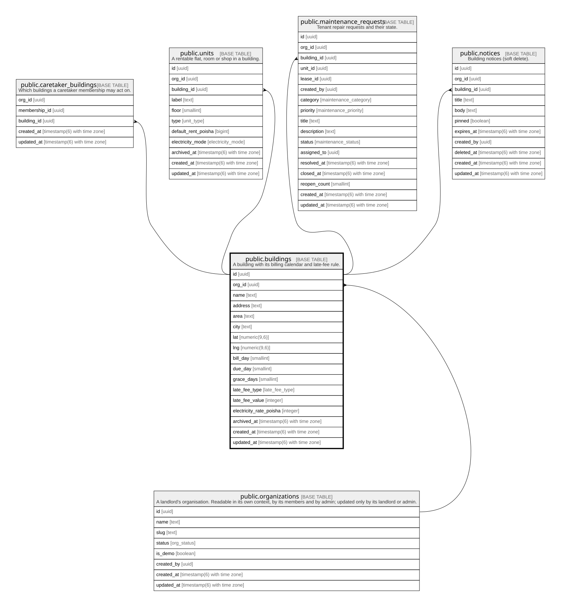

# public.buildings

## Description

A building with its billing calendar and late-fee rule.

## Columns

| Name                    | Type                        | Default               | Nullable | Children                                                                                                                                                                                      | Parents                                         | Comment |
| ----------------------- | --------------------------- | --------------------- | -------- | --------------------------------------------------------------------------------------------------------------------------------------------------------------------------------------------- | ----------------------------------------------- | ------- |
| id                      | uuid                        | gen_random_uuid()     | false    | [public.caretaker_buildings](public.caretaker_buildings.md) [public.units](public.units.md) [public.maintenance_requests](public.maintenance_requests.md) [public.notices](public.notices.md) |                                                 |         |
| org_id                  | uuid                        |                       | false    | [public.caretaker_buildings](public.caretaker_buildings.md) [public.units](public.units.md) [public.maintenance_requests](public.maintenance_requests.md) [public.notices](public.notices.md) | [public.organizations](public.organizations.md) |         |
| name                    | text                        |                       | false    |                                                                                                                                                                                               |                                                 |         |
| address                 | text                        |                       | false    |                                                                                                                                                                                               |                                                 |         |
| area                    | text                        |                       | false    |                                                                                                                                                                                               |                                                 |         |
| city                    | text                        |                       | false    |                                                                                                                                                                                               |                                                 |         |
| lat                     | numeric(9,6)                |                       | true     |                                                                                                                                                                                               |                                                 |         |
| lng                     | numeric(9,6)                |                       | true     |                                                                                                                                                                                               |                                                 |         |
| bill_day                | smallint                    | 1                     | false    |                                                                                                                                                                                               |                                                 |         |
| due_day                 | smallint                    | 10                    | false    |                                                                                                                                                                                               |                                                 |         |
| grace_days              | smallint                    | 0                     | false    |                                                                                                                                                                                               |                                                 |         |
| late_fee_type           | late_fee_type               | 'none'::late_fee_type | false    |                                                                                                                                                                                               |                                                 |         |
| late_fee_value          | integer                     | 0                     | false    |                                                                                                                                                                                               |                                                 |         |
| electricity_rate_poisha | integer                     | 0                     | false    |                                                                                                                                                                                               |                                                 |         |
| archived_at             | timestamp(6) with time zone |                       | true     |                                                                                                                                                                                               |                                                 |         |
| created_at              | timestamp(6) with time zone | CURRENT_TIMESTAMP     | false    |                                                                                                                                                                                               |                                                 |         |
| updated_at              | timestamp(6) with time zone | CURRENT_TIMESTAMP     | false    |                                                                                                                                                                                               |                                                 |         |

## Constraints

| Name                             | Type        | Definition                                                                             |
| -------------------------------- | ----------- | -------------------------------------------------------------------------------------- |
| buildings_bill_day_check         | CHECK       | CHECK (((bill_day >= 1) AND (bill_day <= 28)))                                         |
| buildings_due_day_check          | CHECK       | CHECK (((due_day >= 1) AND (due_day <= 28)))                                           |
| buildings_electricity_rate_check | CHECK       | CHECK ((electricity_rate_poisha >= 0))                                                 |
| buildings_grace_days_check       | CHECK       | CHECK (((grace_days >= 0) AND (grace_days <= 15)))                                     |
| buildings_late_fee_value_check   | CHECK       | CHECK ((late_fee_value >= 0))                                                          |
| buildings_org_id_fkey            | FOREIGN KEY | FOREIGN KEY (org_id) REFERENCES organizations(id) ON UPDATE CASCADE ON DELETE RESTRICT |
| buildings_pkey                   | PRIMARY KEY | PRIMARY KEY (id)                                                                       |

## Indexes

| Name                    | Definition                                                                               |
| ----------------------- | ---------------------------------------------------------------------------------------- |
| buildings_pkey          | CREATE UNIQUE INDEX buildings_pkey ON public.buildings USING btree (id)                  |
| buildings_org_id_idx    | CREATE INDEX buildings_org_id_idx ON public.buildings USING btree (org_id)               |
| buildings_org_id_id_key | CREATE UNIQUE INDEX buildings_org_id_id_key ON public.buildings USING btree (org_id, id) |

## Relations

---

> Generated by [tbls](https://github.com/k1LoW/tbls)
