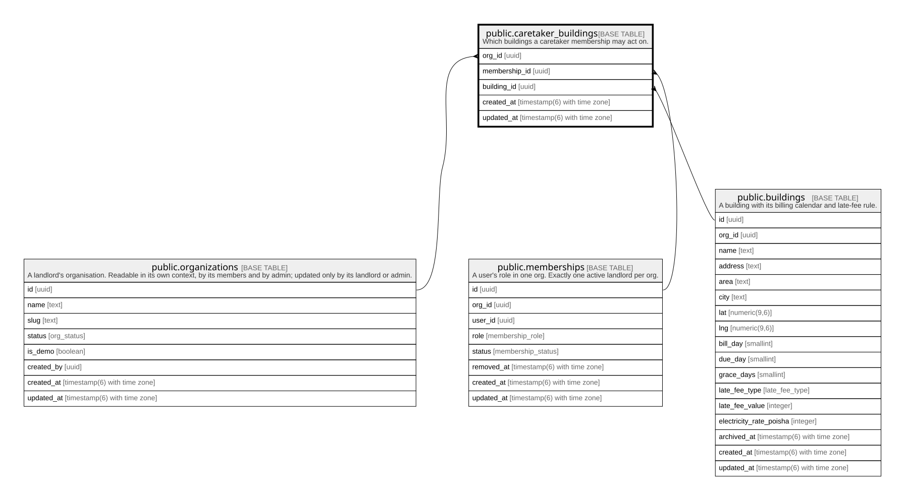

# public.caretaker_buildings

## Description

Which buildings a caretaker membership may act on.

## Columns

| Name          | Type                        | Default           | Nullable | Children | Parents                                                                                                                             | Comment |
| ------------- | --------------------------- | ----------------- | -------- | -------- | ----------------------------------------------------------------------------------------------------------------------------------- | ------- |
| org_id        | uuid                        |                   | false    |          | [public.organizations](public.organizations.md) [public.memberships](public.memberships.md) [public.buildings](public.buildings.md) |         |
| membership_id | uuid                        |                   | false    |          | [public.memberships](public.memberships.md)                                                                                         |         |
| building_id   | uuid                        |                   | false    |          | [public.buildings](public.buildings.md)                                                                                             |         |
| created_at    | timestamp(6) with time zone | CURRENT_TIMESTAMP | false    |          |                                                                                                                                     |         |
| updated_at    | timestamp(6) with time zone | CURRENT_TIMESTAMP | false    |          |                                                                                                                                     |         |

## Constraints

| Name                                          | Type        | Definition                                                                                                 |
| --------------------------------------------- | ----------- | ---------------------------------------------------------------------------------------------------------- |
| caretaker_buildings_org_id_fkey               | FOREIGN KEY | FOREIGN KEY (org_id) REFERENCES organizations(id) ON UPDATE CASCADE ON DELETE RESTRICT                     |
| caretaker_buildings_pkey                      | PRIMARY KEY | PRIMARY KEY (membership_id, building_id)                                                                   |
| caretaker_buildings_org_id_membership_id_fkey | FOREIGN KEY | FOREIGN KEY (org_id, membership_id) REFERENCES memberships(org_id, id) ON UPDATE CASCADE ON DELETE CASCADE |
| caretaker_buildings_org_id_building_id_fkey   | FOREIGN KEY | FOREIGN KEY (org_id, building_id) REFERENCES buildings(org_id, id) ON UPDATE CASCADE ON DELETE CASCADE     |

## Indexes

| Name                                | Definition                                                                                                          |
| ----------------------------------- | ------------------------------------------------------------------------------------------------------------------- |
| caretaker_buildings_pkey            | CREATE UNIQUE INDEX caretaker_buildings_pkey ON public.caretaker_buildings USING btree (membership_id, building_id) |
| caretaker_buildings_org_id_idx      | CREATE INDEX caretaker_buildings_org_id_idx ON public.caretaker_buildings USING btree (org_id)                      |
| caretaker_buildings_building_id_idx | CREATE INDEX caretaker_buildings_building_id_idx ON public.caretaker_buildings USING btree (building_id)            |

## Relations

---

> Generated by [tbls](https://github.com/k1LoW/tbls)
