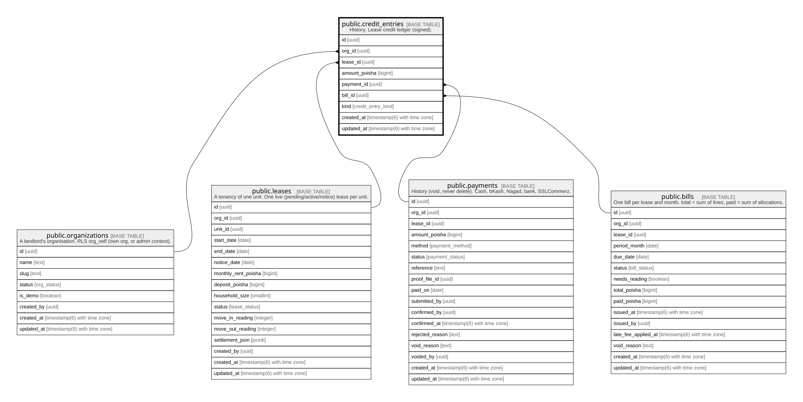

# public.credit_entries

## Description

History. Lease credit ledger (signed).

## Columns

| Name          | Type                        | Default           | Nullable | Children | Parents                                                                                                                                                 | Comment |
| ------------- | --------------------------- | ----------------- | -------- | -------- | ------------------------------------------------------------------------------------------------------------------------------------------------------- | ------- |
| id            | uuid                        | gen_random_uuid() | false    |          |                                                                                                                                                         |         |
| org_id        | uuid                        |                   | false    |          | [public.organizations](public.organizations.md) [public.leases](public.leases.md) [public.bills](public.bills.md) [public.payments](public.payments.md) |         |
| lease_id      | uuid                        |                   | false    |          | [public.leases](public.leases.md)                                                                                                                       |         |
| amount_poisha | bigint                      |                   | false    |          |                                                                                                                                                         |         |
| payment_id    | uuid                        |                   | true     |          | [public.payments](public.payments.md)                                                                                                                   |         |
| bill_id       | uuid                        |                   | true     |          | [public.bills](public.bills.md)                                                                                                                         |         |
| kind          | credit_entry_kind           |                   | false    |          |                                                                                                                                                         |         |
| created_at    | timestamp(6) with time zone | CURRENT_TIMESTAMP | false    |          |                                                                                                                                                         |         |
| updated_at    | timestamp(6) with time zone | CURRENT_TIMESTAMP | false    |          |                                                                                                                                                         |         |

## Constraints

| Name                                  | Type        | Definition                                                                                            |
| ------------------------------------- | ----------- | ----------------------------------------------------------------------------------------------------- |
| credit_entries_org_id_fkey            | FOREIGN KEY | FOREIGN KEY (org_id) REFERENCES organizations(id) ON UPDATE CASCADE ON DELETE RESTRICT                |
| credit_entries_pkey                   | PRIMARY KEY | PRIMARY KEY (id)                                                                                      |
| credit_entries_org_id_lease_id_fkey   | FOREIGN KEY | FOREIGN KEY (org_id, lease_id) REFERENCES leases(org_id, id) ON UPDATE CASCADE ON DELETE RESTRICT     |
| credit_entries_org_id_bill_id_fkey    | FOREIGN KEY | FOREIGN KEY (org_id, bill_id) REFERENCES bills(org_id, id) ON UPDATE CASCADE ON DELETE RESTRICT       |
| credit_entries_org_id_payment_id_fkey | FOREIGN KEY | FOREIGN KEY (org_id, payment_id) REFERENCES payments(org_id, id) ON UPDATE CASCADE ON DELETE RESTRICT |

## Indexes

| Name                          | Definition                                                                                   |
| ----------------------------- | -------------------------------------------------------------------------------------------- |
| credit_entries_pkey           | CREATE UNIQUE INDEX credit_entries_pkey ON public.credit_entries USING btree (id)            |
| credit_entries_org_id_idx     | CREATE INDEX credit_entries_org_id_idx ON public.credit_entries USING btree (org_id)         |
| credit_entries_lease_id_idx   | CREATE INDEX credit_entries_lease_id_idx ON public.credit_entries USING btree (lease_id)     |
| credit_entries_payment_id_idx | CREATE INDEX credit_entries_payment_id_idx ON public.credit_entries USING btree (payment_id) |
| credit_entries_bill_id_idx    | CREATE INDEX credit_entries_bill_id_idx ON public.credit_entries USING btree (bill_id)       |

## Relations

---

> Generated by [tbls](https://github.com/k1LoW/tbls)
