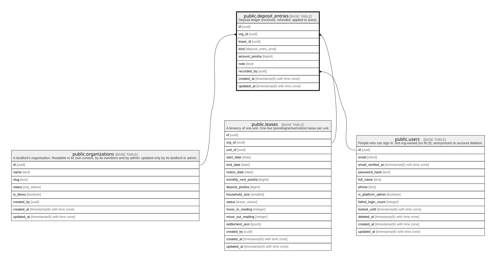

# public.deposit_entries

## Description

Deposit ledger (received, refunded, applied to dues).

## Columns

| Name          | Type                        | Default           | Nullable | Children | Parents                                                                           | Comment |
| ------------- | --------------------------- | ----------------- | -------- | -------- | --------------------------------------------------------------------------------- | ------- |
| id            | uuid                        | gen_random_uuid() | false    |          |                                                                                   |         |
| org_id        | uuid                        |                   | false    |          | [public.organizations](public.organizations.md) [public.leases](public.leases.md) |         |
| lease_id      | uuid                        |                   | false    |          | [public.leases](public.leases.md)                                                 |         |
| kind          | deposit_entry_kind          |                   | false    |          |                                                                                   |         |
| amount_poisha | bigint                      |                   | false    |          |                                                                                   |         |
| note          | text                        |                   | true     |          |                                                                                   |         |
| recorded_by   | uuid                        |                   | false    |          | [public.users](public.users.md)                                                   |         |
| created_at    | timestamp(6) with time zone | CURRENT_TIMESTAMP | false    |          |                                                                                   |         |
| updated_at    | timestamp(6) with time zone | CURRENT_TIMESTAMP | false    |          |                                                                                   |         |

## Constraints

| Name                                 | Type        | Definition                                                                             |
| ------------------------------------ | ----------- | -------------------------------------------------------------------------------------- |
| deposit_entries_amount_check         | CHECK       | CHECK ((amount_poisha >= 0))                                                           |
| deposit_entries_recorded_by_fkey     | FOREIGN KEY | FOREIGN KEY (recorded_by) REFERENCES users(id) ON UPDATE CASCADE ON DELETE RESTRICT    |
| deposit_entries_org_id_fkey          | FOREIGN KEY | FOREIGN KEY (org_id) REFERENCES organizations(id) ON UPDATE CASCADE ON DELETE RESTRICT |
| deposit_entries_pkey                 | PRIMARY KEY | PRIMARY KEY (id)                                                                       |
| deposit_entries_org_id_lease_id_fkey | FOREIGN KEY | FOREIGN KEY (org_id, lease_id) REFERENCES leases(org_id, id) ON DELETE RESTRICT        |

## Indexes

| Name                            | Definition                                                                                       |
| ------------------------------- | ------------------------------------------------------------------------------------------------ |
| deposit_entries_pkey            | CREATE UNIQUE INDEX deposit_entries_pkey ON public.deposit_entries USING btree (id)              |
| deposit_entries_org_id_idx      | CREATE INDEX deposit_entries_org_id_idx ON public.deposit_entries USING btree (org_id)           |
| deposit_entries_lease_id_idx    | CREATE INDEX deposit_entries_lease_id_idx ON public.deposit_entries USING btree (lease_id)       |
| deposit_entries_recorded_by_idx | CREATE INDEX deposit_entries_recorded_by_idx ON public.deposit_entries USING btree (recorded_by) |

## Relations

---

> Generated by [tbls](https://github.com/k1LoW/tbls)
