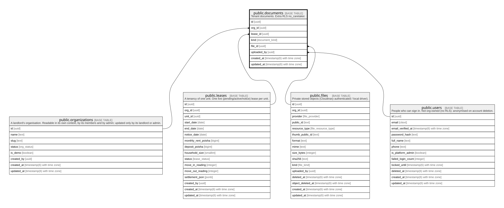

# public.documents

## Description

Tenant documents. Extra RLS no_caretaker.

## Columns

| Name        | Type                        | Default           | Nullable | Children | Parents                                                                                                           | Comment |
| ----------- | --------------------------- | ----------------- | -------- | -------- | ----------------------------------------------------------------------------------------------------------------- | ------- |
| id          | uuid                        | gen_random_uuid() | false    |          |                                                                                                                   |         |
| org_id      | uuid                        |                   | false    |          | [public.organizations](public.organizations.md) [public.leases](public.leases.md) [public.files](public.files.md) |         |
| lease_id    | uuid                        |                   | false    |          | [public.leases](public.leases.md)                                                                                 |         |
| kind        | document_kind               |                   | false    |          |                                                                                                                   |         |
| file_id     | uuid                        |                   | false    |          | [public.files](public.files.md)                                                                                   |         |
| uploaded_by | uuid                        |                   | false    |          | [public.users](public.users.md)                                                                                   |         |
| created_at  | timestamp(6) with time zone | CURRENT_TIMESTAMP | false    |          |                                                                                                                   |         |
| updated_at  | timestamp(6) with time zone | CURRENT_TIMESTAMP | false    |          |                                                                                                                   |         |

## Constraints

| Name                           | Type        | Definition                                                                             |
| ------------------------------ | ----------- | -------------------------------------------------------------------------------------- |
| documents_uploaded_by_fkey     | FOREIGN KEY | FOREIGN KEY (uploaded_by) REFERENCES users(id) ON UPDATE CASCADE ON DELETE RESTRICT    |
| documents_org_id_fkey          | FOREIGN KEY | FOREIGN KEY (org_id) REFERENCES organizations(id) ON UPDATE CASCADE ON DELETE RESTRICT |
| documents_pkey                 | PRIMARY KEY | PRIMARY KEY (id)                                                                       |
| documents_org_id_lease_id_fkey | FOREIGN KEY | FOREIGN KEY (org_id, lease_id) REFERENCES leases(org_id, id) ON DELETE RESTRICT        |
| documents_org_id_file_id_fkey  | FOREIGN KEY | FOREIGN KEY (org_id, file_id) REFERENCES files(org_id, id) ON DELETE RESTRICT          |

## Indexes

| Name                      | Definition                                                                           |
| ------------------------- | ------------------------------------------------------------------------------------ |
| documents_pkey            | CREATE UNIQUE INDEX documents_pkey ON public.documents USING btree (id)              |
| documents_org_id_idx      | CREATE INDEX documents_org_id_idx ON public.documents USING btree (org_id)           |
| documents_lease_id_idx    | CREATE INDEX documents_lease_id_idx ON public.documents USING btree (lease_id)       |
| documents_file_id_idx     | CREATE INDEX documents_file_id_idx ON public.documents USING btree (file_id)         |
| documents_uploaded_by_idx | CREATE INDEX documents_uploaded_by_idx ON public.documents USING btree (uploaded_by) |

## Relations

---

> Generated by [tbls](https://github.com/k1LoW/tbls)
