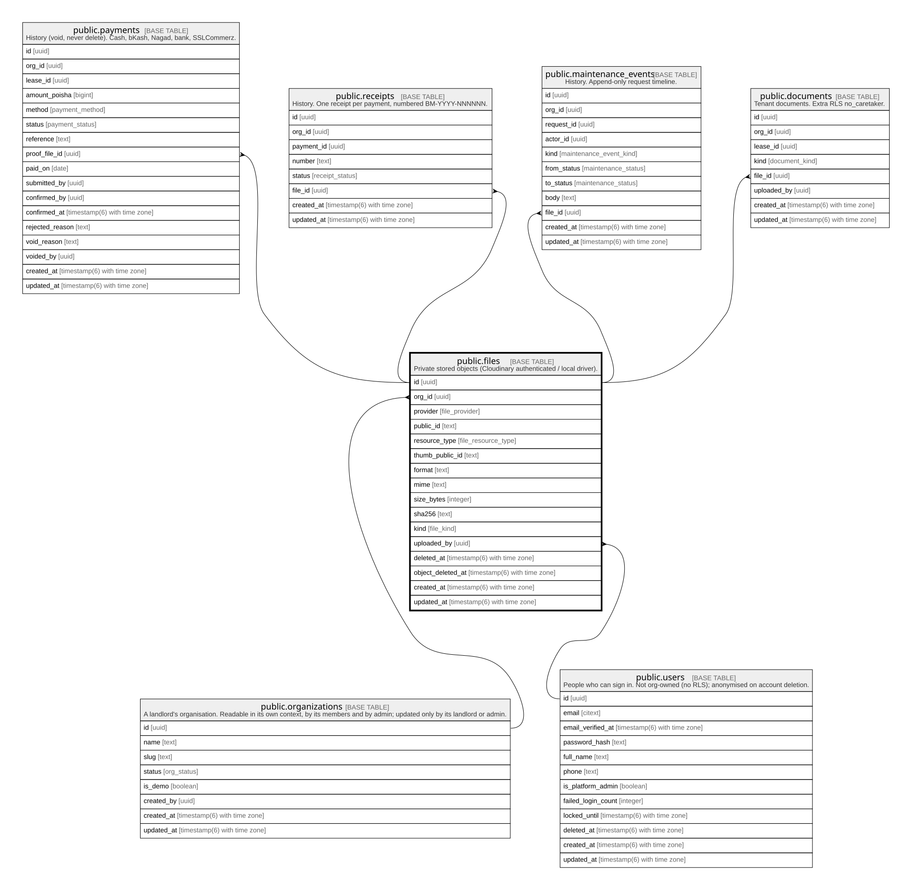

# public.files

## Description

Private stored objects (Cloudinary authenticated / local driver).

## Columns

| Name              | Type                        | Default           | Nullable | Children                                                                                                                                                                      | Parents                                         | Comment |
| ----------------- | --------------------------- | ----------------- | -------- | ----------------------------------------------------------------------------------------------------------------------------------------------------------------------------- | ----------------------------------------------- | ------- |
| id                | uuid                        | gen_random_uuid() | false    | [public.payments](public.payments.md) [public.receipts](public.receipts.md) [public.maintenance_events](public.maintenance_events.md) [public.documents](public.documents.md) |                                                 |         |
| org_id            | uuid                        |                   | false    | [public.payments](public.payments.md) [public.receipts](public.receipts.md) [public.maintenance_events](public.maintenance_events.md) [public.documents](public.documents.md) | [public.organizations](public.organizations.md) |         |
| provider          | file_provider               |                   | false    |                                                                                                                                                                               |                                                 |         |
| public_id         | text                        |                   | false    |                                                                                                                                                                               |                                                 |         |
| resource_type     | file_resource_type          |                   | false    |                                                                                                                                                                               |                                                 |         |
| thumb_public_id   | text                        |                   | true     |                                                                                                                                                                               |                                                 |         |
| format            | text                        |                   | false    |                                                                                                                                                                               |                                                 |         |
| mime              | text                        |                   | false    |                                                                                                                                                                               |                                                 |         |
| size_bytes        | integer                     |                   | false    |                                                                                                                                                                               |                                                 |         |
| sha256            | text                        |                   | false    |                                                                                                                                                                               |                                                 |         |
| kind              | file_kind                   |                   | false    |                                                                                                                                                                               |                                                 |         |
| uploaded_by       | uuid                        |                   | true     |                                                                                                                                                                               | [public.users](public.users.md)                 |         |
| deleted_at        | timestamp(6) with time zone |                   | true     |                                                                                                                                                                               |                                                 |         |
| object_deleted_at | timestamp(6) with time zone |                   | true     |                                                                                                                                                                               |                                                 |         |
| created_at        | timestamp(6) with time zone | CURRENT_TIMESTAMP | false    |                                                                                                                                                                               |                                                 |         |
| updated_at        | timestamp(6) with time zone | CURRENT_TIMESTAMP | false    |                                                                                                                                                                               |                                                 |         |

## Constraints

| Name                   | Type        | Definition                                                                             |
| ---------------------- | ----------- | -------------------------------------------------------------------------------------- |
| files_size_bytes_check | CHECK       | CHECK ((size_bytes >= 0))                                                              |
| files_uploaded_by_fkey | FOREIGN KEY | FOREIGN KEY (uploaded_by) REFERENCES users(id) ON UPDATE CASCADE ON DELETE SET NULL    |
| files_org_id_fkey      | FOREIGN KEY | FOREIGN KEY (org_id) REFERENCES organizations(id) ON UPDATE CASCADE ON DELETE RESTRICT |
| files_pkey             | PRIMARY KEY | PRIMARY KEY (id)                                                                       |

## Indexes

| Name                  | Definition                                                                       |
| --------------------- | -------------------------------------------------------------------------------- |
| files_pkey            | CREATE UNIQUE INDEX files_pkey ON public.files USING btree (id)                  |
| files_public_id_key   | CREATE UNIQUE INDEX files_public_id_key ON public.files USING btree (public_id)  |
| files_org_id_idx      | CREATE INDEX files_org_id_idx ON public.files USING btree (org_id)               |
| files_uploaded_by_idx | CREATE INDEX files_uploaded_by_idx ON public.files USING btree (uploaded_by)     |
| files_org_id_id_key   | CREATE UNIQUE INDEX files_org_id_id_key ON public.files USING btree (org_id, id) |

## Relations

---

> Generated by [tbls](https://github.com/k1LoW/tbls)
