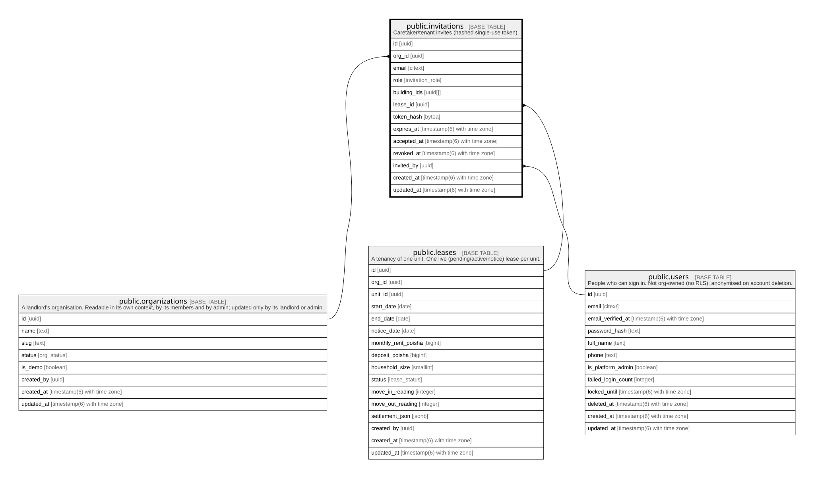

# public.invitations

## Description

Caretaker/tenant invites (hashed single-use token).

## Columns

| Name         | Type                        | Default           | Nullable | Children | Parents                                         | Comment |
| ------------ | --------------------------- | ----------------- | -------- | -------- | ----------------------------------------------- | ------- |
| id           | uuid                        | gen_random_uuid() | false    |          |                                                 |         |
| org_id       | uuid                        |                   | false    |          | [public.organizations](public.organizations.md) |         |
| email        | citext                      |                   | false    |          |                                                 |         |
| role         | invitation_role             |                   | false    |          |                                                 |         |
| building_ids | uuid[]                      | ARRAY[]::uuid[]   | true     |          |                                                 |         |
| lease_id     | uuid                        |                   | true     |          | [public.leases](public.leases.md)               |         |
| token_hash   | bytea                       |                   | false    |          |                                                 |         |
| expires_at   | timestamp(6) with time zone |                   | false    |          |                                                 |         |
| accepted_at  | timestamp(6) with time zone |                   | true     |          |                                                 |         |
| revoked_at   | timestamp(6) with time zone |                   | true     |          |                                                 |         |
| invited_by   | uuid                        |                   | false    |          | [public.users](public.users.md)                 |         |
| created_at   | timestamp(6) with time zone | CURRENT_TIMESTAMP | false    |          |                                                 |         |
| updated_at   | timestamp(6) with time zone | CURRENT_TIMESTAMP | false    |          |                                                 |         |

## Constraints

| Name                        | Type        | Definition                                                                             |
| --------------------------- | ----------- | -------------------------------------------------------------------------------------- |
| invitations_invited_by_fkey | FOREIGN KEY | FOREIGN KEY (invited_by) REFERENCES users(id) ON UPDATE CASCADE ON DELETE RESTRICT     |
| invitations_org_id_fkey     | FOREIGN KEY | FOREIGN KEY (org_id) REFERENCES organizations(id) ON UPDATE CASCADE ON DELETE RESTRICT |
| invitations_pkey            | PRIMARY KEY | PRIMARY KEY (id)                                                                       |
| invitations_lease_id_fkey   | FOREIGN KEY | FOREIGN KEY (lease_id) REFERENCES leases(id) ON UPDATE CASCADE ON DELETE SET NULL      |

## Indexes

| Name                           | Definition                                                                                                                                                        |
| ------------------------------ | ----------------------------------------------------------------------------------------------------------------------------------------------------------------- |
| invitations_pkey               | CREATE UNIQUE INDEX invitations_pkey ON public.invitations USING btree (id)                                                                                       |
| invitations_token_hash_key     | CREATE UNIQUE INDEX invitations_token_hash_key ON public.invitations USING btree (token_hash)                                                                     |
| invitations_org_id_idx         | CREATE INDEX invitations_org_id_idx ON public.invitations USING btree (org_id)                                                                                    |
| invitations_lease_id_idx       | CREATE INDEX invitations_lease_id_idx ON public.invitations USING btree (lease_id)                                                                                |
| invitations_invited_by_idx     | CREATE INDEX invitations_invited_by_idx ON public.invitations USING btree (invited_by)                                                                            |
| invitations_one_open_per_email | CREATE UNIQUE INDEX invitations_one_open_per_email ON public.invitations USING btree (org_id, email, role) WHERE ((accepted_at IS NULL) AND (revoked_at IS NULL)) |

## Relations

---

> Generated by [tbls](https://github.com/k1LoW/tbls)
