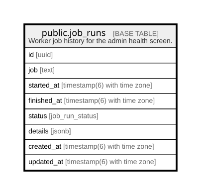

# public.job_runs

## Description

Worker job history for the admin health screen.

## Columns

| Name        | Type                        | Default           | Nullable | Children | Parents | Comment |
| ----------- | --------------------------- | ----------------- | -------- | -------- | ------- | ------- |
| id          | uuid                        | gen_random_uuid() | false    |          |         |         |
| job         | text                        |                   | false    |          |         |         |
| started_at  | timestamp(6) with time zone | CURRENT_TIMESTAMP | false    |          |         |         |
| finished_at | timestamp(6) with time zone |                   | true     |          |         |         |
| status      | job_run_status              |                   | true     |          |         |         |
| details     | jsonb                       |                   | true     |          |         |         |
| created_at  | timestamp(6) with time zone | CURRENT_TIMESTAMP | false    |          |         |         |
| updated_at  | timestamp(6) with time zone | CURRENT_TIMESTAMP | false    |          |         |         |

## Constraints

| Name          | Type        | Definition       |
| ------------- | ----------- | ---------------- |
| job_runs_pkey | PRIMARY KEY | PRIMARY KEY (id) |

## Indexes

| Name                        | Definition                                                                                     |
| --------------------------- | ---------------------------------------------------------------------------------------------- |
| job_runs_pkey               | CREATE UNIQUE INDEX job_runs_pkey ON public.job_runs USING btree (id)                          |
| job_runs_job_started_at_idx | CREATE INDEX job_runs_job_started_at_idx ON public.job_runs USING btree (job, started_at DESC) |

## Relations

---

> Generated by [tbls](https://github.com/k1LoW/tbls)
