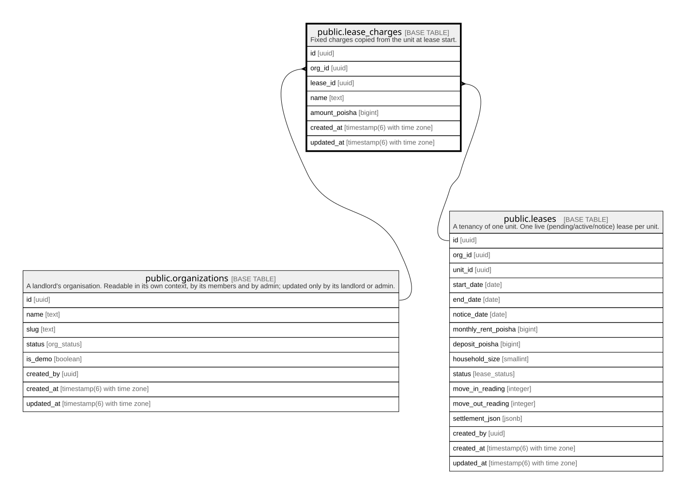

# public.lease_charges

## Description

Fixed charges copied from the unit at lease start.

## Columns

| Name          | Type                        | Default           | Nullable | Children | Parents                                                                           | Comment |
| ------------- | --------------------------- | ----------------- | -------- | -------- | --------------------------------------------------------------------------------- | ------- |
| id            | uuid                        | gen_random_uuid() | false    |          |                                                                                   |         |
| org_id        | uuid                        |                   | false    |          | [public.organizations](public.organizations.md) [public.leases](public.leases.md) |         |
| lease_id      | uuid                        |                   | false    |          | [public.leases](public.leases.md)                                                 |         |
| name          | text                        |                   | false    |          |                                                                                   |         |
| amount_poisha | bigint                      |                   | false    |          |                                                                                   |         |
| created_at    | timestamp(6) with time zone | CURRENT_TIMESTAMP | false    |          |                                                                                   |         |
| updated_at    | timestamp(6) with time zone | CURRENT_TIMESTAMP | false    |          |                                                                                   |         |

## Constraints

| Name                               | Type        | Definition                                                                                       |
| ---------------------------------- | ----------- | ------------------------------------------------------------------------------------------------ |
| lease_charges_amount_check         | CHECK       | CHECK ((amount_poisha >= 0))                                                                     |
| lease_charges_org_id_fkey          | FOREIGN KEY | FOREIGN KEY (org_id) REFERENCES organizations(id) ON UPDATE CASCADE ON DELETE RESTRICT           |
| lease_charges_pkey                 | PRIMARY KEY | PRIMARY KEY (id)                                                                                 |
| lease_charges_org_id_lease_id_fkey | FOREIGN KEY | FOREIGN KEY (org_id, lease_id) REFERENCES leases(org_id, id) ON UPDATE CASCADE ON DELETE CASCADE |

## Indexes

| Name                            | Definition                                                                                               |
| ------------------------------- | -------------------------------------------------------------------------------------------------------- |
| lease_charges_pkey              | CREATE UNIQUE INDEX lease_charges_pkey ON public.lease_charges USING btree (id)                          |
| lease_charges_org_id_idx        | CREATE INDEX lease_charges_org_id_idx ON public.lease_charges USING btree (org_id)                       |
| lease_charges_lease_id_name_key | CREATE UNIQUE INDEX lease_charges_lease_id_name_key ON public.lease_charges USING btree (lease_id, name) |

## Relations

---

> Generated by [tbls](https://github.com/k1LoW/tbls)
