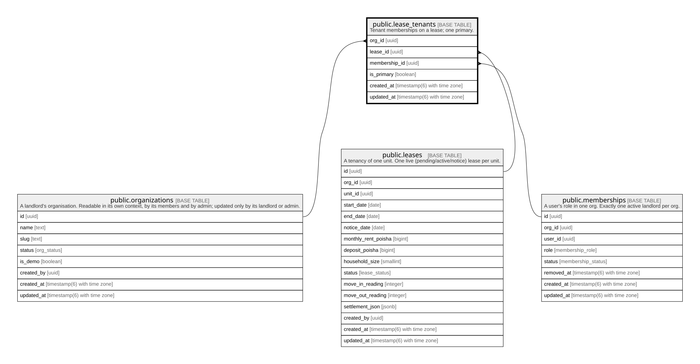

# public.lease_tenants

## Description

Tenant memberships on a lease; one primary.

## Columns

| Name          | Type                        | Default           | Nullable | Children | Parents                                         | Comment |
| ------------- | --------------------------- | ----------------- | -------- | -------- | ----------------------------------------------- | ------- |
| org_id        | uuid                        |                   | false    |          | [public.organizations](public.organizations.md) |         |
| lease_id      | uuid                        |                   | false    |          | [public.leases](public.leases.md)               |         |
| membership_id | uuid                        |                   | false    |          | [public.memberships](public.memberships.md)     |         |
| is_primary    | boolean                     | false             | false    |          |                                                 |         |
| created_at    | timestamp(6) with time zone | CURRENT_TIMESTAMP | false    |          |                                                 |         |
| updated_at    | timestamp(6) with time zone | CURRENT_TIMESTAMP | false    |          |                                                 |         |

## Constraints

| Name                             | Type        | Definition                                                                                  |
| -------------------------------- | ----------- | ------------------------------------------------------------------------------------------- |
| lease_tenants_org_id_fkey        | FOREIGN KEY | FOREIGN KEY (org_id) REFERENCES organizations(id) ON UPDATE CASCADE ON DELETE RESTRICT      |
| lease_tenants_membership_id_fkey | FOREIGN KEY | FOREIGN KEY (membership_id) REFERENCES memberships(id) ON UPDATE CASCADE ON DELETE RESTRICT |
| lease_tenants_lease_id_fkey      | FOREIGN KEY | FOREIGN KEY (lease_id) REFERENCES leases(id) ON UPDATE CASCADE ON DELETE CASCADE            |
| lease_tenants_pkey               | PRIMARY KEY | PRIMARY KEY (lease_id, membership_id)                                                       |

## Indexes

| Name                            | Definition                                                                                                    |
| ------------------------------- | ------------------------------------------------------------------------------------------------------------- |
| lease_tenants_pkey              | CREATE UNIQUE INDEX lease_tenants_pkey ON public.lease_tenants USING btree (lease_id, membership_id)          |
| lease_tenants_org_id_idx        | CREATE INDEX lease_tenants_org_id_idx ON public.lease_tenants USING btree (org_id)                            |
| lease_tenants_membership_id_idx | CREATE INDEX lease_tenants_membership_id_idx ON public.lease_tenants USING btree (membership_id)              |
| lease_tenants_one_primary       | CREATE UNIQUE INDEX lease_tenants_one_primary ON public.lease_tenants USING btree (lease_id) WHERE is_primary |

## Relations

---

> Generated by [tbls](https://github.com/k1LoW/tbls)
