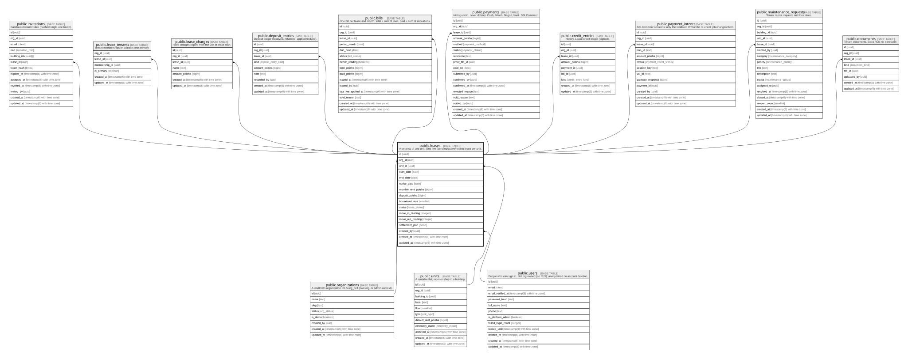

# public.leases

## Description

A tenancy of one unit. One live (pending/active/notice) lease per unit.

## Columns

| Name                | Type                        | Default                 | Nullable | Children                                                                                                                                                                                                                                                                                                                                                                                                                                                                          | Parents                                         | Comment |
| ------------------- | --------------------------- | ----------------------- | -------- | --------------------------------------------------------------------------------------------------------------------------------------------------------------------------------------------------------------------------------------------------------------------------------------------------------------------------------------------------------------------------------------------------------------------------------------------------------------------------------- | ----------------------------------------------- | ------- |
| id                  | uuid                        | gen_random_uuid()       | false    | [public.invitations](public.invitations.md) [public.lease_tenants](public.lease_tenants.md) [public.lease_charges](public.lease_charges.md) [public.deposit_entries](public.deposit_entries.md) [public.bills](public.bills.md) [public.payments](public.payments.md) [public.credit_entries](public.credit_entries.md) [public.payment_intents](public.payment_intents.md) [public.maintenance_requests](public.maintenance_requests.md) [public.documents](public.documents.md) |                                                 |         |
| org_id              | uuid                        |                         | false    |                                                                                                                                                                                                                                                                                                                                                                                                                                                                                   | [public.organizations](public.organizations.md) |         |
| unit_id             | uuid                        |                         | false    |                                                                                                                                                                                                                                                                                                                                                                                                                                                                                   | [public.units](public.units.md)                 |         |
| start_date          | date                        |                         | false    |                                                                                                                                                                                                                                                                                                                                                                                                                                                                                   |                                                 |         |
| end_date            | date                        |                         | true     |                                                                                                                                                                                                                                                                                                                                                                                                                                                                                   |                                                 |         |
| notice_date         | date                        |                         | true     |                                                                                                                                                                                                                                                                                                                                                                                                                                                                                   |                                                 |         |
| monthly_rent_poisha | bigint                      |                         | false    |                                                                                                                                                                                                                                                                                                                                                                                                                                                                                   |                                                 |         |
| deposit_poisha      | bigint                      | 0                       | false    |                                                                                                                                                                                                                                                                                                                                                                                                                                                                                   |                                                 |         |
| household_size      | smallint                    | 1                       | false    |                                                                                                                                                                                                                                                                                                                                                                                                                                                                                   |                                                 |         |
| status              | lease_status                | 'pending'::lease_status | false    |                                                                                                                                                                                                                                                                                                                                                                                                                                                                                   |                                                 |         |
| move_in_reading     | integer                     |                         | true     |                                                                                                                                                                                                                                                                                                                                                                                                                                                                                   |                                                 |         |
| move_out_reading    | integer                     |                         | true     |                                                                                                                                                                                                                                                                                                                                                                                                                                                                                   |                                                 |         |
| settlement_json     | jsonb                       |                         | true     |                                                                                                                                                                                                                                                                                                                                                                                                                                                                                   |                                                 |         |
| created_by          | uuid                        |                         | false    |                                                                                                                                                                                                                                                                                                                                                                                                                                                                                   | [public.users](public.users.md)                 |         |
| created_at          | timestamp(6) with time zone | CURRENT_TIMESTAMP       | false    |                                                                                                                                                                                                                                                                                                                                                                                                                                                                                   |                                                 |         |
| updated_at          | timestamp(6) with time zone | CURRENT_TIMESTAMP       | false    |                                                                                                                                                                                                                                                                                                                                                                                                                                                                                   |                                                 |         |

## Constraints

| Name                      | Type        | Definition                                                                             |
| ------------------------- | ----------- | -------------------------------------------------------------------------------------- |
| leases_deposit_check      | CHECK       | CHECK ((deposit_poisha >= 0))                                                          |
| leases_monthly_rent_check | CHECK       | CHECK ((monthly_rent_poisha >= 0))                                                     |
| leases_created_by_fkey    | FOREIGN KEY | FOREIGN KEY (created_by) REFERENCES users(id) ON UPDATE CASCADE ON DELETE RESTRICT     |
| leases_org_id_fkey        | FOREIGN KEY | FOREIGN KEY (org_id) REFERENCES organizations(id) ON UPDATE CASCADE ON DELETE RESTRICT |
| leases_unit_id_fkey       | FOREIGN KEY | FOREIGN KEY (unit_id) REFERENCES units(id) ON UPDATE CASCADE ON DELETE RESTRICT        |
| leases_pkey               | PRIMARY KEY | PRIMARY KEY (id)                                                                       |

## Indexes

| Name                     | Definition                                                                                                                                                                                |
| ------------------------ | ----------------------------------------------------------------------------------------------------------------------------------------------------------------------------------------- |
| leases_pkey              | CREATE UNIQUE INDEX leases_pkey ON public.leases USING btree (id)                                                                                                                         |
| leases_org_id_status_idx | CREATE INDEX leases_org_id_status_idx ON public.leases USING btree (org_id, status)                                                                                                       |
| leases_unit_id_idx       | CREATE INDEX leases_unit_id_idx ON public.leases USING btree (unit_id)                                                                                                                    |
| leases_created_by_idx    | CREATE INDEX leases_created_by_idx ON public.leases USING btree (created_by)                                                                                                              |
| leases_one_live_per_unit | CREATE UNIQUE INDEX leases_one_live_per_unit ON public.leases USING btree (unit_id) WHERE (status = ANY (ARRAY['pending'::lease_status, 'active'::lease_status, 'notice'::lease_status])) |

## Relations

---

> Generated by [tbls](https://github.com/k1LoW/tbls)
