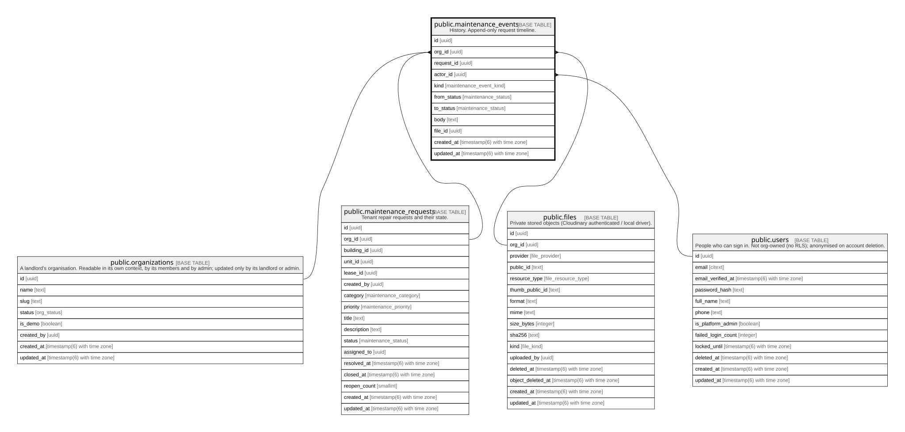

# public.maintenance_events

## Description

History. Append-only request timeline.

## Columns

| Name        | Type                        | Default           | Nullable | Children | Parents                                                       | Comment |
| ----------- | --------------------------- | ----------------- | -------- | -------- | ------------------------------------------------------------- | ------- |
| id          | uuid                        | gen_random_uuid() | false    |          |                                                               |         |
| org_id      | uuid                        |                   | false    |          | [public.organizations](public.organizations.md)               |         |
| request_id  | uuid                        |                   | false    |          | [public.maintenance_requests](public.maintenance_requests.md) |         |
| actor_id    | uuid                        |                   | false    |          | [public.users](public.users.md)                               |         |
| kind        | maintenance_event_kind      |                   | false    |          |                                                               |         |
| from_status | maintenance_status          |                   | true     |          |                                                               |         |
| to_status   | maintenance_status          |                   | true     |          |                                                               |         |
| body        | text                        |                   | true     |          |                                                               |         |
| file_id     | uuid                        |                   | true     |          | [public.files](public.files.md)                               |         |
| created_at  | timestamp(6) with time zone | CURRENT_TIMESTAMP | false    |          |                                                               |         |
| updated_at  | timestamp(6) with time zone | CURRENT_TIMESTAMP | false    |          |                                                               |         |

## Constraints

| Name                               | Type        | Definition                                                                                        |
| ---------------------------------- | ----------- | ------------------------------------------------------------------------------------------------- |
| maintenance_events_actor_id_fkey   | FOREIGN KEY | FOREIGN KEY (actor_id) REFERENCES users(id) ON UPDATE CASCADE ON DELETE RESTRICT                  |
| maintenance_events_org_id_fkey     | FOREIGN KEY | FOREIGN KEY (org_id) REFERENCES organizations(id) ON UPDATE CASCADE ON DELETE RESTRICT            |
| maintenance_events_request_id_fkey | FOREIGN KEY | FOREIGN KEY (request_id) REFERENCES maintenance_requests(id) ON UPDATE CASCADE ON DELETE RESTRICT |
| maintenance_events_pkey            | PRIMARY KEY | PRIMARY KEY (id)                                                                                  |
| maintenance_events_file_id_fkey    | FOREIGN KEY | FOREIGN KEY (file_id) REFERENCES files(id) ON UPDATE CASCADE ON DELETE SET NULL                   |

## Indexes

| Name                                         | Definition                                                                                                                  |
| -------------------------------------------- | --------------------------------------------------------------------------------------------------------------------------- |
| maintenance_events_pkey                      | CREATE UNIQUE INDEX maintenance_events_pkey ON public.maintenance_events USING btree (id)                                   |
| maintenance_events_org_id_idx                | CREATE INDEX maintenance_events_org_id_idx ON public.maintenance_events USING btree (org_id)                                |
| maintenance_events_request_id_created_at_idx | CREATE INDEX maintenance_events_request_id_created_at_idx ON public.maintenance_events USING btree (request_id, created_at) |
| maintenance_events_actor_id_idx              | CREATE INDEX maintenance_events_actor_id_idx ON public.maintenance_events USING btree (actor_id)                            |
| maintenance_events_file_id_idx               | CREATE INDEX maintenance_events_file_id_idx ON public.maintenance_events USING btree (file_id)                              |

## Relations

---

> Generated by [tbls](https://github.com/k1LoW/tbls)
