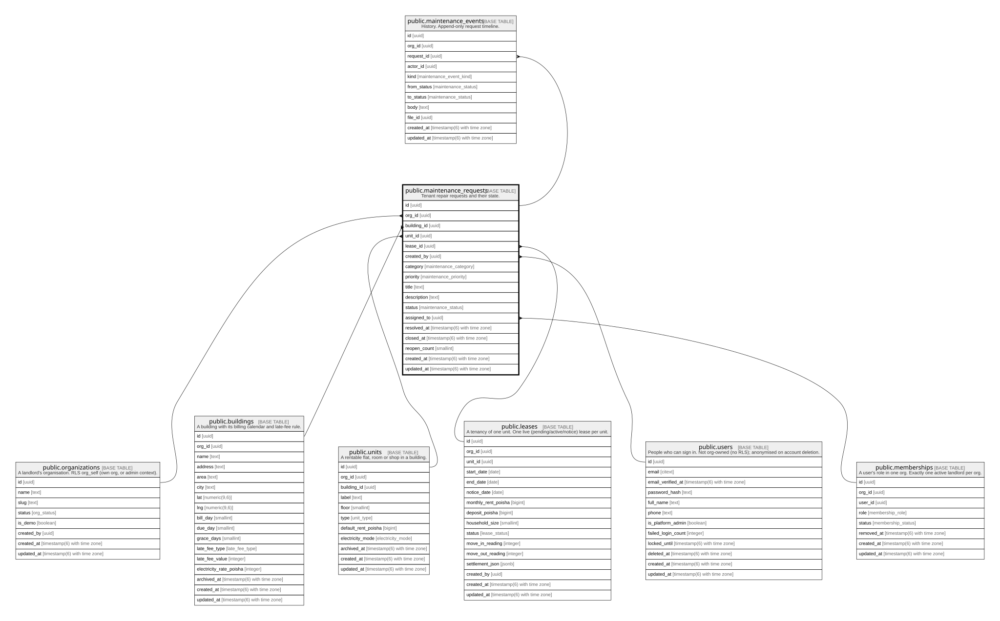

# public.maintenance_requests

## Description

Tenant repair requests and their state.

## Columns

| Name         | Type                        | Default                        | Nullable | Children                                                  | Parents                                         | Comment |
| ------------ | --------------------------- | ------------------------------ | -------- | --------------------------------------------------------- | ----------------------------------------------- | ------- |
| id           | uuid                        | gen_random_uuid()              | false    | [public.maintenance_events](public.maintenance_events.md) |                                                 |         |
| org_id       | uuid                        |                                | false    |                                                           | [public.organizations](public.organizations.md) |         |
| building_id  | uuid                        |                                | false    |                                                           | [public.buildings](public.buildings.md)         |         |
| unit_id      | uuid                        |                                | false    |                                                           | [public.units](public.units.md)                 |         |
| lease_id     | uuid                        |                                | false    |                                                           | [public.leases](public.leases.md)               |         |
| created_by   | uuid                        |                                | false    |                                                           | [public.users](public.users.md)                 |         |
| category     | maintenance_category        |                                | false    |                                                           |                                                 |         |
| priority     | maintenance_priority        | 'normal'::maintenance_priority | false    |                                                           |                                                 |         |
| title        | text                        |                                | false    |                                                           |                                                 |         |
| description  | text                        |                                | false    |                                                           |                                                 |         |
| status       | maintenance_status          | 'open'::maintenance_status     | false    |                                                           |                                                 |         |
| assigned_to  | uuid                        |                                | true     |                                                           | [public.memberships](public.memberships.md)     |         |
| resolved_at  | timestamp(6) with time zone |                                | true     |                                                           |                                                 |         |
| closed_at    | timestamp(6) with time zone |                                | true     |                                                           |                                                 |         |
| reopen_count | smallint                    | 0                              | false    |                                                           |                                                 |         |
| created_at   | timestamp(6) with time zone | CURRENT_TIMESTAMP              | false    |                                                           |                                                 |         |
| updated_at   | timestamp(6) with time zone | CURRENT_TIMESTAMP              | false    |                                                           |                                                 |         |

## Constraints

| Name                                  | Type        | Definition                                                                                |
| ------------------------------------- | ----------- | ----------------------------------------------------------------------------------------- |
| maintenance_requests_created_by_fkey  | FOREIGN KEY | FOREIGN KEY (created_by) REFERENCES users(id) ON UPDATE CASCADE ON DELETE RESTRICT        |
| maintenance_requests_org_id_fkey      | FOREIGN KEY | FOREIGN KEY (org_id) REFERENCES organizations(id) ON UPDATE CASCADE ON DELETE RESTRICT    |
| maintenance_requests_assigned_to_fkey | FOREIGN KEY | FOREIGN KEY (assigned_to) REFERENCES memberships(id) ON UPDATE CASCADE ON DELETE SET NULL |
| maintenance_requests_building_id_fkey | FOREIGN KEY | FOREIGN KEY (building_id) REFERENCES buildings(id) ON UPDATE CASCADE ON DELETE RESTRICT   |
| maintenance_requests_unit_id_fkey     | FOREIGN KEY | FOREIGN KEY (unit_id) REFERENCES units(id) ON UPDATE CASCADE ON DELETE RESTRICT           |
| maintenance_requests_lease_id_fkey    | FOREIGN KEY | FOREIGN KEY (lease_id) REFERENCES leases(id) ON UPDATE CASCADE ON DELETE RESTRICT         |
| maintenance_requests_pkey             | PRIMARY KEY | PRIMARY KEY (id)                                                                          |

## Indexes

| Name                                        | Definition                                                                                                                |
| ------------------------------------------- | ------------------------------------------------------------------------------------------------------------------------- |
| maintenance_requests_pkey                   | CREATE UNIQUE INDEX maintenance_requests_pkey ON public.maintenance_requests USING btree (id)                             |
| maintenance_requests_org_id_status_idx      | CREATE INDEX maintenance_requests_org_id_status_idx ON public.maintenance_requests USING btree (org_id, status)           |
| maintenance_requests_building_id_status_idx | CREATE INDEX maintenance_requests_building_id_status_idx ON public.maintenance_requests USING btree (building_id, status) |
| maintenance_requests_unit_id_idx            | CREATE INDEX maintenance_requests_unit_id_idx ON public.maintenance_requests USING btree (unit_id)                        |
| maintenance_requests_lease_id_idx           | CREATE INDEX maintenance_requests_lease_id_idx ON public.maintenance_requests USING btree (lease_id)                      |
| maintenance_requests_created_by_idx         | CREATE INDEX maintenance_requests_created_by_idx ON public.maintenance_requests USING btree (created_by)                  |
| maintenance_requests_assigned_to_idx        | CREATE INDEX maintenance_requests_assigned_to_idx ON public.maintenance_requests USING btree (assigned_to)                |

## Relations

---

> Generated by [tbls](https://github.com/k1LoW/tbls)
