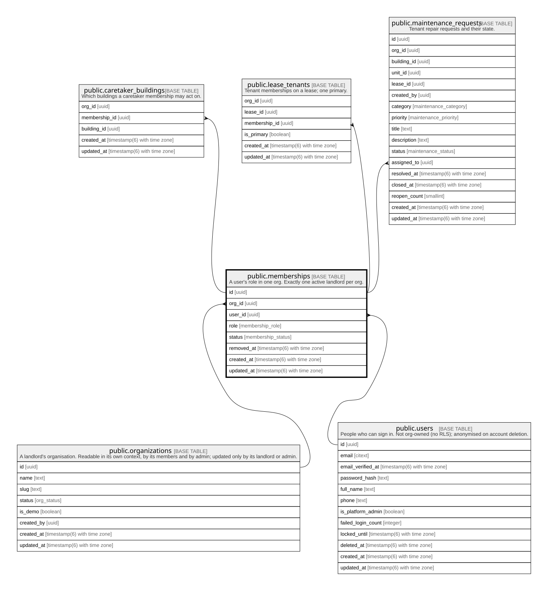

# public.memberships

## Description

A user's role in one org. Exactly one active landlord per org.

## Columns

| Name       | Type                        | Default                     | Nullable | Children                                                                                                                                                                  | Parents                                         | Comment |
| ---------- | --------------------------- | --------------------------- | -------- | ------------------------------------------------------------------------------------------------------------------------------------------------------------------------- | ----------------------------------------------- | ------- |
| id         | uuid                        | gen_random_uuid()           | false    | [public.caretaker_buildings](public.caretaker_buildings.md) [public.lease_tenants](public.lease_tenants.md) [public.maintenance_requests](public.maintenance_requests.md) |                                                 |         |
| org_id     | uuid                        |                             | false    |                                                                                                                                                                           | [public.organizations](public.organizations.md) |         |
| user_id    | uuid                        |                             | false    |                                                                                                                                                                           | [public.users](public.users.md)                 |         |
| role       | membership_role             |                             | false    |                                                                                                                                                                           |                                                 |         |
| status     | membership_status           | 'active'::membership_status | false    |                                                                                                                                                                           |                                                 |         |
| removed_at | timestamp(6) with time zone |                             | true     |                                                                                                                                                                           |                                                 |         |
| created_at | timestamp(6) with time zone | CURRENT_TIMESTAMP           | false    |                                                                                                                                                                           |                                                 |         |
| updated_at | timestamp(6) with time zone | CURRENT_TIMESTAMP           | false    |                                                                                                                                                                           |                                                 |         |

## Constraints

| Name                     | Type        | Definition                                                                             |
| ------------------------ | ----------- | -------------------------------------------------------------------------------------- |
| memberships_user_id_fkey | FOREIGN KEY | FOREIGN KEY (user_id) REFERENCES users(id) ON UPDATE CASCADE ON DELETE RESTRICT        |
| memberships_org_id_fkey  | FOREIGN KEY | FOREIGN KEY (org_id) REFERENCES organizations(id) ON UPDATE CASCADE ON DELETE RESTRICT |
| memberships_pkey         | PRIMARY KEY | PRIMARY KEY (id)                                                                       |

## Indexes

| Name                            | Definition                                                                                                                                                                             |
| ------------------------------- | -------------------------------------------------------------------------------------------------------------------------------------------------------------------------------------- |
| memberships_pkey                | CREATE UNIQUE INDEX memberships_pkey ON public.memberships USING btree (id)                                                                                                            |
| memberships_user_id_idx         | CREATE INDEX memberships_user_id_idx ON public.memberships USING btree (user_id)                                                                                                       |
| memberships_org_id_user_id_key  | CREATE UNIQUE INDEX memberships_org_id_user_id_key ON public.memberships USING btree (org_id, user_id)                                                                                 |
| memberships_one_active_landlord | CREATE UNIQUE INDEX memberships_one_active_landlord ON public.memberships USING btree (org_id) WHERE ((role = 'landlord'::membership_role) AND (status = 'active'::membership_status)) |

## Relations

---

> Generated by [tbls](https://github.com/k1LoW/tbls)
