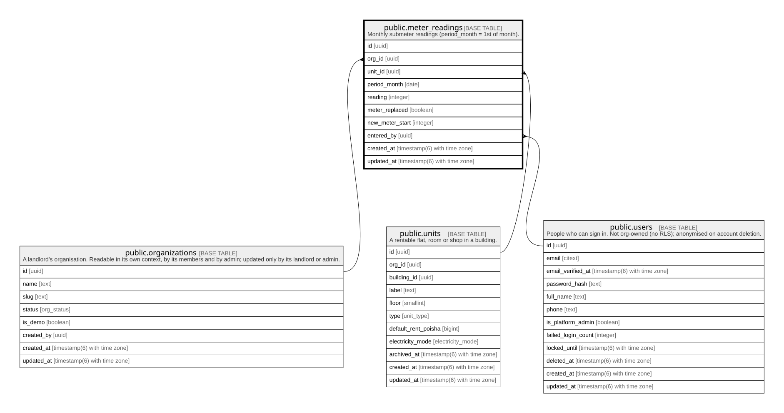

# public.meter_readings

## Description

Monthly submeter readings (period_month = 1st of month).

## Columns

| Name            | Type                        | Default           | Nullable | Children | Parents                                                                         | Comment |
| --------------- | --------------------------- | ----------------- | -------- | -------- | ------------------------------------------------------------------------------- | ------- |
| id              | uuid                        | gen_random_uuid() | false    |          |                                                                                 |         |
| org_id          | uuid                        |                   | false    |          | [public.organizations](public.organizations.md) [public.units](public.units.md) |         |
| unit_id         | uuid                        |                   | false    |          | [public.units](public.units.md)                                                 |         |
| period_month    | date                        |                   | false    |          |                                                                                 |         |
| reading         | integer                     |                   | false    |          |                                                                                 |         |
| meter_replaced  | boolean                     | false             | false    |          |                                                                                 |         |
| new_meter_start | integer                     |                   | true     |          |                                                                                 |         |
| entered_by      | uuid                        |                   | false    |          | [public.users](public.users.md)                                                 |         |
| created_at      | timestamp(6) with time zone | CURRENT_TIMESTAMP | false    |          |                                                                                 |         |
| updated_at      | timestamp(6) with time zone | CURRENT_TIMESTAMP | false    |          |                                                                                 |         |

## Constraints

| Name                               | Type        | Definition                                                                                           |
| ---------------------------------- | ----------- | ---------------------------------------------------------------------------------------------------- |
| meter_readings_period_month_check  | CHECK       | CHECK ((period_month = (date_trunc('month'::text, (period_month)::timestamp with time zone))::date)) |
| meter_readings_reading_check       | CHECK       | CHECK ((reading >= 0))                                                                               |
| meter_readings_entered_by_fkey     | FOREIGN KEY | FOREIGN KEY (entered_by) REFERENCES users(id) ON UPDATE CASCADE ON DELETE RESTRICT                   |
| meter_readings_org_id_fkey         | FOREIGN KEY | FOREIGN KEY (org_id) REFERENCES organizations(id) ON UPDATE CASCADE ON DELETE RESTRICT               |
| meter_readings_pkey                | PRIMARY KEY | PRIMARY KEY (id)                                                                                     |
| meter_readings_org_id_unit_id_fkey | FOREIGN KEY | FOREIGN KEY (org_id, unit_id) REFERENCES units(org_id, id) ON UPDATE CASCADE ON DELETE RESTRICT      |

## Indexes

| Name                                    | Definition                                                                                                               |
| --------------------------------------- | ------------------------------------------------------------------------------------------------------------------------ |
| meter_readings_pkey                     | CREATE UNIQUE INDEX meter_readings_pkey ON public.meter_readings USING btree (id)                                        |
| meter_readings_org_id_idx               | CREATE INDEX meter_readings_org_id_idx ON public.meter_readings USING btree (org_id)                                     |
| meter_readings_entered_by_idx           | CREATE INDEX meter_readings_entered_by_idx ON public.meter_readings USING btree (entered_by)                             |
| meter_readings_unit_id_period_month_key | CREATE UNIQUE INDEX meter_readings_unit_id_period_month_key ON public.meter_readings USING btree (unit_id, period_month) |

## Relations

---

> Generated by [tbls](https://github.com/k1LoW/tbls)
