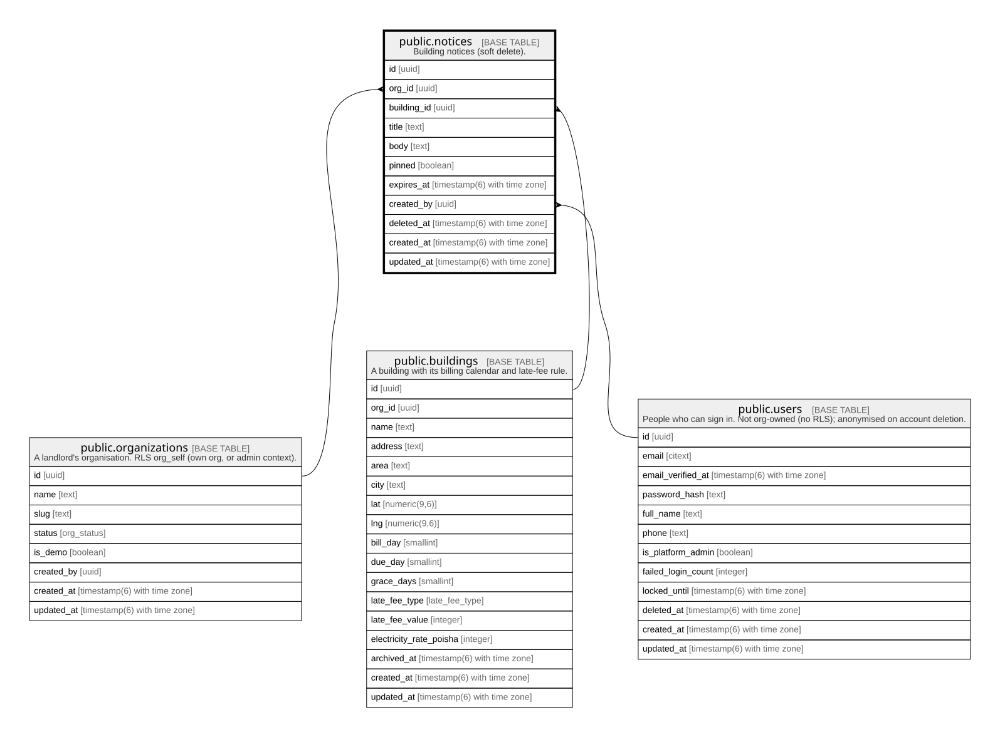

# public.notices

## Description

Building notices (soft delete).

## Columns

| Name        | Type                        | Default           | Nullable | Children | Parents                                                                                 | Comment |
| ----------- | --------------------------- | ----------------- | -------- | -------- | --------------------------------------------------------------------------------------- | ------- |
| id          | uuid                        | gen_random_uuid() | false    |          |                                                                                         |         |
| org_id      | uuid                        |                   | false    |          | [public.organizations](public.organizations.md) [public.buildings](public.buildings.md) |         |
| building_id | uuid                        |                   | false    |          | [public.buildings](public.buildings.md)                                                 |         |
| title       | text                        |                   | false    |          |                                                                                         |         |
| body        | text                        |                   | false    |          |                                                                                         |         |
| pinned      | boolean                     | false             | false    |          |                                                                                         |         |
| expires_at  | timestamp(6) with time zone |                   | true     |          |                                                                                         |         |
| created_by  | uuid                        |                   | false    |          | [public.users](public.users.md)                                                         |         |
| deleted_at  | timestamp(6) with time zone |                   | true     |          |                                                                                         |         |
| created_at  | timestamp(6) with time zone | CURRENT_TIMESTAMP | false    |          |                                                                                         |         |
| updated_at  | timestamp(6) with time zone | CURRENT_TIMESTAMP | false    |          |                                                                                         |         |

## Constraints

| Name                            | Type        | Definition                                                                             |
| ------------------------------- | ----------- | -------------------------------------------------------------------------------------- |
| notices_created_by_fkey         | FOREIGN KEY | FOREIGN KEY (created_by) REFERENCES users(id) ON UPDATE CASCADE ON DELETE RESTRICT     |
| notices_org_id_fkey             | FOREIGN KEY | FOREIGN KEY (org_id) REFERENCES organizations(id) ON UPDATE CASCADE ON DELETE RESTRICT |
| notices_pkey                    | PRIMARY KEY | PRIMARY KEY (id)                                                                       |
| notices_org_id_building_id_fkey | FOREIGN KEY | FOREIGN KEY (org_id, building_id) REFERENCES buildings(org_id, id) ON DELETE RESTRICT  |

## Indexes

| Name                               | Definition                                                                                                   |
| ---------------------------------- | ------------------------------------------------------------------------------------------------------------ |
| notices_pkey                       | CREATE UNIQUE INDEX notices_pkey ON public.notices USING btree (id)                                          |
| notices_org_id_idx                 | CREATE INDEX notices_org_id_idx ON public.notices USING btree (org_id)                                       |
| notices_building_id_created_at_idx | CREATE INDEX notices_building_id_created_at_idx ON public.notices USING btree (building_id, created_at DESC) |
| notices_created_by_idx             | CREATE INDEX notices_created_by_idx ON public.notices USING btree (created_by)                               |

## Relations

---

> Generated by [tbls](https://github.com/k1LoW/tbls)
