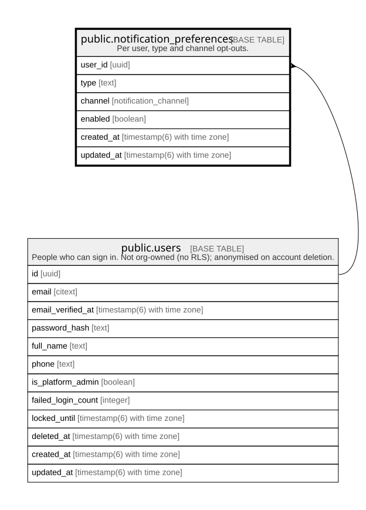

# public.notification_preferences

## Description

Per user, type and channel opt-outs.

## Columns

| Name       | Type                        | Default           | Nullable | Children | Parents                         | Comment |
| ---------- | --------------------------- | ----------------- | -------- | -------- | ------------------------------- | ------- |
| user_id    | uuid                        |                   | false    |          | [public.users](public.users.md) |         |
| type       | text                        |                   | false    |          |                                 |         |
| channel    | notification_channel        |                   | false    |          |                                 |         |
| enabled    | boolean                     |                   | false    |          |                                 |         |
| created_at | timestamp(6) with time zone | CURRENT_TIMESTAMP | false    |          |                                 |         |
| updated_at | timestamp(6) with time zone | CURRENT_TIMESTAMP | false    |          |                                 |         |

## Constraints

| Name                                  | Type        | Definition                                                                     |
| ------------------------------------- | ----------- | ------------------------------------------------------------------------------ |
| notification_preferences_user_id_fkey | FOREIGN KEY | FOREIGN KEY (user_id) REFERENCES users(id) ON UPDATE CASCADE ON DELETE CASCADE |
| notification_preferences_pkey         | PRIMARY KEY | PRIMARY KEY (user_id, type, channel)                                           |

## Indexes

| Name                          | Definition                                                                                                                |
| ----------------------------- | ------------------------------------------------------------------------------------------------------------------------- |
| notification_preferences_pkey | CREATE UNIQUE INDEX notification_preferences_pkey ON public.notification_preferences USING btree (user_id, type, channel) |

## Relations

---

> Generated by [tbls](https://github.com/k1LoW/tbls)
