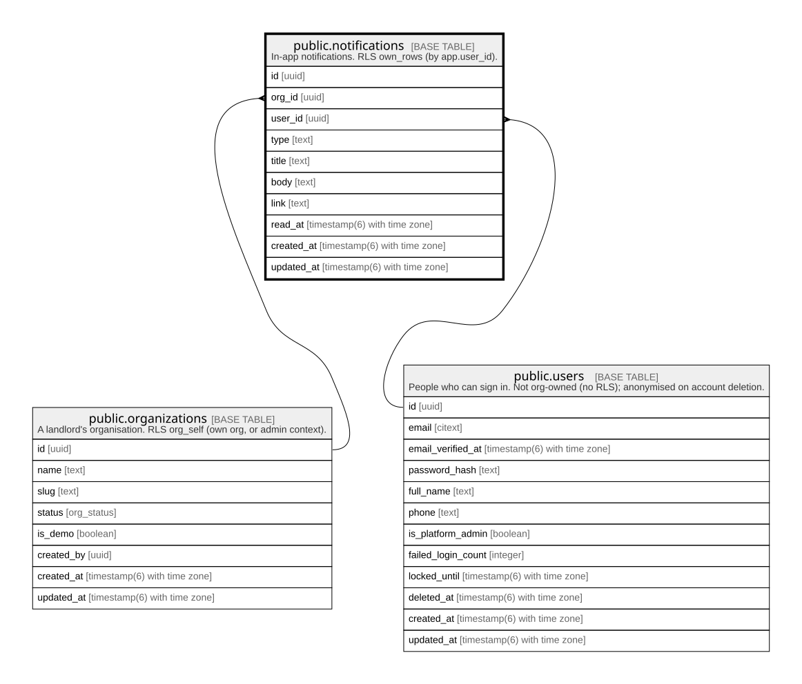

# public.notifications

## Description

In-app notifications. RLS own_rows (by app.user_id).

## Columns

| Name       | Type                        | Default           | Nullable | Children | Parents                                         | Comment |
| ---------- | --------------------------- | ----------------- | -------- | -------- | ----------------------------------------------- | ------- |
| id         | uuid                        | gen_random_uuid() | false    |          |                                                 |         |
| org_id     | uuid                        |                   | true     |          | [public.organizations](public.organizations.md) |         |
| user_id    | uuid                        |                   | false    |          | [public.users](public.users.md)                 |         |
| type       | text                        |                   | false    |          |                                                 |         |
| title      | text                        |                   | false    |          |                                                 |         |
| body       | text                        |                   | true     |          |                                                 |         |
| link       | text                        |                   | true     |          |                                                 |         |
| read_at    | timestamp(6) with time zone |                   | true     |          |                                                 |         |
| created_at | timestamp(6) with time zone | CURRENT_TIMESTAMP | false    |          |                                                 |         |
| updated_at | timestamp(6) with time zone | CURRENT_TIMESTAMP | false    |          |                                                 |         |

## Constraints

| Name                       | Type        | Definition                                                                             |
| -------------------------- | ----------- | -------------------------------------------------------------------------------------- |
| notifications_user_id_fkey | FOREIGN KEY | FOREIGN KEY (user_id) REFERENCES users(id) ON UPDATE CASCADE ON DELETE RESTRICT        |
| notifications_org_id_fkey  | FOREIGN KEY | FOREIGN KEY (org_id) REFERENCES organizations(id) ON UPDATE CASCADE ON DELETE SET NULL |
| notifications_pkey         | PRIMARY KEY | PRIMARY KEY (id)                                                                       |

## Indexes

| Name                                         | Definition                                                                                                                        |
| -------------------------------------------- | --------------------------------------------------------------------------------------------------------------------------------- |
| notifications_pkey                           | CREATE UNIQUE INDEX notifications_pkey ON public.notifications USING btree (id)                                                   |
| notifications_user_id_read_at_created_at_idx | CREATE INDEX notifications_user_id_read_at_created_at_idx ON public.notifications USING btree (user_id, read_at, created_at DESC) |
| notifications_org_id_idx                     | CREATE INDEX notifications_org_id_idx ON public.notifications USING btree (org_id)                                                |

## Relations

---

> Generated by [tbls](https://github.com/k1LoW/tbls)
