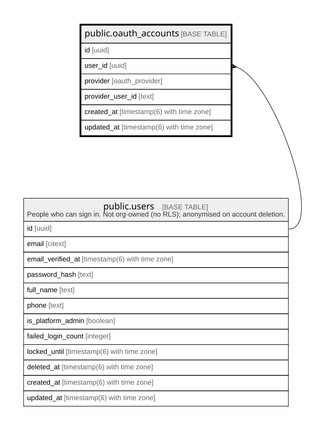

# public.oauth_accounts

## Columns

| Name             | Type                        | Default           | Nullable | Children | Parents                         | Comment |
| ---------------- | --------------------------- | ----------------- | -------- | -------- | ------------------------------- | ------- |
| id               | uuid                        | gen_random_uuid() | false    |          |                                 |         |
| user_id          | uuid                        |                   | false    |          | [public.users](public.users.md) |         |
| provider         | oauth_provider              |                   | false    |          |                                 |         |
| provider_user_id | text                        |                   | false    |          |                                 |         |
| created_at       | timestamp(6) with time zone | CURRENT_TIMESTAMP | false    |          |                                 |         |
| updated_at       | timestamp(6) with time zone | CURRENT_TIMESTAMP | false    |          |                                 |         |

## Constraints

| Name                        | Type        | Definition                                                                     |
| --------------------------- | ----------- | ------------------------------------------------------------------------------ |
| oauth_accounts_user_id_fkey | FOREIGN KEY | FOREIGN KEY (user_id) REFERENCES users(id) ON UPDATE CASCADE ON DELETE CASCADE |
| oauth_accounts_pkey         | PRIMARY KEY | PRIMARY KEY (id)                                                               |

## Indexes

| Name                                         | Definition                                                                                                                         |
| -------------------------------------------- | ---------------------------------------------------------------------------------------------------------------------------------- |
| oauth_accounts_pkey                          | CREATE UNIQUE INDEX oauth_accounts_pkey ON public.oauth_accounts USING btree (id)                                                  |
| oauth_accounts_user_id_idx                   | CREATE INDEX oauth_accounts_user_id_idx ON public.oauth_accounts USING btree (user_id)                                             |
| oauth_accounts_provider_provider_user_id_key | CREATE UNIQUE INDEX oauth_accounts_provider_provider_user_id_key ON public.oauth_accounts USING btree (provider, provider_user_id) |

## Relations

---

> Generated by [tbls](https://github.com/k1LoW/tbls)
