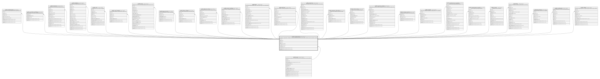

# public.organizations

## Description

A landlord's organisation. Readable in its own context, by its members and by admin; updated only by its landlord or admin.

## Columns

| Name       | Type                        | Default              | Nullable | Children                                                                                                                                                                                                                                                                                                                                                                                                                                                                                                                                                                                                                                                                                                                                                                                                                                                                                                                                                                                                                                                                                                                                                                                                              | Parents                         | Comment |
| ---------- | --------------------------- | -------------------- | -------- | --------------------------------------------------------------------------------------------------------------------------------------------------------------------------------------------------------------------------------------------------------------------------------------------------------------------------------------------------------------------------------------------------------------------------------------------------------------------------------------------------------------------------------------------------------------------------------------------------------------------------------------------------------------------------------------------------------------------------------------------------------------------------------------------------------------------------------------------------------------------------------------------------------------------------------------------------------------------------------------------------------------------------------------------------------------------------------------------------------------------------------------------------------------------------------------------------------------------- | ------------------------------- | ------- |
| id         | uuid                        | gen_random_uuid()    | false    | [public.memberships](public.memberships.md) [public.caretaker_buildings](public.caretaker_buildings.md) [public.invitations](public.invitations.md) [public.buildings](public.buildings.md) [public.units](public.units.md) [public.unit_charges](public.unit_charges.md) [public.leases](public.leases.md) [public.lease_tenants](public.lease_tenants.md) [public.lease_charges](public.lease_charges.md) [public.deposit_entries](public.deposit_entries.md) [public.meter_readings](public.meter_readings.md) [public.bills](public.bills.md) [public.bill_lines](public.bill_lines.md) [public.payments](public.payments.md) [public.payment_allocations](public.payment_allocations.md) [public.credit_entries](public.credit_entries.md) [public.payment_intents](public.payment_intents.md) [public.receipt_counters](public.receipt_counters.md) [public.receipts](public.receipts.md) [public.maintenance_requests](public.maintenance_requests.md) [public.maintenance_events](public.maintenance_events.md) [public.notices](public.notices.md) [public.files](public.files.md) [public.documents](public.documents.md) [public.notifications](public.notifications.md) [public.outbox](public.outbox.md) |                                 |         |
| name       | text                        |                      | false    |                                                                                                                                                                                                                                                                                                                                                                                                                                                                                                                                                                                                                                                                                                                                                                                                                                                                                                                                                                                                                                                                                                                                                                                                                       |                                 |         |
| slug       | text                        |                      | false    |                                                                                                                                                                                                                                                                                                                                                                                                                                                                                                                                                                                                                                                                                                                                                                                                                                                                                                                                                                                                                                                                                                                                                                                                                       |                                 |         |
| status     | org_status                  | 'active'::org_status | false    |                                                                                                                                                                                                                                                                                                                                                                                                                                                                                                                                                                                                                                                                                                                                                                                                                                                                                                                                                                                                                                                                                                                                                                                                                       |                                 |         |
| is_demo    | boolean                     | false                | false    |                                                                                                                                                                                                                                                                                                                                                                                                                                                                                                                                                                                                                                                                                                                                                                                                                                                                                                                                                                                                                                                                                                                                                                                                                       |                                 |         |
| created_by | uuid                        |                      | false    |                                                                                                                                                                                                                                                                                                                                                                                                                                                                                                                                                                                                                                                                                                                                                                                                                                                                                                                                                                                                                                                                                                                                                                                                                       | [public.users](public.users.md) |         |
| created_at | timestamp(6) with time zone | CURRENT_TIMESTAMP    | false    |                                                                                                                                                                                                                                                                                                                                                                                                                                                                                                                                                                                                                                                                                                                                                                                                                                                                                                                                                                                                                                                                                                                                                                                                                       |                                 |         |
| updated_at | timestamp(6) with time zone | CURRENT_TIMESTAMP    | false    |                                                                                                                                                                                                                                                                                                                                                                                                                                                                                                                                                                                                                                                                                                                                                                                                                                                                                                                                                                                                                                                                                                                                                                                                                       |                                 |         |

## Constraints

| Name                          | Type        | Definition                                                                         |
| ----------------------------- | ----------- | ---------------------------------------------------------------------------------- |
| organizations_created_by_fkey | FOREIGN KEY | FOREIGN KEY (created_by) REFERENCES users(id) ON UPDATE CASCADE ON DELETE RESTRICT |
| organizations_pkey            | PRIMARY KEY | PRIMARY KEY (id)                                                                   |

## Indexes

| Name                         | Definition                                                                                 |
| ---------------------------- | ------------------------------------------------------------------------------------------ |
| organizations_pkey           | CREATE UNIQUE INDEX organizations_pkey ON public.organizations USING btree (id)            |
| organizations_slug_key       | CREATE UNIQUE INDEX organizations_slug_key ON public.organizations USING btree (slug)      |
| organizations_created_by_idx | CREATE INDEX organizations_created_by_idx ON public.organizations USING btree (created_by) |

## Relations

---

> Generated by [tbls](https://github.com/k1LoW/tbls)
