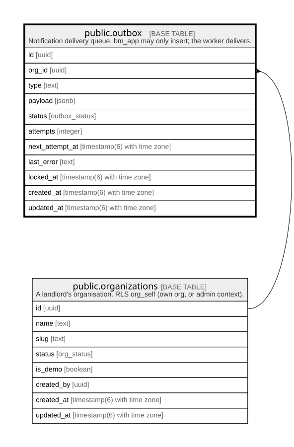

# public.outbox

## Description

Notification delivery queue. bm_app may only insert; the worker delivers.

## Columns

| Name            | Type                        | Default                  | Nullable | Children | Parents                                         | Comment |
| --------------- | --------------------------- | ------------------------ | -------- | -------- | ----------------------------------------------- | ------- |
| id              | uuid                        | gen_random_uuid()        | false    |          |                                                 |         |
| org_id          | uuid                        |                          | true     |          | [public.organizations](public.organizations.md) |         |
| type            | text                        |                          | false    |          |                                                 |         |
| payload         | jsonb                       |                          | false    |          |                                                 |         |
| status          | outbox_status               | 'pending'::outbox_status | false    |          |                                                 |         |
| attempts        | integer                     | 0                        | false    |          |                                                 |         |
| next_attempt_at | timestamp(6) with time zone | CURRENT_TIMESTAMP        | false    |          |                                                 |         |
| last_error      | text                        |                          | true     |          |                                                 |         |
| locked_at       | timestamp(6) with time zone |                          | true     |          |                                                 |         |
| created_at      | timestamp(6) with time zone | CURRENT_TIMESTAMP        | false    |          |                                                 |         |
| updated_at      | timestamp(6) with time zone | CURRENT_TIMESTAMP        | false    |          |                                                 |         |

## Constraints

| Name               | Type        | Definition                                                                             |
| ------------------ | ----------- | -------------------------------------------------------------------------------------- |
| outbox_org_id_fkey | FOREIGN KEY | FOREIGN KEY (org_id) REFERENCES organizations(id) ON UPDATE CASCADE ON DELETE SET NULL |
| outbox_pkey        | PRIMARY KEY | PRIMARY KEY (id)                                                                       |

## Indexes

| Name                              | Definition                                                                                            |
| --------------------------------- | ----------------------------------------------------------------------------------------------------- |
| outbox_pkey                       | CREATE UNIQUE INDEX outbox_pkey ON public.outbox USING btree (id)                                     |
| outbox_status_next_attempt_at_idx | CREATE INDEX outbox_status_next_attempt_at_idx ON public.outbox USING btree (status, next_attempt_at) |
| outbox_org_id_idx                 | CREATE INDEX outbox_org_id_idx ON public.outbox USING btree (org_id)                                  |

## Relations

---

> Generated by [tbls](https://github.com/k1LoW/tbls)
