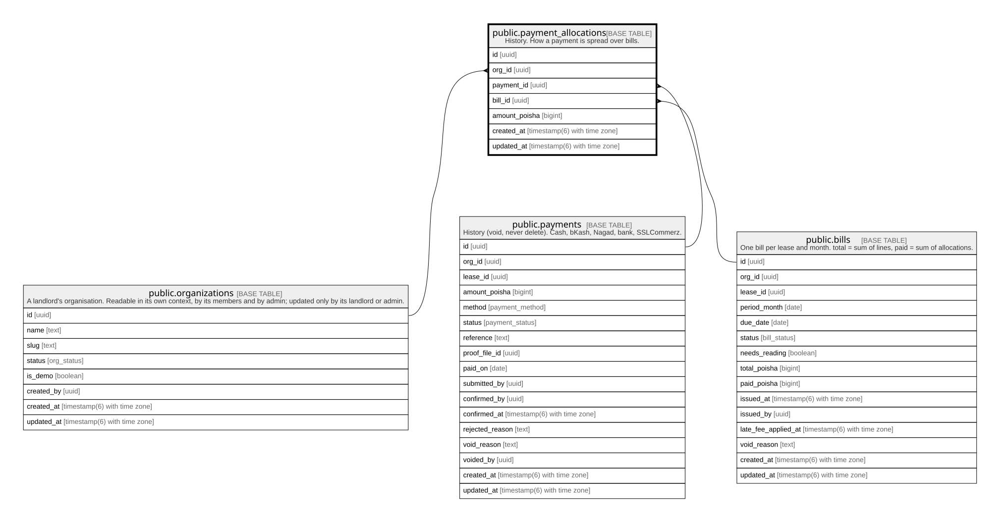

# public.payment_allocations

## Description

History. How a payment is spread over bills.

## Columns

| Name          | Type                        | Default           | Nullable | Children | Parents                                         | Comment |
| ------------- | --------------------------- | ----------------- | -------- | -------- | ----------------------------------------------- | ------- |
| id            | uuid                        | gen_random_uuid() | false    |          |                                                 |         |
| org_id        | uuid                        |                   | false    |          | [public.organizations](public.organizations.md) |         |
| payment_id    | uuid                        |                   | false    |          | [public.payments](public.payments.md)           |         |
| bill_id       | uuid                        |                   | false    |          | [public.bills](public.bills.md)                 |         |
| amount_poisha | bigint                      |                   | false    |          |                                                 |         |
| created_at    | timestamp(6) with time zone | CURRENT_TIMESTAMP | false    |          |                                                 |         |
| updated_at    | timestamp(6) with time zone | CURRENT_TIMESTAMP | false    |          |                                                 |         |

## Constraints

| Name                                | Type        | Definition                                                                             |
| ----------------------------------- | ----------- | -------------------------------------------------------------------------------------- |
| payment_allocations_amount_check    | CHECK       | CHECK ((amount_poisha > 0))                                                            |
| payment_allocations_org_id_fkey     | FOREIGN KEY | FOREIGN KEY (org_id) REFERENCES organizations(id) ON UPDATE CASCADE ON DELETE RESTRICT |
| payment_allocations_bill_id_fkey    | FOREIGN KEY | FOREIGN KEY (bill_id) REFERENCES bills(id) ON UPDATE CASCADE ON DELETE RESTRICT        |
| payment_allocations_payment_id_fkey | FOREIGN KEY | FOREIGN KEY (payment_id) REFERENCES payments(id) ON UPDATE CASCADE ON DELETE RESTRICT  |
| payment_allocations_pkey            | PRIMARY KEY | PRIMARY KEY (id)                                                                       |

## Indexes

| Name                               | Definition                                                                                             |
| ---------------------------------- | ------------------------------------------------------------------------------------------------------ |
| payment_allocations_pkey           | CREATE UNIQUE INDEX payment_allocations_pkey ON public.payment_allocations USING btree (id)            |
| payment_allocations_org_id_idx     | CREATE INDEX payment_allocations_org_id_idx ON public.payment_allocations USING btree (org_id)         |
| payment_allocations_payment_id_idx | CREATE INDEX payment_allocations_payment_id_idx ON public.payment_allocations USING btree (payment_id) |
| payment_allocations_bill_id_idx    | CREATE INDEX payment_allocations_bill_id_idx ON public.payment_allocations USING btree (bill_id)       |

## Relations

---

> Generated by [tbls](https://github.com/k1LoW/tbls)
