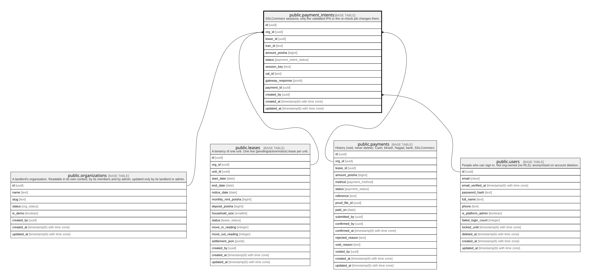

# public.payment_intents

## Description

SSLCommerz sessions; only the validated IPN or the re-check job changes them.

## Columns

| Name             | Type                        | Default                            | Nullable | Children | Parents                                                                                                                 | Comment |
| ---------------- | --------------------------- | ---------------------------------- | -------- | -------- | ----------------------------------------------------------------------------------------------------------------------- | ------- |
| id               | uuid                        | gen_random_uuid()                  | false    |          |                                                                                                                         |         |
| org_id           | uuid                        |                                    | false    |          | [public.organizations](public.organizations.md) [public.leases](public.leases.md) [public.payments](public.payments.md) |         |
| lease_id         | uuid                        |                                    | false    |          | [public.leases](public.leases.md)                                                                                       |         |
| tran_id          | text                        |                                    | false    |          |                                                                                                                         |         |
| amount_poisha    | bigint                      |                                    | false    |          |                                                                                                                         |         |
| status           | payment_intent_status       | 'initiated'::payment_intent_status | false    |          |                                                                                                                         |         |
| session_key      | text                        |                                    | true     |          |                                                                                                                         |         |
| val_id           | text                        |                                    | true     |          |                                                                                                                         |         |
| gateway_response | jsonb                       |                                    | true     |          |                                                                                                                         |         |
| payment_id       | uuid                        |                                    | true     |          | [public.payments](public.payments.md)                                                                                   |         |
| created_by       | uuid                        |                                    | false    |          | [public.users](public.users.md)                                                                                         |         |
| created_at       | timestamp(6) with time zone | CURRENT_TIMESTAMP                  | false    |          |                                                                                                                         |         |
| updated_at       | timestamp(6) with time zone | CURRENT_TIMESTAMP                  | false    |          |                                                                                                                         |         |

## Constraints

| Name                                   | Type        | Definition                                                                             |
| -------------------------------------- | ----------- | -------------------------------------------------------------------------------------- |
| payment_intents_amount_check           | CHECK       | CHECK ((amount_poisha > 0))                                                            |
| payment_intents_created_by_fkey        | FOREIGN KEY | FOREIGN KEY (created_by) REFERENCES users(id) ON UPDATE CASCADE ON DELETE RESTRICT     |
| payment_intents_org_id_fkey            | FOREIGN KEY | FOREIGN KEY (org_id) REFERENCES organizations(id) ON UPDATE CASCADE ON DELETE RESTRICT |
| payment_intents_pkey                   | PRIMARY KEY | PRIMARY KEY (id)                                                                       |
| payment_intents_org_id_lease_id_fkey   | FOREIGN KEY | FOREIGN KEY (org_id, lease_id) REFERENCES leases(org_id, id) ON DELETE RESTRICT        |
| payment_intents_org_id_payment_id_fkey | FOREIGN KEY | FOREIGN KEY (org_id, payment_id) REFERENCES payments(org_id, id) ON DELETE RESTRICT    |

## Indexes

| Name                                  | Definition                                                                                                    |
| ------------------------------------- | ------------------------------------------------------------------------------------------------------------- |
| payment_intents_pkey                  | CREATE UNIQUE INDEX payment_intents_pkey ON public.payment_intents USING btree (id)                           |
| payment_intents_tran_id_key           | CREATE UNIQUE INDEX payment_intents_tran_id_key ON public.payment_intents USING btree (tran_id)               |
| payment_intents_status_created_at_idx | CREATE INDEX payment_intents_status_created_at_idx ON public.payment_intents USING btree (status, created_at) |
| payment_intents_org_id_idx            | CREATE INDEX payment_intents_org_id_idx ON public.payment_intents USING btree (org_id)                        |
| payment_intents_lease_id_idx          | CREATE INDEX payment_intents_lease_id_idx ON public.payment_intents USING btree (lease_id)                    |
| payment_intents_payment_id_idx        | CREATE INDEX payment_intents_payment_id_idx ON public.payment_intents USING btree (payment_id)                |
| payment_intents_created_by_idx        | CREATE INDEX payment_intents_created_by_idx ON public.payment_intents USING btree (created_by)                |

## Relations

---

> Generated by [tbls](https://github.com/k1LoW/tbls)
