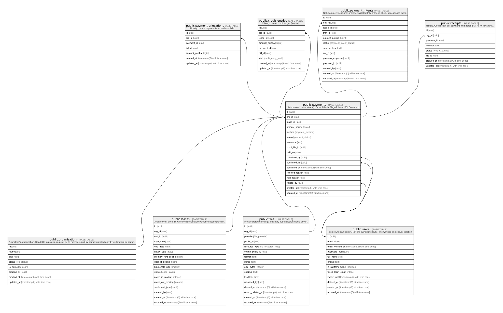

# public.payments

## Description

History (void, never delete). Cash, bKash, Nagad, bank, SSLCommerz.

## Columns

| Name            | Type                        | Default           | Nullable | Children                                                                                                                                                                                                | Parents                                                                                                           | Comment |
| --------------- | --------------------------- | ----------------- | -------- | ------------------------------------------------------------------------------------------------------------------------------------------------------------------------------------------------------- | ----------------------------------------------------------------------------------------------------------------- | ------- |
| id              | uuid                        | gen_random_uuid() | false    | [public.payment_allocations](public.payment_allocations.md) [public.credit_entries](public.credit_entries.md) [public.payment_intents](public.payment_intents.md) [public.receipts](public.receipts.md) |                                                                                                                   |         |
| org_id          | uuid                        |                   | false    | [public.payment_allocations](public.payment_allocations.md) [public.credit_entries](public.credit_entries.md) [public.payment_intents](public.payment_intents.md) [public.receipts](public.receipts.md) | [public.organizations](public.organizations.md) [public.leases](public.leases.md) [public.files](public.files.md) |         |
| lease_id        | uuid                        |                   | false    |                                                                                                                                                                                                         | [public.leases](public.leases.md)                                                                                 |         |
| amount_poisha   | bigint                      |                   | false    |                                                                                                                                                                                                         |                                                                                                                   |         |
| method          | payment_method              |                   | false    |                                                                                                                                                                                                         |                                                                                                                   |         |
| status          | payment_status              |                   | false    |                                                                                                                                                                                                         |                                                                                                                   |         |
| reference       | text                        |                   | true     |                                                                                                                                                                                                         |                                                                                                                   |         |
| proof_file_id   | uuid                        |                   | true     |                                                                                                                                                                                                         | [public.files](public.files.md)                                                                                   |         |
| paid_on         | date                        |                   | false    |                                                                                                                                                                                                         |                                                                                                                   |         |
| submitted_by    | uuid                        |                   | false    |                                                                                                                                                                                                         | [public.users](public.users.md)                                                                                   |         |
| confirmed_by    | uuid                        |                   | true     |                                                                                                                                                                                                         | [public.users](public.users.md)                                                                                   |         |
| confirmed_at    | timestamp(6) with time zone |                   | true     |                                                                                                                                                                                                         |                                                                                                                   |         |
| rejected_reason | text                        |                   | true     |                                                                                                                                                                                                         |                                                                                                                   |         |
| void_reason     | text                        |                   | true     |                                                                                                                                                                                                         |                                                                                                                   |         |
| voided_by       | uuid                        |                   | true     |                                                                                                                                                                                                         | [public.users](public.users.md)                                                                                   |         |
| created_at      | timestamp(6) with time zone | CURRENT_TIMESTAMP | false    |                                                                                                                                                                                                         |                                                                                                                   |         |
| updated_at      | timestamp(6) with time zone | CURRENT_TIMESTAMP | false    |                                                                                                                                                                                                         |                                                                                                                   |         |

## Constraints

| Name                               | Type        | Definition                                                                                            |
| ---------------------------------- | ----------- | ----------------------------------------------------------------------------------------------------- |
| payments_amount_check              | CHECK       | CHECK ((amount_poisha > 0))                                                                           |
| payments_confirmed_by_fkey         | FOREIGN KEY | FOREIGN KEY (confirmed_by) REFERENCES users(id) ON UPDATE CASCADE ON DELETE SET NULL                  |
| payments_submitted_by_fkey         | FOREIGN KEY | FOREIGN KEY (submitted_by) REFERENCES users(id) ON UPDATE CASCADE ON DELETE RESTRICT                  |
| payments_voided_by_fkey            | FOREIGN KEY | FOREIGN KEY (voided_by) REFERENCES users(id) ON UPDATE CASCADE ON DELETE SET NULL                     |
| payments_org_id_fkey               | FOREIGN KEY | FOREIGN KEY (org_id) REFERENCES organizations(id) ON UPDATE CASCADE ON DELETE RESTRICT                |
| payments_pkey                      | PRIMARY KEY | PRIMARY KEY (id)                                                                                      |
| payments_org_id_lease_id_fkey      | FOREIGN KEY | FOREIGN KEY (org_id, lease_id) REFERENCES leases(org_id, id) ON UPDATE CASCADE ON DELETE RESTRICT     |
| payments_org_id_proof_file_id_fkey | FOREIGN KEY | FOREIGN KEY (org_id, proof_file_id) REFERENCES files(org_id, id) ON UPDATE CASCADE ON DELETE RESTRICT |

## Indexes

| Name                             | Definition                                                                                                                                                                                                                          |
| -------------------------------- | ----------------------------------------------------------------------------------------------------------------------------------------------------------------------------------------------------------------------------------- |
| payments_pkey                    | CREATE UNIQUE INDEX payments_pkey ON public.payments USING btree (id)                                                                                                                                                               |
| payments_org_id_status_idx       | CREATE INDEX payments_org_id_status_idx ON public.payments USING btree (org_id, status)                                                                                                                                             |
| payments_lease_id_idx            | CREATE INDEX payments_lease_id_idx ON public.payments USING btree (lease_id)                                                                                                                                                        |
| payments_proof_file_id_idx       | CREATE INDEX payments_proof_file_id_idx ON public.payments USING btree (proof_file_id)                                                                                                                                              |
| payments_submitted_by_idx        | CREATE INDEX payments_submitted_by_idx ON public.payments USING btree (submitted_by)                                                                                                                                                |
| payments_confirmed_by_idx        | CREATE INDEX payments_confirmed_by_idx ON public.payments USING btree (confirmed_by)                                                                                                                                                |
| payments_voided_by_idx           | CREATE INDEX payments_voided_by_idx ON public.payments USING btree (voided_by)                                                                                                                                                      |
| payments_one_claim_per_reference | CREATE UNIQUE INDEX payments_one_claim_per_reference ON public.payments USING btree (method, reference) WHERE ((method = ANY (ARRAY['bkash'::payment_method, 'nagad'::payment_method])) AND (status <> 'rejected'::payment_status)) |
| payments_org_id_id_key           | CREATE UNIQUE INDEX payments_org_id_id_key ON public.payments USING btree (org_id, id)                                                                                                                                              |

## Relations

---

> Generated by [tbls](https://github.com/k1LoW/tbls)
